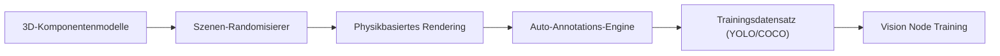

<!-- =============================================================================
HYDRA-UMC-SYNTHETIC-DATA-GEN - Procedural training datasets with exact labels
Copyright (C) JuanenRac (Electro Hobby 3D) <electrohobby3d@gmail.com>
GPL-3.0-or-later - see LICENSE
============================================================================= -->

<p align="center">
  
</p>

# 📸 HYDRA-UMC-SYNTHETIC-DATA-GEN

<p align="center"><a href="README.md">🇺🇸 English</a> | <a href="README_spa.md">🇪🇸 Español</a> | <a href="README_fra.md">🇫🇷 Français</a> | <a href="README_ita.md">🇮🇹 Italiano</a> | 🇩🇪 <b>Deutsch</b> | <a href="README_zho.md">🇨🇳 简体中文</a> | <a href="README_jpn.md">🇯🇵 日本語</a> | <a href="README_por.md">🇵🇹 Português</a></p>

### 📸 Prozeduraler Datensatz-Generator für das Vision AI Node Training

<p align="center">
  
  
  
  
  
  
</p>

---

> **Stand von Sicherheit (Safety) und Security:** Dieses Ökosystem ist kein zertifiziertes Sicherheitssystem. Es gibt noch keinen Hardware-E-STOP-Pfad, keine von der Firmware durchgesetzten Grenzen oder Verriegelungen und keinen verifizierten Bewegungsbefehl; Firmware-Images werden mit CRC32 und einem HMAC-SHA256 mit gemeinsamem Schlüssel geprüft, nicht mit einer asymmetrischen Signatur; TLS und gegenseitiges TLS sind optional und standardmäßig aus; noch keine eigene Platine wurde bestückt oder getestet. Lesen Sie die [Sicherheitsbasis](https://github.com/JuanenRac/HYDRA-UMC-DOCS/blob/main/docs/SECURITY_BASELINE.md) und das [Bedrohungsmodell](https://github.com/JuanenRac/HYDRA-UMC-DOCS/blob/main/docs/THREAT_MODEL.md), bevor Sie sich für die Sicherheit einer Person auf eine Aussage hier verlassen.

---

## 📋 Auf einen Blick

| | |
|---|---|
| Version | `0.1.1` |
| Reifegrad | Etabliert |
| Tests | 82 (`python -m pytest -q tests`) |
| Technik | Python / procedural scene generation / YOLO/COCO annotation export |
| Ziel | Der PC der Person, die es benutzt |
| Auf echter Hardware | Nicht zutreffend: nichts hiervon läuft auf Hardware |

**Springe zu:** [Überblick](#-überblick) · [Architektur](#-architektur) · [Schnellstart](#-schnellstart) · [Tests](#-tests) · [Struktur des Repositorys](#-struktur-des-repositorys) · [Verwandte Projekte](#-verwandte-projekte)

## 🚦 Projektstatus

Jede Zeile ist ein Teil dieses Repositorys, und die Ampel sagt, wie weit er heute ist. Sie beruht auf dem, was das Repository zeigen kann (Tests, Builds, Läufe), nicht auf dem, was geplant ist.

🟢 Fertig und überprüft · 🟡 Funktioniert, mit bekannten Grenzen · 🟠 Teilweise fertig oder noch nicht überprüft · 🔴 Nicht gemacht oder funktioniert nicht

| Bereich | Stand | Was das hier bedeutet |
|---|---|---|
| Software | 🟢 | Für seinen Zweck vollständig und stabil; die Ehrlichkeitsprüfung oben nennt die bekannten Grenzen |
| Tests | 🟢 | 82 automatische Tests, bei jeder Änderung ausgeführt |
| Echte Hardware | 🟢 | Nicht zutreffend: nichts hiervon läuft auf Hardware |
| Dokumentation | 🟢 | README in acht Sprachen, bei jeder Änderung gegen das Manifest geprüft |

## 🎯 Überblick

**HYDRA-UMC-SYNTHETIC-DATA-GEN** ist die Datenfabrik für den Vision AI Node. Er nutzt die Physik- und Rendering-Engines des Digital Twin, um prozedural Tausende von beschrifteten Bildern für das Training neuronaler Netze zu generieren.

Er löst das "Kaltstart"-Problem für neue industrielle Komponenten oder seltene Defekttypen mit automatischer, pixelgenauer Bounding-Box-Annotation. Fotorealistische 3D-Szenarien, Segmentierungsmasken und Keypoints sind das Ziel, sobald HYDRA-UMC-TWINs eigene echte Physik-/Rendering-Engine existiert (siehe die Key-Features-Vorbehalte und den Ehrlichkeitscheck weiter unten für das, was heute wirklich läuft: echtes 2D-Platzhalterform-Rendering, kein 3D).

### Hauptmerkmale:
* 🎲 **Prozedurale Szenarien (v0):** Echte, deterministische (seed-basierte) Randomisierung von Position, Größe und Farbe von 2D-Komponenten. *(implementiert als echte 2D-Platzhalterformen, noch keine 3D-Posen/Beleuchtung/Texturen über die Engine von HYDRA-UMC-TWIN - siehe BUILD UND RUN unten)*
* 📸 **Multi-Kamera-Rendering:** Generiert simultane Ansichten von 8+ virtuellen Kameras. *(geplant - benötigt die echte Rendering-Engine von HYDRA-UMC-TWIN)*
* 🏷️ **Automatische Beschriftung (v0):** Echter, pixelgenauer Export in YOLO und COCO. *(implementiert für YOLO/COCO; TFRecord-Export ist geplant)*
* 🛠️ **Defekt-Injektion (v0):** Echte, zufällige rechteckige Überlagerung pro Komponente, mit konfigurierbarer Wahrscheinlichkeit. *(implementiert als einfache echte Überlagerung - echte Kratzer-/Fehlteil-/Lötbrücken-Formen sind geplant)*
* 📋 **Datensatz-Manifest & Validierung (v0):** Jeder `generate`-Lauf schreibt eine echte `manifest.json` (reproduzierbares-Seed-Flag, Erzeugungsparameter und eine echte sha256-Prüfsumme pro Bild) und führt eine echte Nach-Generierungs-Validierung durch - Szenengrenzen, BMP-Integrität gegen das bekannte reale Dateilayout, und Plausibilität der Label-Verteilung - und beendet sich mit einem Fehlercode ungleich null, falls ein echtes Problem gefunden wird.

## 🧩 Rolle in HYDRA-UMC

**HYDRA-UMC-SYNTHETIC-DATA-GEN** schreibt kleine Trainingsdatensätze für die Vision-Knoten: zufällige Szenen aus Bauteilen, deren Begrenzungsrahmen aus denselben Koordinaten stammen, mit denen sie gezeichnet wurden, exportiert als YOLO oder COCO zusammen mit einem Manifest, wie der Satz entstand. Heute sind die Szenen flache 2D-Formen; das Rendern über den Digital Twin ist geplant.

## 🏛️ Architektur

<p align="center">
  
</p>

<details>
<summary>Textversion des Diagramms (Mermaid)</summary>



</details>

### ARCHITEKTUR & DESIGNENTSCHEIDUNGEN

* **Warum dieser Generator keine `hardware/`/`firmware/`/`os/`-Ordner hat.** Reine Software - er rendert Szenen über die eigene Engine von HYDRA-UMC-TWIN, statt selbst Hardware zu besitzen.
* **Warum er Geschwister, kein Submodul, von HYDRA-UMC-TWIN ist.** Die Datensatzerzeugung ist eine Batch-, Offline-Arbeitslast (potenziell Stunden an Rendering) - grundlegend anders als die eigene Echtzeitschleife des Zwillings - sie getrennt zu halten bedeutet, dass ein langer Export nie mit der Echtzeitsimulation um die CPU/GPU desselben Prozesses konkurriert.
* **Warum die bloße Ausführung weiterhin nur Identität/Version/Rolle ausgibt.** Das bleibt der ursprüngliche Rauchtest der Gerüstbau-Phase: der Nachweis, dass das Paket sich sauber installieren und importieren lässt. Die echte Logik für prozedurale Zufallsgenerierung/Rendering/Annotationsexport liegt hinter dem Unterbefehl `generate`.
* **Wie sich das ins restliche Ökosystem einfügt.** Rendert Trainingsdatensätze (mit automatischer YOLO/COCO-Annotation) über die eigene Engine von HYDRA-UMC-TWIN, damit HYDRA-UMC-VISION-NODE und HYDRA-UMC-DETECTION-HEF damit trainieren können - synthetische Daten statt manueller Beschriftung echter Kameraaufnahmen.
* **Warum v0 echte 2D-Platzhalterformen rendert, statt auf HYDRA-UMC-TWIN zu warten.** HYDRA-UMC-TWIN (das eigene Integrations-Elternprojekt) befindet sich selbst noch im Gerüstbau-Stadium - die Datensatzerzeugung vollständig an seine echte 3D-Engine zu binden würde die Annotations-Pipeline (den eigentlich schwierigen, wiederverwendbaren Teil: Platzierung, Beschriftung, YOLO/COCO-Export) ungetestet lassen. Ein echter, rein stdlib-basierter BMP-Rasterizer liefert schon heute echte, pixelgenaue Ground-Truth-Daten - die spätere Ersetzung durch die echte Engine von TWIN ändert nur, wie Pixel gemalt werden, nicht die `Scene`/`Component`/Export-Verträge.
* **Warum Bounding Boxes durch Konstruktion pixelgenau sind.** `export.py` liest genau dieselben `Component`-Koordinaten, die `scene.py` platziert und `render.py` gemalt hat - es gibt in dieser v0-Schleife kein Erkennungsmodell und keinen manuellen Beschriftungsschritt, von dem Annotationen abweichen könnten.
* **Warum die Validierung `render.py`s eigene Zeilengrößen-Formel wiederverwendet statt eines zweiten, unabhängigen Parsers.** `validate_bmp_integrity()` importiert `_row_size()` direkt aus `render.py`, statt die BMP-Zeilenauffüllung neu herzuleiten - eine einzige Quelle der Wahrheit für das exakte Byte-Layout verhindert, dass sich eine künftige echte Änderung im Writer stillschweigend vom Prüfer desynchronisiert.
* **Warum "reproduzierbar" ein Manifest-Feld ist, nicht nur eine unausgesprochene Eigenschaft von `--seed`.** `--seed` machte die Generierung schon vor dieser Änderung deterministisch, aber nichts hielt fest, ob ein gegebener Datensatz auf der Festplatte tatsächlich einen Seed verwendet hatte - ein Konsument hatte keine Möglichkeit, im Nachhinein einen reproduzierbaren von einem zufälligen Lauf zu unterscheiden. Das `reproducible`-Flag von `manifest.json` plus ein echtes sha256 pro Bild macht diese Behauptung überprüfbar.

## 🚀 Schnellstart

Benötigt Python 3.10 oder neuer.

```bash
./build.sh  # Linux, macOS (build.bat on Windows)
./run.sh generate --out ./out --count 10 --seed 42
./run.sh generate --out ./out --format yolo --defect-rate 0.3
```

## 🧪 Tests

82 automatische Tests laufen mit `python -m pytest -q tests`. Sie brauchen weder Hardware noch etwas außerhalb dieses Rechners.

Die CI führt `HYDRA_UMC_CI=1 python tools/ci_validate.py` aus; das prüft das Manifest, die Dokumente, die acht READMEs und die Bilder.

## 🏗️ Build und Veröffentlichung

Erfordert Python 3.10+.

```bash
# Linux / macOS
./build.sh   # erstellt .venv, installiert
             # das Paket im editierbaren Modus (mit Dev-Extras), führt die
             # echte Testsuite aus, Compile-Check von src/
./run.sh     # führt den Einstiegspunkt aus .venv aus, gibt Name + Version + Rolle aus
```

```bat
:: Windows
build.bat
run.bat
```

`build.sh`/`build.bat` ändern die Version nie (nur `python tools/hydra_project_tool.py bump` erhöht sie), führen einen Compile-Check des Quellcodes mit `python -m compileall` durch und anschließend die echte Testsuite aus (`pytest tests/`).

Das echte `generate`-Subcommand schreibt einen echten Datensatz auf die Festplatte:

```bash
./run.sh generate --out dataset/ --count 20 --components 6 --defect-rate 0.3 --seed 42 --format both

# Windows
run.bat generate --out dataset\ --count 20 --components 6 --defect-rate 0.3 --seed 42 --format both
```

`--jobs N` rendert die Szenen in N Prozessen (Standard 1): Jede Szene hat ihren eigenen, aus Startwert und Index gesäten Zufallsgenerator, der Datensatz ist also bei jedem N derselbe. Das Manifest verzeichnet jetzt die Klassenliste (`classes`) und ihren Hash (`classes_sha256`, das sha256 von `classes.txt`), damit, wer ein mit dem Datensatz trainiertes Modell registriert, die Klassenreihenfolge prüfen kann. `verify --out dataset/` liest einen Datensatzordner zurück: die Bilder gegen die Prüfsummen des Manifests, die YOLO-Labels (fünf Felder, bekannte Klassen-ID, alles in [0, 1]), die COCO-Datei (eindeutige IDs, Boxen im Bild) und die Anzahl der Labels gegen das Manifest; `generate` führt dieselbe Prüfung an seiner eigenen Ausgabe durch. Der BMP-Renderer malt scheibenweise statt pixelweise (dieselben Bytes, bei großen Bildern viel schneller). Getestet; die Prüfung auf der DETECTION-HEF-Seite, die den Hash vergleichen würde, gibt es noch nicht.

Schreibt echte BMP-Bilder nach `dataset/images/`, echte YOLO-Labels nach `dataset/labels/` + `dataset/classes.txt`, und/oder eine echte `dataset/annotations.json` im COCO-Format, je nach `--format`. Ein gegebener `--seed` macht den Datensatz byte-genau reproduzierbar.

Die Argumente werden auf ihren Bereich geprüft (`--count` 1..10000, `--width`/`--height` 16..4096, `--components` 1..1000, `--defect-rate` 0..1), und die Bilder des gesamten Datensatzes sind auf 4 GiB begrenzt: Ein Befehl, dessen geschätzte Größe darüber liegt, wird mit Exit-Code 2 abgelehnt, bevor etwas geschrieben wird, sodass ein Tippfehler nicht den Datenträger des ausführenden Rechners füllen kann.

Jeder Lauf schreibt außerdem eine echte `dataset/manifest.json` und validiert seine eigene Ausgabe:

```
Generated 20 scene(s) -> dataset/images
Total labeled components (incl. defects): 150
Annotations exported as: both
Reproducible seed: yes (seed=42)
Manifest written -> dataset/manifest.json
Validation: OK (scene bounds, BMP integrity, label distribution)
```

```json
{
  "seed": 42,
  "reproducible": true,
  "count": 20,
  "scenes": [
    { "image": "scene_0000.bmp", "num_components": 7,
      "label_counts": {"bracket": 1, "bolt": 2, "gear": 2, "defect": 1, "connector": 1},
      "sha256": "2301c6974673d9f6a408d7a4b746d236d0ec98b535064884b7a3929645a8f2eb" }
  ],
  "validation_issues": []
}
```

Findet die Validierung ein echtes Problem (eine Komponente außerhalb der Grenzen, eine abgeschnittene/beschädigte BMP-Datei, oder eine Defektrate, die stark von `--defect-rate` abweicht), beendet sich `generate` mit Code `1` und listet jedes Problem auf, statt stillschweigend einen fehlerhaften Datensatz auszuliefern.

## 📂 Struktur des Repositorys

<p align="center">
  
</p>

<details>
<summary>Textversion des Baums</summary>

```text
HYDRA-UMC-SYNTHETIC-DATA-GEN/
├── src/hydra_umc_synthetic_data_gen/   Quellcode
│   ├── __init__.py                     Paketversion
│   ├── scene.py                        Echte prozedurale Generierung von 2D-Szenen/-Komponenten
│   ├── render.py                       Echte, rein stdlib-basierte BMP-Rasterisierung
│   ├── export.py                       Echter YOLO-/COCO-Annotationsexport
│   ├── manifest.py                     Echte manifest.json des Datensatzes (Seed, Prüfsummen)
│   ├── validate.py                     Echte Validierung: Grenzen/BMP-Integrität/Verteilung
│   ├── main.py                         Einstiegspunkt + echtes `generate`-Subcommand
│   └── verify.py                       Prüft einen fertigen Datensatzordner gegen sein eigenes Manifest und gegen sich selbst (Prüfsummen, YOLO-Labels, COCO-Annotationen)
├── tests/                              Echte Tests: Generierung, Rendering, Export, End-to-End-CLI
├── docs/                               Dokumentation und prozedurale Anleitungen
├── images/                             Medien und Diagramme
├── tools/                              ci_validate.py - Manifest-/CHANGELOG-/Doku-Validierung, von der CI genutzt
├── .github/                            CI-Workflow und Issue-Vorlagen
├── pyproject.toml                      Paketmetadaten
├── bump_version.py                     ausdrückliche Versionserhöhung
├── bump_manifest_version.py            Synchronisiert die Version von hydra-umc.project.json mit der nativen (--sync)
├── build.sh / build.bat                venv + editierbare Installation (mit Dev-Extras) + echte Tests + Compile-Check
├── run.sh / run.bat                    Führt den Einstiegspunkt aus dem lokalen venv aus (leitet Argumente weiter, z. B. `generate`)
├── CHANGELOG.md                        was sich in jeder Version geändert hat
├── build-test.sh                       Build-Prüfung ohne Änderungen
├── hydra-umc.project.json              Manifest: Version, Reifegrad, Familie
└── test.sh                             führt die Tests aus
```

</details>

## 🗺️ Roadmap und bekannte Grenzen

**Bekannte Grenzen heute**

* **Phase 1:** Digital-Twin-Synchronisation mit Echtzeit-Hardware-Telemetrie und Sub-10ms-Latenz.
* **Phase 2:** Physics Replica-Integration mit industriellen Simulatoren (Isaac Sim) und Unterstützung für verformbare Körper.
* **Phase 3:** Automatisierte Wiederherstellungsmuster von Node Healing für dezentrales Failover und frühzeitige Erkennung von Sensordegradation.
* **Phase 4:** GAN-basierte Texturverfeinerung für hyperrealistische Industriematerialien und fotorealistische Datensatzgenerierung.

## 🌍 Sprachen

Diese README und die Dokumente des Repositorys gibt es in acht Sprachen: Englisch, Spanisch, Deutsch, Französisch, Italienisch, Japanisch, Chinesisch und Portugiesisch (Portugal). Sie entstehen gemeinsam, und die CI prüft, dass die acht Dateien dieselben Abschnitte und dieselben Links haben. Dieses Repository hat weder eine eigene Oberfläche noch einen eigenen Meldungskatalog, es gibt also keine Oberflächentexte zu übersetzen.

## 🔗 Verwandte Projekte

Dieses Projekt ist Teil des HYDRA-UMC-Robotik-Ökosystems desselben Autors (JuanenRac / Electro Hobby 3D). Gut zu wissen, da eine Anfrage eigentlich eines dieser Projekte betreffen könnte statt dieses Repositorys.

**Übergeordnetes Projekt**
- **[HYDRA-UMC-TWIN](https://github.com/JuanenRac/HYDRA-UMC-TWIN)** — Integrationsknoten für die Digital-Twin-Engine, mit einem echten Versionskompatibilitäts-Sync-Vertrag; das übergeordnete Projekt, dessen spezifischer Simulationsdienst dieses Repository innerhalb seiner eigenen Digital-Twin-Engine ist.

**Geschwisterprojekte** — die übrigen Simulationsdienste der eigenen Digital-Twin-Engine von HYDRA-UMC-TWIN
- **[HYDRA-UMC-PHYSICS-REPLICA](https://github.com/JuanenRac/HYDRA-UMC-PHYSICS-REPLICA)** — echte Vorwärtskinematik und Gelenkgrenzenvalidierung über eine echte URDF-Teilmenge.
- **[HYDRA-UMC-HIL-BRIDGE](https://github.com/JuanenRac/HYDRA-UMC-HIL-BRIDGE)** — Hardware-in-the-Loop-Router mit einer Software-Kollisionsverriegelung zwischen Simulation und echter Hardware (ohne echte Hardware getestet).

**Direkt verwandt**
- **[HYDRA-UMC-VISION-NODE](https://github.com/JuanenRac/HYDRA-UMC-VISION-NODE)** — Integrationsknoten für die Hailo-8-Vision-Pipeline, mit einer echten stufenweisen Hardware-Bereitschaftsprüfung — trainiert mit den Datensätzen, die dieses Projekt generiert.
- **[HYDRA-UMC-DETECTION-HEF](https://github.com/JuanenRac/HYDRA-UMC-DETECTION-HEF)** — echte Registry für kompilierte Modelle mit Hailo-Architektur-/Prüfsummen-Safe-Load-Verifizierung — trainiert mit den Datensätzen, die dieses Projekt generiert.

**Ebenfalls Teil des Ökosystems**

*Kern-Hardware & Plattform*
- **[HYDRA-UMC](https://github.com/JuanenRac/HYDRA-UMC)** — der Entwurf des Motherboards des Roboterarms: CM5-Host + Dual-Core-STM32H745, gedacht zur Koordination von bis zu 8 Werkzeugarmen über CAN-OTA/SPI-OTA (Firmware in einer frühen Phase; noch keine bestückte Platine).
- **[HYDRA-UMC-OS](https://github.com/JuanenRac/HYDRA-UMC-OS)** — reproduzierbare Raspberry-Pi-OS-Produktschicht für den CM5: schreibgeschützter Agent, validierte Konfiguration/Profile, WiFi-Ersteinrichtung.
- **[HYDRA-UMC-SDK](https://github.com/JuanenRac/HYDRA-UMC-SDK)** — der gemeinsame JSON-Schema-Vertrag und die Software-Auftragsschranke, gegen die jede Bridge ihre Befehle validiert (keine zertifizierte Sicherheitsfunktion).
- **[HYDRA-UMC-CONNECTOR-HUB](https://github.com/JuanenRac/HYDRA-UMC-CONNECTOR-HUB)** — deklaratives Adapter-Manifest-Register und Validator für Konnektoren externer Maschinen; erweitert die eigene Vertragsidee des SDK auf externe Maschinen, ohne die Industrie-Gateway-Projekte zu ersetzen.

*Kern-Backend & Clients*
- **[HYDRA-UMC-SERVER](https://github.com/JuanenRac/HYDRA-UMC-SERVER)** — das reale Headless-Backend (REST/WebSocket), mit dem jeder Steuerungsclient tatsächlich spricht.
- **[HYDRA-UMC-STUDIO](https://github.com/JuanenRac/HYDRA-UMC-STUDIO)** — Web-Steuerungs-Dashboard mit Echtzeit-3D-Visualisierung mehrerer Roboter.
- **[HYDRA-UMC-SUITE](https://github.com/JuanenRac/HYDRA-UMC-SUITE)** — Desktop-Schwarmleitstand (PySide6) für mehrere Server gleichzeitig, verpackt als eigenständige ausführbare Datei.
- **[HYDRA-UMC-ANDROID-CONTROL](https://github.com/JuanenRac/HYDRA-UMC-ANDROID-CONTROL)** — native Android-Steuerungs-App mit biometrischem Login und einer gekoppelten Wear-OS-Begleit-App.
- **[HYDRA-UMC-IOS-CONTROL](https://github.com/JuanenRac/HYDRA-UMC-IOS-CONTROL)** — iOS/iPadOS-Steuerungs-App (Flutter) mit Echtzeit-WebSocket-Synchronisierung.
- **[HYDRA-UMC-DSI](https://github.com/JuanenRac/HYDRA-UMC-DSI)** — native Touch-UI für das eingebaute 7"-DSI-Touchscreen, direkt auf dem CM5 eingebettet.
- **[HYDRA-UMC-EDITOR-URDF](https://github.com/JuanenRac/HYDRA-UMC-EDITOR-URDF)** — grafischer Desktop-URDF-Ersteller/-Editor, der fertige Modelle in STUDIOs eigenen Katalog überträgt.
- **[HYDRA-UMC-EDITOR-STL](https://github.com/JuanenRac/HYDRA-UMC-EDITOR-STL)** — Desktop-STL-Modelleditor, der echte Teile im selben Modellkatalog transformiert/ersetzt/entfernt/hinzufügt, den auch HYDRA-UMC-EDITOR-URDF bearbeitet.
- **[HYDRA-UMC-BRIDGE-AMR](https://github.com/JuanenRac/HYDRA-UMC-BRIDGE-AMR)** — Koordinationsschranke für AGV-/AMR-Flotten über einen VDA-5050-MQTT-Publisher (nur gegen eine emulierte Flotte getestet).
- **[HYDRA-UMC-BRIDGE-CNC](https://github.com/JuanenRac/HYDRA-UMC-BRIDGE-CNC)** — High-Level-Koordinator für CNC-Zellen mit GRBL-Status-/Steuerbyte-Zugriff (nur gegen einen Emulator getestet).
- **[HYDRA-UMC-BRIDGE-DROIDS](https://github.com/JuanenRac/HYDRA-UMC-BRIDGE-DROIDS)** — Koordinationsschranke für laufende/humanoide Droiden, mit einem Boston-Dynamics-Spot-Befehlssender (nur gegen einen Emulator getestet).
- **[HYDRA-UMC-BRIDGE-LASER](https://github.com/JuanenRac/HYDRA-UMC-BRIDGE-LASER)** — Koordinator für Laserzellen, liest 3 Schlüssel-/Gehäuse-/Verriegelungs-GPIO-Signale (nur gegen einen simulierten Chip getestet; kann keinen Laser scharfschalten oder auslösen).
- **[HYDRA-UMC-BRIDGE-OPENPNP](https://github.com/JuanenRac/HYDRA-UMC-BRIDGE-OPENPNP)** — sicherer High-Level-Koordinator für den Leiterplattenfluss von OpenPnP Pick-and-Place.
- **[HYDRA-UMC-BRIDGE-PRINTER3D](https://github.com/JuanenRac/HYDRA-UMC-BRIDGE-PRINTER3D)** — sichere Koordinationsschranke für Moonraker/Klipper-3D-Drucker, mit echten gesicherten Job-Befehlen.
- **[HYDRA-UMC-BRIDGE-ROS2](https://github.com/JuanenRac/HYDRA-UMC-BRIDGE-ROS2)** — Koordinator mit einem träge importierten rclpy-ROS-2-Transport (noch nicht gegen eine ROS-2-Installation ausgeführt).
- **[HYDRA-UMC-BRIDGE-UAV](https://github.com/JuanenRac/HYDRA-UMC-BRIDGE-UAV)** — Koordinationsschranke für kameraausgestattete UAVs, mit einem MAVLink-Befehlssender (nur gegen einen Emulator getestet).

*URTC-Werkzeugplattform*
- **[URTC](https://github.com/JuanenRac/URTC)** — Firmware für die physische Universal-Robot-Tool-Controller-Platine, 25+ Werkzeugprofile über CAN-Bus.
- **[URTC-FLASHER](https://github.com/JuanenRac/URTC-FLASHER)** — Desktop-GUI-Flash-Tool für URTC-Platinen, CAN-OTA plus Full-Chip-SWD/JTAG.
- **[URTC-TESTER](https://github.com/JuanenRac/URTC-TESTER)** — Desktop-Live-CAN-Bus-Diagnosetool für URTC-Platinen, ein Panel pro Werkzeugprofil.
- **[URTC-WEB-STUDIO](https://github.com/JuanenRac/URTC-WEB-STUDIO)** — browserbasierte Alternative zu URTC-TESTER über die Web-Serial-API, ohne lokale Installation.
- **[URTC-GATEWAY](https://github.com/JuanenRac/URTC-GATEWAY)** — Gateway vor dem CAN-Bus von URTC: Liste erlaubter Kennungen, Ratenbegrenzung und Sitzungsschlüssel; Software auf dem Computer getestet, noch nicht an einem echten Bus.

*Vision-KI-Knoten (Hailo-8)*
- **[HYDRA-UMC-VISION-STREAMER](https://github.com/JuanenRac/HYDRA-UMC-VISION-STREAMER)** — echter GStreamer-Pipeline- + MediaMTX-Konfigurationsgenerator mit einer echten HailoRT-Integrationsschranke.
- **[HYDRA-UMC-VISUAL-SERVOING-API](https://github.com/JuanenRac/HYDRA-UMC-VISUAL-SERVOING-API)** — Position-Based-Visual-Servoing-Korrekturgesetz mit Freigabe abhängig vom Zonenstatus; noch keine Posenschätzung per Kamera.
- **[HYDRA-UMC-SAFETY-ZONES](https://github.com/JuanenRac/HYDRA-UMC-SAFETY-ZONES)** — v0-Logik für Zonenverletzung, Kalibrierungsaktualität und E-STOP-Anforderung, die Objektpositionen aus einer Datei nimmt; kein Detektor speist sie, und noch kein physischer E-STOP ist angeschlossen.

*Kognitiver KI-Knoten (Hailo-10)*
- **[HYDRA-UMC-COGNITIVE-NODE](https://github.com/JuanenRac/HYDRA-UMC-COGNITIVE-NODE)** — Integrationsknoten für die Hailo-10-Cognitive-Pipeline (LLM-/VLA-/Sprach-Orchestrierung).
- **[HYDRA-UMC-VLA-ENGINE](https://github.com/JuanenRac/HYDRA-UMC-VLA-ENGINE)** — echte Aktions-Token-Kodierung/-Dekodierung und Trajektoriengenerierung für ein Vision-Language-Action-Modell.
- **[HYDRA-UMC-VOICE-UI](https://github.com/JuanenRac/HYDRA-UMC-VOICE-UI)** — echtes Sprach-Frontend (VAD + Intent-Parser) mit einem begrenzten, bestätigungsgesicherten Watch-Relay.
- **[HYDRA-UMC-SEMANTIC-PLANNER](https://github.com/JuanenRac/HYDRA-UMC-SEMANTIC-PLANNER)** — echte regelbasierte Aufgabenzerlegung und semantische Fehlerbehebung über MCU-Fehlercodes.
- **[HYDRA-UMC-DOCS-QA](https://github.com/JuanenRac/HYDRA-UMC-DOCS-QA)** — echte, nur auf der Standardbibliothek basierende TF-IDF-Dokumentensuche über die eigenen Markdown-Dokumente dieses Ökosystems.
- **[HYDRA-UMC-LOCAL-TECHNICIAN](https://github.com/JuanenRac/HYDRA-UMC-LOCAL-TECHNICIAN)** — lokaler, richtlinien-gesteuerter KI-Wartungstechniker für das Ökosystem selbst - beobachtet, diagnostiziert und schlägt Korrekturen vor; die zwei höchsten Risikostufen sind absichtlich noch nicht implementiert.

*Orchestrierung & Schwarm*
- **[HYDRA-UMC-ORCHESTRATOR](https://github.com/JuanenRac/HYDRA-UMC-ORCHESTRATOR)** — Integrationsknoten mit einem echten gRPC/Protobuf-Health-Report-Vertrag und einer Missions-Zustandsmaschine.
- **[HYDRA-UMC-JOB-DISPATCHER](https://github.com/JuanenRac/HYDRA-UMC-JOB-DISPATCHER)** — echte prioritätsbasierte Job-Queue mit Deduplizierung, über eine echte HTTP-API.
- **[HYDRA-UMC-NODE-HEALING](https://github.com/JuanenRac/HYDRA-UMC-NODE-HEALING)** — echter gRPC-basierter Flotten-Health-Watchdog mit Retry/Backoff und Identitäts-Mismatch-Erkennung.
- **[HYDRA-UMC-PATH-PLANNER-3D](https://github.com/JuanenRac/HYDRA-UMC-PATH-PLANNER-3D)** — echter RRT-basierter 3D-Pfadplaner mit echter Hindernis-/Arbeitsraum-Kollisionsvalidierung.
- **[HYDRA-UMC-SWARM-SYNC](https://github.com/JuanenRac/HYDRA-UMC-SWARM-SYNC)** — echte CRDT-LWW-Element-Map-Zustandssynchronisation, eigenschaftsgetestet auf Multi-Zellen-Konvergenz.

*Daten & Analytik*
- **[HYDRA-UMC-DATALAKE](https://github.com/JuanenRac/HYDRA-UMC-DATALAKE)** — echter sqlite3-gestützter Zeitreihenspeicher mit einer echten Ingest-/Abfrage-HTTP-API.
- **[HYDRA-UMC-ANOMALY-DETECTOR](https://github.com/JuanenRac/HYDRA-UMC-ANOMALY-DETECTOR)** — echter FFT- + statistischer Basislinien-Anomaliedetektor mit Drift-Überwachung.
- **[HYDRA-UMC-PRODUCTION-REPORTS](https://github.com/JuanenRac/HYDRA-UMC-PRODUCTION-REPORTS)** — echte OEE-/Verfügbarkeitsberechnung über den DATALAKE-Verlauf, mit reproduzierbarem CSV-Export.
- **[HYDRA-UMC-TELEMETRY-COLLECTOR](https://github.com/JuanenRac/HYDRA-UMC-TELEMETRY-COLLECTOR)** — echte CAN/WebSocket-Ingestion-Pipeline in DATALAKE, mit Sequenz-Deduplizierung.

*Industrie-Gateway*
- **[HYDRA-UMC-GATEWAY-INDUSTRIAL](https://github.com/JuanenRac/HYDRA-UMC-GATEWAY-INDUSTRIAL)** — Integrationsknoten, der zu Industrieprotokollen weiterleitet, mit einer echten Befehls-Allowlist-/Backpressure-Schicht.
- **[HYDRA-UMC-OPCUA-SERVER](https://github.com/JuanenRac/HYDRA-UMC-OPCUA-SERVER)** — echter OPC-UA-Adressraum, verifiziert mit einer echten Binärprotokoll-Client-Session.
- **[HYDRA-UMC-MQTT-BROKER](https://github.com/JuanenRac/HYDRA-UMC-MQTT-BROKER)** — echter MQTT-Broker mit optionaler Pro-Client-Authentifizierung und Topic-ACLs.
- **[HYDRA-UMC-MTCONNECT-ADAPTER](https://github.com/JuanenRac/HYDRA-UMC-MTCONNECT-ADAPTER)** — echte MTConnect-`/probe`- und `/current`-XML-Endpunkte mit Degraded-Mode-Ausgabe.

*Ergänzende Tools & Ökosystembetrieb*
- **[HYDRA-UMC-DASHBOARD-AI](https://github.com/JuanenRac/HYDRA-UMC-DASHBOARD-AI)** — Smart-Summaries- und Anomaly-Highlighting-Panels über DATALAKE/ANOMALY-DETECTOR, mit einem ehrlichen statistischen Fallback.
- **[HYDRA-UMC-TOOL-CLI](https://github.com/JuanenRac/HYDRA-UMC-TOOL-CLI)** — Flotten-CLI mit einem echten, stabilen Exit-Code-Vertrag, ein echter Live-Client der eigenen API von HYDRA-UMC-SERVER.
- **[HYDRA-UMC-WATCH](https://github.com/JuanenRac/HYDRA-UMC-WATCH)** — WearOS-Begleit-App mit haptischen Alarmmustern und einem Sprach-Relay zum gekoppelten Telefon (noch nicht auf einer physischen Uhr ausgeführt).
- **[URTC-SMART-RACK](https://github.com/JuanenRac/URTC-SMART-RACK)** — Firmware für ein Platinenmontagegestell mit echter Werkzeug-ID-Dekodierung und Smart-Idle-Vorheizlogik.
- **[URTC-VISION-TOOL](https://github.com/JuanenRac/URTC-VISION-TOOL)** — Firmware plus ein echter Python-Vision-Begleiter für einen Thermal-/RGB-Inspektionswerkzeugkopf.
- **[HYDRA-UMC-UPDATER](https://github.com/JuanenRac/HYDRA-UMC-UPDATER)** — administratives Desktop-Tool, das jedes Repository in diesem Ökosystem entdeckt, klont und aktualisiert.
- **[HYDRA-UMC-OS-REBUILDER](https://github.com/JuanenRac/HYDRA-UMC-OS-REBUILDER)** — Windows/Linux-Desktop-Tool, das ein flashbereites CM5-Image baut, vorgeladen mit den aktuellsten Versionen des Ökosystems, mit Ersteinrichtungs-Konfiguration für WLAN/Benutzer/SSH im Stil von Raspberry Pi Imager.
- **[HYDRA-UMC-OPS-AGENT](https://github.com/JuanenRac/HYDRA-UMC-OPS-AGENT)** — Wartungsvorfall-Koordinator: eine Edge-Rolle mit niedrigem Privileg sammelt einen bereinigten Inventar-/Gesundheits-Snapshot, eine Control-Plane-Rolle rendert ihn schreibgeschützt und bittet einen KI-Anbieter um einen Diagnosevorschlag - wendet nie einen Patch an und stellt nie etwas bereit.
- **[HYDRA-UMC-DEV-SERVER](https://github.com/JuanenRac/HYDRA-UMC-DEV-SERVER)** — reproduzierbarer Entwicklungshost (Raspberry Pi 5 / CM5), der den Quellcode des Ökosystems vorhält und begrenzte Build-/Test-Aufgaben über eine dauerhafte Warteschlange ausführt; eine dedizierte Entwicklerrolle, ausdrücklich kein operativer CM5.

## 📚 Dokumentation

Hier steht mehr:

* [Sicherheitsgrundlage des Ökosystems](https://github.com/JuanenRac/HYDRA-UMC-DOCS/blob/main/docs/SECURITY_BASELINE.md)
* [Bedrohungsmodell des Ökosystems](https://github.com/JuanenRac/HYDRA-UMC-DOCS/blob/main/docs/THREAT_MODEL.md)
* [Änderungsprotokoll dieses Repositorys](CHANGELOG.md)
* [Lizenz dieses Repositorys](LICENSE.md)

## 🤝 Mitwirken und Community

* Führe vor einem Pull Request `HYDRA_UMC_CI=1 py -3 tools/ci_validate.py` (oder `HYDRA_UMC_CI=1 python3 tools/ci_validate.py`) aus: Es muss `CI_VALIDATION=PASS` ausgeben. Führe dafür nicht `build.sh` oder `build.bat` aus; Bauen ist keine Prüfung.
* Die acht READMEs entstehen aus einer einzigen Quelle in HYDRA-UMC-DOCS; bearbeite sie nicht von Hand. Ändere die Quelle und schreibe sie mit `tools/make_readmes.py` neu.
* Behaupte in einer README nichts, was nicht gelaufen ist: Schreibe „simuliert“ oder „nicht auf Hardware erprobt“, wo das stimmt.
* Siehe [CONTRIBUTING.md](CONTRIBUTING.md), den [Verhaltenskodex](CODE_OF_CONDUCT.md), [SECURITY.md](SECURITY.md) und [SUPPORT.md](SUPPORT.md).

## 👤 AUTOR

**JuanenRac (Electro Hobby 3D)** · electrohobby3d@gmail.com

## 📜 LIZENZ

GPL-3.0-or-later - [LICENSE](LICENSE).
