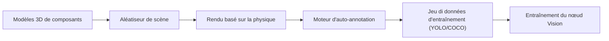

<!-- =============================================================================
HYDRA-UMC-SYNTHETIC-DATA-GEN - Procedural training datasets with exact labels
Copyright (C) JuanenRac (Electro Hobby 3D) <electrohobby3d@gmail.com>
GPL-3.0-or-later - see LICENSE
============================================================================= -->

<p align="center">
  
</p>

# 📸 HYDRA-UMC-SYNTHETIC-DATA-GEN

<p align="center"><a href="README.md">🇺🇸 English</a> | <a href="README_spa.md">🇪🇸 Español</a> | 🇫🇷 <b>Français</b> | <a href="README_ita.md">🇮🇹 Italiano</a> | <a href="README_deu.md">🇩🇪 Deutsch</a> | <a href="README_zho.md">🇨🇳 简体中文</a> | <a href="README_jpn.md">🇯🇵 日本語</a> | <a href="README_por.md">🇵🇹 Português</a></p>

### 📸 Générateur de jeux di données procéduraux pour l'entraînement des nœuds Vision AI

<p align="center">
  
  
  
  
  
  
</p>

---

> **État de la sûreté et de la cybersécurité :** cet écosystème n'est pas un système de sécurité certifié. Il n'existe pas encore de chaîne d'E-STOP matérielle, ni de limites ou de verrouillages imposés par le firmware, ni de commande de mouvement vérifiée ; les images de firmware sont contrôlées par CRC-32 et une signature Ed25519, et une compilation de version refuse les clés de développement publiées (les têtes d'outil et les cartes d'extension derrière le relais utilisent encore les chargeurs d'URTC, qui prennent un HMAC-SHA256 à clé partagée au lieu d'une signature) ; TLS et TLS mutuel sont optionnels et désactivés par défaut ; aucune carte propre n'a encore été assemblée ni testée. Lisez la [base de sécurité](https://github.com/JuanenRac/HYDRA-UMC-DOCS/blob/main/docs/SECURITY_BASELINE.md) et le [modèle de menaces](https://github.com/JuanenRac/HYDRA-UMC-DOCS/blob/main/docs/THREAT_MODEL.md) avant de vous fier à une affirmation d'ici pour la sécurité d'une personne.

---

## 📋 En un coup d'œil

| | |
|---|---|
| Version | `0.1.2` |
| Maturité | Établi |
| Tests | 101 (`python -m pytest -q tests`) |
| Technologie | Python / procedural scene generation / YOLO/COCO annotation export |
| Cible | Le PC de la personne qui l'utilise |
| Sur matériel réel | Sans objet : rien ici ne s'exécute sur du matériel |

**Aller à :** [Présentation](#-présentation) · [Architecture](#-architecture) · [Démarrage rapide](#-démarrage-rapide) · [Tests](#-tests) · [Structure du dépôt](#-structure-du-dépôt) · [Projets liés](#-projets-liés)

## 🚦 État du projet

Chaque ligne est une partie de ce dépôt et le feu dit où elle en est aujourd'hui. Elle est écrite d'après ce que le dépôt peut montrer (tests, compilations, exécutions), pas d'après ce qui est prévu.

🟢 Fait et vérifié · 🟡 Fonctionne, avec des limites connues · 🟠 À moitié fait ou pas encore vérifié · 🔴 Pas fait ou ne fonctionne pas

| Domaine | État | Ce que cela veut dire ici |
|---|---|---|
| Logiciel | 🟢 | Complet pour son usage et stable ; la vérification d'honnêteté ci-dessus liste les limites connues |
| Tests | 🟢 | 101 tests automatiques, exécutés à chaque modification |
| Matériel réel | 🟢 | Sans objet : rien ici ne s'exécute sur du matériel |
| Documentation | 🟢 | README en huit langues, vérifié par rapport au manifeste à chaque modification |

## 🎯 Présentation

**HYDRA-UMC-SYNTHETIC-DATA-GEN** est l'usine de données pour le nœud Vision AI. Il exploite les moteurs de physique et de rendu du jumeau numérique pour générer de manière procédurale des milliers d'images étiquetées pour l'entraînement des réseaux neuronaux.

Il résout le problème du « démarrage à froid » pour les nouveaux composants industriels ou les types de défauts rares avec une annotation automatique de boîtes de délimitation parfaite au pixel près. Les scénarios 3D photoréalistes, les masques de segmentation et les points clés sont l'objectif visé une fois que le véritable moteur physique/de rendu de HYDRA-UMC-TWIN existera (voir les réserves de Key Features et la Vérification d'honnêteté ci-dessous pour ce qui fonctionne réellement aujourd'hui : un rendu réel de formes 2D de substitution, pas en 3D).

### Caractéristiques principales :
* 🎲 **Scénarios procéduraux (v0) :** Randomisation réelle et déterministe (à partir d'une graine) de la position, la taille et la couleur de composants 2D. *(implémenté comme de vraies formes 2D de substitution, pas encore de poses/éclairage/textures 3D via le moteur de HYDRA-UMC-TWIN - voir BUILD ET RUN ci-dessous)*
* 📸 **Rendu multi-caméras :** Génère des vues simultanées à partir de plus de 8 caméras virtuelles. *(prévu - nécessite le vrai moteur de rendu de HYDRA-UMC-TWIN)*
* 🏷️ **Étiquetage automatique (v0) :** Export réel et parfait au pixel près en YOLO et COCO. *(implémenté pour YOLO/COCO ; l'export TFRecord est prévu)*
* 🛠️ **Injection de défauts (v0) :** Superposition rectangulaire réelle et aléatoire par composant, avec probabilité configurable. *(implémenté comme une simple superposition réelle - de vraies formes de rayure/pièce manquante/pont de soudure sont prévues)*
* 📋 **Manifeste de jeu de données & validation (v0) :** Chaque exécution de `generate` écrit un vrai `manifest.json` (indicateur de graine reproductible, paramètres de génération, et une vraie somme de contrôle sha256 par image) et exécute une vraie validation post-génération - limites de scène, intégrité BMP par rapport à la disposition de fichier réelle connue, et cohérence de la distribution des étiquettes - se terminant avec un code non nul si un vrai problème est trouvé.
* ✂️ **Répartition entraînement, validation et test :** `generate --split train=0.8,val=0.1,test=0.1` écrit en plus `train.txt`, `val.txt` et `test.txt`, un `data.yaml` pour les entraîneurs YOLO et `splits.json`. La part d'une scène ne dépend que de la graine et de l'indice de la scène, chaque scène est dans une seule part, et `verify` le contrôle. Sans `--split`, rien ne change.

## 🧩 Rôle dans HYDRA-UMC

**HYDRA-UMC-SYNTHETIC-DATA-GEN** écrit de petits jeux d'entraînement pour les nœuds de vision : des scènes aléatoires de composants, dont les boîtes englobantes viennent des mêmes coordonnées que celles qui les ont dessinées, exportées en YOLO ou COCO avec un manifeste de la façon dont le jeu a été fait. Aujourd'hui les scènes sont des formes 2D plates ; le rendu via le Digital Twin est prévu.

## 🏛️ Architecture

<p align="center">
  
</p>

<details>
<summary>Version texte du diagramme (Mermaid)</summary>



</details>

### ARCHITECTURE & DÉCISIONS DE CONCEPTION

* **Pourquoi ce générateur n'a pas de dossiers `hardware/`/`firmware/`/`os/`.** Logiciel pur - il rend des scènes via le propre moteur de HYDRA-UMC-TWIN plutôt que de posséder du matériel lui-même.
* **Pourquoi c'est un frère, pas un sous-module, de HYDRA-UMC-TWIN.** La génération de jeux de données est une charge de travail par lots, hors ligne (potentiellement des heures de rendu) fondamentalement différente de la propre boucle temps réel du jumeau - la garder séparée signifie qu'un long export ne concurrence jamais la simulation temps réel pour le CPU/GPU du même processus.
* **Pourquoi l'invocation simple ne fait toujours qu'imprimer identité/version/rôle.** Cela reste le test de fumée d'origine de l'étape d'échafaudage : prouver que le paquet s'installe et s'importe proprement. La vraie logique de randomisation procédurale/rendu/export d'annotations vit derrière la sous-commande `generate`.
* **Comment cela s'intègre dans le reste de l'écosystème.** Rend des jeux de données d'entraînement (avec annotation automatique YOLO/COCO) via le propre moteur de HYDRA-UMC-TWIN, pour que HYDRA-UMC-VISION-NODE et HYDRA-UMC-DETECTION-HEF s'entraînent dessus - des données synthétiques plutôt que d'étiqueter à la main de vraies images caméra.
* **Pourquoi v0 rend de vraies formes 2D de substitution plutôt que d'attendre HYDRA-UMC-TWIN.** HYDRA-UMC-TWIN (le propre parent d'intégration de ce projet) est lui-même encore à l'étape d'échafaudage - bloquer entièrement la génération de jeux de données sur son vrai moteur 3D laisserait le pipeline d'annotation (la partie réellement difficile et réutilisable : placement, étiquetage, export YOLO/COCO) non testé. Un rasteriseur BMP réel, stdlib uniquement, donne des données réelles et parfaites au pixel près dès aujourd'hui ; substituer plus tard le vrai moteur de TWIN ne change que la façon dont les pixels sont peints, pas les contrats `Scene`/`Component`/export.
* **Pourquoi les boîtes englobantes sont parfaites au pixel près par construction.** `export.py` lit exactement les mêmes coordonnées de `Component` que `scene.py` a placées et `render.py` a peintes - il n'y a aucun modèle de détection ni étape d'étiquetage manuel dans cette boucle v0 dont les annotations pourraient dériver.
* **Pourquoi la validation réutilise la propre formule de taille de ligne de `render.py` plutôt qu'un second analyseur indépendant.** `validate_bmp_integrity()` importe directement `_row_size()` de `render.py` plutôt que de re-dériver le calcul de remplissage de ligne BMP - une seule source de vérité pour la disposition exacte des octets évite qu'un futur changement réel dans l'écrivain se désynchronise silencieusement du vérificateur.
* **Pourquoi « reproductible » est un champ du manifeste, pas seulement une propriété implicite de `--seed`.** `--seed` rendait déjà la génération déterministe avant ce changement, mais rien n'enregistrait si un jeu de données donné sur disque avait réellement utilisé une graine - un consommateur n'avait aucun moyen de distinguer après coup une exécution reproductible d'une exécution aléatoire. L'indicateur `reproducible` de `manifest.json` plus une vraie somme sha256 par image rend cette affirmation vérifiable.

## 🚀 Démarrage rapide

Nécessite Python 3.10 ou plus récent.

```bash
./build.sh  # Linux, macOS (build.bat on Windows)
./run.sh generate --out ./out --count 10 --seed 42
./run.sh generate --out ./out --format yolo --defect-rate 0.3
```

## 🧪 Tests

101 tests automatiques s'exécutent avec `python -m pytest -q tests`. Ils n'ont besoin ni de matériel ni de rien en dehors de cette machine.

La CI exécute `HYDRA_UMC_CI=1 python tools/ci_validate.py`, qui vérifie le manifeste, les documents, les huit README et les images.

## 🏗️ Compilation et publication

Nécessite Python 3.10+.

```bash
# Linux / macOS
./build.sh   # crée .venv,
             # installe le paquet en mode éditable (avec extras dev),
             # exécute la vraie suite de tests, compile-check de src/
./run.sh     # exécute le point d'entrée depuis .venv, affiche nom + version + rôle
```

```bat
:: Windows
build.bat
run.bat
```

`build.sh`/`build.bat` ne changent jamais la version (seule `python tools/hydra_project_tool.py bump` la fait monter), effectuent un compile-check du code source avec `python -m compileall`, puis exécutent la vraie suite de tests (`pytest tests/`).

La vraie sous-commande `generate` écrit un vrai jeu de données sur disque :

```bash
./run.sh generate --out dataset/ --count 20 --components 6 --defect-rate 0.3 --seed 42 --format both

# Windows
run.bat generate --out dataset\ --count 20 --components 6 --defect-rate 0.3 --seed 42 --format both
```

`--jobs N` rend les scènes dans N processus (1 par défaut) : chaque scène a son propre générateur aléatoire amorcé par la graine et son indice, donc le jeu de données est le même quel que soit N. Le manifeste enregistre désormais la liste des classes (`classes`) et son empreinte (`classes_sha256`, le sha256 de `classes.txt`) pour que qui enregistre un modèle entraîné sur le jeu de données puisse vérifier l'ordre des classes. `verify --out dataset/` relit un dossier de jeu de données : les images contre les sommes de contrôle du manifeste, les étiquettes YOLO (cinq champs, un identifiant de classe connu, tout dans [0, 1]), le fichier COCO (identifiants uniques, boîtes dans l'image) et le nombre d'étiquettes contre le manifeste ; `generate` fait la même vérification sur sa propre sortie. Le moteur BMP peint par tranches plutôt que pixel par pixel (les mêmes octets, bien plus vite sur les grandes images). Testé ; la vérification côté DETECTION-HEF qui comparerait l'empreinte n'existe pas encore.

Écrit de vraies images BMP dans `dataset/images/`, de vraies étiquettes YOLO dans `dataset/labels/` + `dataset/classes.txt`, et/ou un vrai `dataset/annotations.json` au format COCO, selon `--format`. Une `--seed` donnée rend le jeu de données reproductible octet pour octet.

Les arguments sont vérifiés par plage (`--count` 1..10000, `--width`/`--height` 16..4096, `--components` 1..1000, `--defect-rate` 0..1) et les images de tout le jeu de données sont plafonnées à 4 Gio : une commande dont la taille estimée dépasse cette limite est refusée avec le code de sortie 2 avant que quoi que ce soit ne soit écrit, si bien qu'une faute de frappe ne peut pas remplir le disque de la machine où elle s'exécute.

Chaque exécution écrit aussi un vrai `dataset/manifest.json` et valide sa propre sortie :

```
Generated 20 scene(s) -> dataset/images
Total labeled components (incl. defects): 150
Annotations exported as: both
Reproducible seed: yes (seed=42)
Manifest written -> dataset/manifest.json
Validation: OK (scene bounds, BMP integrity, label distribution)
```

```json
{
  "seed": 42,
  "reproducible": true,
  "count": 20,
  "scenes": [
    { "image": "scene_0000.bmp", "num_components": 7,
      "label_counts": {"bracket": 1, "bolt": 2, "gear": 2, "defect": 1, "connector": 1},
      "sha256": "2301c6974673d9f6a408d7a4b746d236d0ec98b535064884b7a3929645a8f2eb" }
  ],
  "validation_issues": []
}
```

Si la validation trouve un vrai problème (un composant hors limites, un BMP tronqué/corrompu, ou un taux de défauts qui a dérivé loin de `--defect-rate`), `generate` se termine avec le code `1` et liste chaque problème au lieu de livrer silencieusement un jeu de données défectueux.

## 📂 Structure du dépôt

<p align="center">
  
</p>

<details>
<summary>Version texte de l'arborescence</summary>

```text
HYDRA-UMC-SYNTHETIC-DATA-GEN/
├── src/hydra_umc_synthetic_data_gen/   code source
│   ├── __init__.py                     Version du paquet
│   ├── scene.py                        Génération réelle de scènes/composants 2D procéduraux
│   ├── render.py                       Rastérisation BMP réelle, stdlib uniquement
│   ├── export.py                       Export réel des annotations YOLO/COCO
│   ├── manifest.py                     Vrai manifest.json du jeu de données (graine, sommes de contrôle)
│   ├── validate.py                     Vraie validation limites/intégrité BMP/distribution
│   ├── main.py                         Point d'entrée + sous-commande réelle `generate`
│   └── verify.py                       Vérifie un dossier de jeu de données terminé par rapport à son manifeste et à lui-même (sommes de contrôle, étiquettes YOLO, annotations COCO)
├── tests/                              Tests réels : génération, rendu, export, CLI de bout en bout
├── docs/                               Documentation et guides procéduraux
├── images/                             Médias et diagrammes
├── tools/                              ci_validate.py - validation manifest/CHANGELOG/docs utilisée par la CI
├── .github/                            workflow de CI et modèles de tickets
├── pyproject.toml                      Métadonnées du paquet, dépendances, version compteur kilométrique
├── bump_version.py                     Incrément de version type compteur kilométrique (exécuté seulement par la commande `bump` explicite)
├── bump_manifest_version.py            Synchronise la version de hydra-umc.project.json avec la version native (--sync)
├── build.sh / build.bat                venv + installation éditable (avec extras dev) + tests réels + compile-check
├── run.sh / run.bat                    Exécute le point d'entrée depuis le venv local (transmet les arguments, ex. `generate`)
├── CHANGELOG.md                        ce qui a changé à chaque version
├── build-test.sh                       vérification de build sans modification
├── hydra-umc.project.json              manifeste : version, maturité, famille
└── test.sh                             lance les tests
```

</details>

## 🗺️ Feuille de route et limites connues

**Limites connues aujourd'hui**

* **Phase 1 :** Liste de classes fixe et partitions reproductibles entraînement/validation/test (l'option `--split` est la première étape).
* **Phase 2 :** Masques de segmentation en plus des boîtes englobantes.
* **Phase 3 :** Annotations de points clés pour les jeux de données d'estimation de pose.
* **Phase 4 :** Sortie PNG et intégration avec le jumeau numérique (TWIN) comme source de scènes.

## 🌍 Langues

Ce README et les documents du dépôt existent en huit langues : anglais, espagnol, allemand, français, italien, japonais, chinois et portugais (Portugal). Ils sont écrits ensemble et la CI vérifie que les huit fichiers ont les mêmes sections et les mêmes liens. Ce dépôt n'a ni écran ni catalogue de messages propre, il n'y a donc aucune chaîne d'interface à traduire.

## 🔗 Projets liés

Ce projet fait partie de l'écosystème robotique HYDRA-UMC du même auteur (JuanenRac / Electro Hobby 3D). Bon à savoir, car une demande pourrait en réalité concerner l'un de ceux-ci plutôt que ce dépôt.

**Projet Parent**
- **[HYDRA-UMC-TWIN](https://github.com/JuanenRac/HYDRA-UMC-TWIN)** — hub d'intégration pour le moteur de jumeau numérique, avec un vrai contrat de synchronisation par compatibilité de version ; le parent dont ce dépôt est un service de simulation spécifique, au sein de son propre moteur de jumeau numérique.

**Projets Frères** — les autres services de simulation du propre moteur de jumeau numérique de HYDRA-UMC-TWIN
- **[HYDRA-UMC-PHYSICS-REPLICA](https://github.com/JuanenRac/HYDRA-UMC-PHYSICS-REPLICA)** — vraie cinématique directe et validation des limites articulaires sur un vrai sous-ensemble URDF.
- **[HYDRA-UMC-HIL-BRIDGE](https://github.com/JuanenRac/HYDRA-UMC-HIL-BRIDGE)** — routeur hardware-in-the-loop avec un verrouillage logiciel de collision entre simulation et matériel réel (testé sans matériel réel).

**Directement Liés**
- **[HYDRA-UMC-VISION-NODE](https://github.com/JuanenRac/HYDRA-UMC-VISION-NODE)** — hub d'intégration pour le pipeline de vision Hailo-8, avec une vraie vérification de disponibilité matérielle par étape — entraîné sur les jeux de données que ce projet génère.
- **[HYDRA-UMC-DETECTION-HEF](https://github.com/JuanenRac/HYDRA-UMC-DETECTION-HEF)** — registre réel de modèles compilés avec vérification de chargement sécurisé par architecture Hailo/checksum — entraîné sur les jeux de données que ce projet génère.

**Fait Également Partie de l'Écosystème**

*Matériel & Plateforme de Base*
- **[HYDRA-UMC](https://github.com/JuanenRac/HYDRA-UMC)** — la conception de la carte mère du bras robotique : hôte CM5 + coprocesseur STM32H745 double cœur, destinée à coordonner jusqu'à 8 bras-outils via CAN-OTA/SPI-OTA (firmware à un stade précoce ; aucune carte assemblée pour l'instant).
- **[HYDRA-UMC-OS](https://github.com/JuanenRac/HYDRA-UMC-OS)** — couche produit reproductible sur Raspberry Pi OS pour le CM5 : agent en lecture seule, config/profils validés, provisionnement WiFi de premier contact.
- **[HYDRA-UMC-SDK](https://github.com/JuanenRac/HYDRA-UMC-SDK)** — le contrat JSON-Schema partagé et la barrière logicielle de contrôle des jobs contre laquelle chaque bridge valide ses commandes (pas une fonction de sécurité certifiée).
- **[HYDRA-UMC-CONNECTOR-HUB](https://github.com/JuanenRac/HYDRA-UMC-CONNECTOR-HUB)** — registre déclaratif et validateur de manifestes d'adaptateur pour les connecteurs de machines externes ; étend la propre idée de contrat du SDK aux machines externes sans remplacer les projets de passerelle industrielle.

*Backend Central & Clients*
- **[HYDRA-UMC-SERVER](https://github.com/JuanenRac/HYDRA-UMC-SERVER)** — le vrai backend headless (REST/WebSocket) auquel parle réellement chaque client de contrôle.
- **[HYDRA-UMC-STUDIO](https://github.com/JuanenRac/HYDRA-UMC-STUDIO)** — tableau de bord de contrôle web avec visualisation 3D multi-robot en temps réel.
- **[HYDRA-UMC-SUITE](https://github.com/JuanenRac/HYDRA-UMC-SUITE)** — centre de commande d'essaim de bureau (PySide6) pour plusieurs serveurs à la fois, empaqueté en exécutable autonome.
- **[HYDRA-UMC-ANDROID-CONTROL](https://github.com/JuanenRac/HYDRA-UMC-ANDROID-CONTROL)** — application de contrôle Android native avec connexion biométrique et un compagnon Wear OS jumelé.
- **[HYDRA-UMC-IOS-CONTROL](https://github.com/JuanenRac/HYDRA-UMC-IOS-CONTROL)** — application de contrôle iOS/iPadOS (Flutter) avec synchronisation WebSocket en temps réel.
- **[HYDRA-UMC-DSI](https://github.com/JuanenRac/HYDRA-UMC-DSI)** — interface tactile native pour l'écran tactile DSI 7" embarqué, intégrée directement sur le CM5.
- **[HYDRA-UMC-EDITOR-URDF](https://github.com/JuanenRac/HYDRA-UMC-EDITOR-URDF)** — créateur/éditeur graphique de bureau pour URDF qui envoie les modèles terminés vers le propre catalogue de STUDIO.
- **[HYDRA-UMC-EDITOR-STL](https://github.com/JuanenRac/HYDRA-UMC-EDITOR-STL)** — éditeur de bureau de modèles STL, transformant/remplaçant/retirant/ajoutant de vraies pièces dans le même catalogue de modèles qu'édite aussi HYDRA-UMC-EDITOR-URDF.
- **[HYDRA-UMC-BRIDGE-AMR](https://github.com/JuanenRac/HYDRA-UMC-BRIDGE-AMR)** — frontière de coordination pour les flottes AGV/AMR via un éditeur MQTT VDA 5050 (testé uniquement contre une flotte émulée).
- **[HYDRA-UMC-BRIDGE-CNC](https://github.com/JuanenRac/HYDRA-UMC-BRIDGE-CNC)** — coordinateur haut niveau pour cellules CNC avec accès au statut/octets de contrôle GRBL (testé uniquement contre un émulateur).
- **[HYDRA-UMC-BRIDGE-DROIDS](https://github.com/JuanenRac/HYDRA-UMC-BRIDGE-DROIDS)** — frontière de coordination pour droïdes à pattes/humanoïdes, avec un émetteur de commandes Boston Dynamics Spot (testé uniquement contre un émulateur).
- **[HYDRA-UMC-BRIDGE-LASER](https://github.com/JuanenRac/HYDRA-UMC-BRIDGE-LASER)** — coordinateur de cellules laser lisant 3 signaux GPIO de clé/enceinte/verrouillage (testé uniquement contre une puce simulée ; il ne peut ni armer ni tirer un laser).
- **[HYDRA-UMC-BRIDGE-OPENPNP](https://github.com/JuanenRac/HYDRA-UMC-BRIDGE-OPENPNP)** — coordinateur haut niveau sûr pour le flux de cartes du pick-and-place OpenPnP.
- **[HYDRA-UMC-BRIDGE-PRINTER3D](https://github.com/JuanenRac/HYDRA-UMC-BRIDGE-PRINTER3D)** — frontière de coordination sûre pour imprimantes 3D Moonraker/Klipper, avec de vraies commandes de tâche contrôlées.
- **[HYDRA-UMC-BRIDGE-ROS2](https://github.com/JuanenRac/HYDRA-UMC-BRIDGE-ROS2)** — coordinateur avec un transport ROS 2 rclpy à importation paresseuse (pas encore exécuté contre une installation ROS 2).
- **[HYDRA-UMC-BRIDGE-UAV](https://github.com/JuanenRac/HYDRA-UMC-BRIDGE-UAV)** — frontière de coordination pour UAV équipés de caméra, avec un émetteur de commandes MAVLink (testé uniquement contre un émulateur).

*Plateforme d'Outils URTC*
- **[URTC](https://github.com/JuanenRac/URTC)** — firmware pour la carte physique Universal Robot Tool Controller, plus de 25 profils d'outil sur bus CAN.
- **[URTC-FLASHER](https://github.com/JuanenRac/URTC-FLASHER)** — outil de bureau à interface graphique pour flasher les cartes URTC, CAN-OTA plus SWD/JTAG puce complète.
- **[URTC-TESTER](https://github.com/JuanenRac/URTC-TESTER)** — outil de bureau de diagnostic CAN-bus en direct pour cartes URTC, un panneau par profil d'outil.
- **[URTC-WEB-STUDIO](https://github.com/JuanenRac/URTC-WEB-STUDIO)** — alternative basée navigateur à URTC-TESTER via la Web Serial API, sans installation locale.
- **[URTC-GATEWAY](https://github.com/JuanenRac/URTC-GATEWAY)** — passerelle devant le bus CAN d'URTC : liste d'identifiants autorisés, limite de débit et clé de session ; logiciel testé sur ordinateur, pas encore sur un bus réel.

*Nœud IA de Vision (Hailo-8)*
- **[HYDRA-UMC-VISION-STREAMER](https://github.com/JuanenRac/HYDRA-UMC-VISION-STREAMER)** — générateur réel de pipeline GStreamer + config MediaMTX, avec une vraie frontière d'intégration HailoRT.
- **[HYDRA-UMC-VISUAL-SERVOING-API](https://github.com/JuanenRac/HYDRA-UMC-VISUAL-SERVOING-API)** — loi de correction Position-Based Visual Servoing avec autorisation conditionnée à l'état de zone ; pas encore d'estimation de pose par caméra.
- **[HYDRA-UMC-SAFETY-ZONES](https://github.com/JuanenRac/HYDRA-UMC-SAFETY-ZONES)** — logique v0 de violation de zone, de fraîcheur de calibration et de demande d'E-STOP qui lit les positions d'objets dans un fichier ; aucun détecteur ne l'alimente et aucun E-STOP physique n'y est encore relié.

*Nœud IA Cognitif (Hailo-10)*
- **[HYDRA-UMC-COGNITIVE-NODE](https://github.com/JuanenRac/HYDRA-UMC-COGNITIVE-NODE)** — hub d'intégration pour le pipeline cognitif Hailo-10 (orchestration LLM/VLA/voix).
- **[HYDRA-UMC-VLA-ENGINE](https://github.com/JuanenRac/HYDRA-UMC-VLA-ENGINE)** — vrai encodage/décodage de jetons d'action et génération de trajectoire pour un modèle Vision-Language-Action.
- **[HYDRA-UMC-VOICE-UI](https://github.com/JuanenRac/HYDRA-UMC-VOICE-UI)** — vrai front-end vocal (VAD + analyseur d'intention) avec un relais Watch borné et soumis à confirmation.
- **[HYDRA-UMC-SEMANTIC-PLANNER](https://github.com/JuanenRac/HYDRA-UMC-SEMANTIC-PLANNER)** — vraie décomposition de tâches basée sur des règles et récupération sémantique d'erreurs sur les codes d'erreur MCU.
- **[HYDRA-UMC-DOCS-QA](https://github.com/JuanenRac/HYDRA-UMC-DOCS-QA)** — vraie recherche documentaire TF-IDF (bibliothèque standard uniquement) sur les propres documents Markdown de cet écosystème.
- **[HYDRA-UMC-LOCAL-TECHNICIAN](https://github.com/JuanenRac/HYDRA-UMC-LOCAL-TECHNICIAN)** — technicien de maintenance IA local et à portes de politique pour l'écosystème lui-même - observe, diagnostique et propose des corrections ; les deux niveaux de risque les plus élevés ne sont délibérément pas encore implémentés.

*Orchestration & Essaim*
- **[HYDRA-UMC-ORCHESTRATOR](https://github.com/JuanenRac/HYDRA-UMC-ORCHESTRATOR)** — hub d'intégration avec un vrai contrat de rapport de santé gRPC/Protobuf et une machine à états de mission.
- **[HYDRA-UMC-JOB-DISPATCHER](https://github.com/JuanenRac/HYDRA-UMC-JOB-DISPATCHER)** — vraie file de tâches basée sur la priorité avec déduplication, via une vraie API HTTP.
- **[HYDRA-UMC-NODE-HEALING](https://github.com/JuanenRac/HYDRA-UMC-NODE-HEALING)** — vrai chien de garde de santé de flotte basé sur gRPC, avec retry/backoff et détection d'incohérence d'identité.
- **[HYDRA-UMC-PATH-PLANNER-3D](https://github.com/JuanenRac/HYDRA-UMC-PATH-PLANNER-3D)** — vrai planificateur de trajectoire 3D basé sur RRT, avec vraie validation des collisions obstacle/espace de travail.
- **[HYDRA-UMC-SWARM-SYNC](https://github.com/JuanenRac/HYDRA-UMC-SWARM-SYNC)** — vraie synchronisation d'état CRDT LWW-Element-Map, testée par propriétés pour la convergence multi-cellule.

*Données & Analytique*
- **[HYDRA-UMC-DATALAKE](https://github.com/JuanenRac/HYDRA-UMC-DATALAKE)** — vrai magasin de séries temporelles basé sur sqlite3, avec une vraie API HTTP d'ingestion/requête.
- **[HYDRA-UMC-ANOMALY-DETECTOR](https://github.com/JuanenRac/HYDRA-UMC-ANOMALY-DETECTOR)** — vrai détecteur d'anomalies FFT + ligne de base statistique, avec surveillance de dérive.
- **[HYDRA-UMC-PRODUCTION-REPORTS](https://github.com/JuanenRac/HYDRA-UMC-PRODUCTION-REPORTS)** — vrai calcul OEE/disponibilité sur l'historique de DATALAKE, avec export CSV reproductible.
- **[HYDRA-UMC-TELEMETRY-COLLECTOR](https://github.com/JuanenRac/HYDRA-UMC-TELEMETRY-COLLECTOR)** — vrai pipeline d'ingestion CAN/WebSocket vers DATALAKE, avec déduplication par séquence.

*Passerelle Industrielle*
- **[HYDRA-UMC-GATEWAY-INDUSTRIAL](https://github.com/JuanenRac/HYDRA-UMC-GATEWAY-INDUSTRIAL)** — hub d'intégration relayant vers les protocoles industriels, avec une vraie couche de liste blanche de commandes/contre-pression.
- **[HYDRA-UMC-OPCUA-SERVER](https://github.com/JuanenRac/HYDRA-UMC-OPCUA-SERVER)** — vrai espace d'adressage OPC-UA, vérifié avec une vraie session client du protocole binaire.
- **[HYDRA-UMC-MQTT-BROKER](https://github.com/JuanenRac/HYDRA-UMC-MQTT-BROKER)** — vrai broker MQTT avec authentification par client optionnelle et ACL de sujets.
- **[HYDRA-UMC-MTCONNECT-ADAPTER](https://github.com/JuanenRac/HYDRA-UMC-MTCONNECT-ADAPTER)** — vrais points de terminaison XML MTConnect `/probe` et `/current`, avec sortie en mode dégradé.

*Outils Complémentaires & Opérations de l'Écosystème*
- **[HYDRA-UMC-DASHBOARD-AI](https://github.com/JuanenRac/HYDRA-UMC-DASHBOARD-AI)** — panneaux Smart Summaries et Anomaly Highlighting sur DATALAKE/ANOMALY-DETECTOR, avec un repli statistique honnête.
- **[HYDRA-UMC-TOOL-CLI](https://github.com/JuanenRac/HYDRA-UMC-TOOL-CLI)** — CLI de flotte avec un vrai contrat de codes de sortie stable, un vrai client en direct de la propre API de HYDRA-UMC-SERVER.
- **[HYDRA-UMC-WATCH](https://github.com/JuanenRac/HYDRA-UMC-WATCH)** — application compagnon WearOS avec des motifs d'alerte haptique et un relais vocal vers le téléphone jumelé (pas encore exécutée sur une montre physique).
- **[URTC-SMART-RACK](https://github.com/JuanenRac/URTC-SMART-RACK)** — firmware pour un rack de montage de cartes avec décodage réel d'ID d'outil et logique de préchauffage Smart Idle.
- **[URTC-VISION-TOOL](https://github.com/JuanenRac/URTC-VISION-TOOL)** — firmware plus un vrai compagnon de vision Python pour une tête d'outil d'inspection thermique/RGB.
- **[HYDRA-UMC-UPDATER](https://github.com/JuanenRac/HYDRA-UMC-UPDATER)** — outil administratif de bureau qui découvre, clone et met à jour chaque dépôt de cet écosystème.
- **[HYDRA-UMC-OS-REBUILDER](https://github.com/JuanenRac/HYDRA-UMC-OS-REBUILDER)** — outil de bureau Windows/Linux qui construit une image de la CM5 prête à graver, préchargée avec les versions les plus actuelles de l'écosystème, avec une configuration de premier démarrage Wi-Fi/utilisateur/SSH façon Raspberry Pi Imager.
- **[HYDRA-UMC-OPS-AGENT](https://github.com/JuanenRac/HYDRA-UMC-OPS-AGENT)** — coordinateur d'incidents de maintenance : un rôle edge à faible privilège collecte un instantané d'inventaire/santé assaini, un rôle control-plane le rend en lecture seule et demande à un fournisseur d'IA de suggérer un diagnostic - n'applique jamais de correctif ni ne déploie rien.
- **[HYDRA-UMC-DEV-SERVER](https://github.com/JuanenRac/HYDRA-UMC-DEV-SERVER)** — hôte de développement reproductible (Raspberry Pi 5 / CM5) qui héberge le code source de l'écosystème et exécute des tâches de compilation/test délimitées via une file d'attente durable ; un rôle de développement dédié, explicitement distinct d'un CM5 opérationnel.

## 📚 Documentation

Où lire la suite :

* [Base de sécurité de l'écosystème](https://github.com/JuanenRac/HYDRA-UMC-DOCS/blob/main/docs/SECURITY_BASELINE.md)
* [Modèle de menaces de l'écosystème](https://github.com/JuanenRac/HYDRA-UMC-DOCS/blob/main/docs/THREAT_MODEL.md)
* [Journal des modifications de ce dépôt](CHANGELOG.md)
* [Licence de ce dépôt](LICENSE.md)

## 🤝 Contribuer et communauté

* Avant une pull request, exécutez `HYDRA_UMC_CI=1 py -3 tools/ci_validate.py` (ou `HYDRA_UMC_CI=1 python3 tools/ci_validate.py`) : il doit afficher `CI_VALIDATION=PASS`. N'exécutez pas `build.sh` ni `build.bat` pour cette vérification ; compiler n'est pas vérifier.
* Les huit README sont écrits à partir d'une source unique dans HYDRA-UMC-DOCS ; ne les modifiez pas à la main. Changez la source et réécrivez-les avec `tools/make_readmes.py`.
* N'affirmez pas dans un README ce qui n'a pas tourné : écrivez « simulé » ou « non essayé sur matériel » quand c'est la vérité.
* Voir [CONTRIBUTING.md](CONTRIBUTING.md), le [code de conduite](CODE_OF_CONDUCT.md), [SECURITY.md](SECURITY.md) et [SUPPORT.md](SUPPORT.md).

## 👤 AUTEUR

**JuanenRac (Electro Hobby 3D)** · electrohobby3d@gmail.com

## 📜 LICENCE

GPL-3.0-or-later - [LICENSE](LICENSE).
