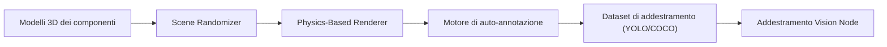

<!-- =============================================================================
HYDRA-UMC-SYNTHETIC-DATA-GEN - Procedural training datasets with exact labels
Copyright (C) JuanenRac (Electro Hobby 3D) <electrohobby3d@gmail.com>
GPL-3.0-or-later - see LICENSE
============================================================================= -->

<p align="center">
  
</p>

# 📸 HYDRA-UMC-SYNTHETIC-DATA-GEN

<p align="center"><a href="README.md">🇺🇸 English</a> | <a href="README_spa.md">🇪🇸 Español</a> | <a href="README_fra.md">🇫🇷 Français</a> | 🇮🇹 <b>Italiano</b> | <a href="README_deu.md">🇩🇪 Deutsch</a> | <a href="README_zho.md">🇨🇳 简体中文</a> | <a href="README_jpn.md">🇯🇵 日本語</a> | <a href="README_por.md">🇵🇹 Português</a></p>

### 📸 Generatore di dataset procedurali per l'addestramento dei Vision AI Node

<p align="center">
  
  
  
  
  
  
</p>

---

> **Stato di sicurezza (safety e security):** questo ecosistema non è un sistema di sicurezza certificato. Non esiste ancora un percorso E-STOP hardware, né limiti o interblocchi imposti dal firmware, né un comando di movimento verificato; le immagini firmware sono controllate con CRC-32 e una firma Ed25519, e una compilazione di rilascio rifiuta le chiavi di sviluppo pubblicate (le teste utensile e le schede di espansione dietro il relè usano ancora i bootloader di URTC, che accettano un HMAC-SHA256 a chiave condivisa invece di una firma); TLS e TLS reciproco sono opzionali e disattivati per impostazione predefinita; nessuna scheda propria è stata ancora assemblata o provata. Leggi la [base di sicurezza](https://github.com/JuanenRac/HYDRA-UMC-DOCS/blob/main/docs/SECURITY_BASELINE.md) e il [modello delle minacce](https://github.com/JuanenRac/HYDRA-UMC-DOCS/blob/main/docs/THREAT_MODEL.md) prima di fidarti di qualsiasi affermazione qui per la sicurezza di una persona.

---

## 📋 In breve

| | |
|---|---|
| Versione | `0.1.2` |
| Maturità | Consolidato |
| Test | 82 (`python -m pytest -q tests`) |
| Tecnologia | Python / procedural scene generation / YOLO/COCO annotation export |
| Destinazione | Il PC di chi lo usa |
| Su hardware reale | Non applicabile: nulla qui gira su hardware |

**Vai a:** [Panoramica](#-panoramica) · [Architettura](#-architettura) · [Avvio rapido](#-avvio-rapido) · [Test](#-test) · [Struttura del repository](#-struttura-del-repository) · [Progetti correlati](#-progetti-correlati)

## 🚦 Stato del progetto

Ogni riga è una parte di questo repository e il semaforo dice a che punto è oggi. È scritta in base a ciò che il repository può mostrare (test, compilazioni, esecuzioni), non a ciò che è previsto.

🟢 Fatto e verificato · 🟡 Funziona, con limiti noti · 🟠 Fatto a metà o non ancora verificato · 🔴 Non fatto o non funzionante

| Area | Stato | Cosa significa qui |
|---|---|---|
| Software | 🟢 | Completo per il suo scopo e stabile; la verifica di onestà qui sopra elenca i limiti noti |
| Test | 🟢 | 82 test automatici, eseguiti a ogni modifica |
| Hardware reale | 🟢 | Non applicabile: nulla qui gira su hardware |
| Documentazione | 🟢 | README in otto lingue, verificato rispetto al manifesto a ogni modifica |

## 🎯 Panoramica

**HYDRA-UMC-SYNTHETIC-DATA-GEN** è la fabbrica di dati per i Vision AI Node. Sfrutta i motori di fisica e rendering del Digital Twin per generare proceduralmente migliaia di immagini etichettate per l'addestramento delle reti neurali.

Risolve il problema del «cold start» per i nuovi componenti industriali o i tipi di difetti rari con annotazioni automatiche di bounding box perfette al pixel. Scenari 3D fotorealistici, maschere di segmentazione e keypoint sono l'obiettivo una volta che esisterà il vero motore fisico/di rendering di HYDRA-UMC-TWIN (vedi le avvertenze in Key Features e il Controllo di onestà più sotto per ciò che funziona davvero oggi: un vero rendering di forme 2D segnaposto, non 3D).

### Caratteristiche principali:
* 🎲 **Scenari procedurali (v0):** Randomizzazione reale e deterministica (con seed) di posizione, dimensione e colore dei componenti 2D. *(implementato come vere forme 2D segnaposto, non ancora pose/illuminazione/texture 3D tramite il motore di HYDRA-UMC-TWIN - vedi BUILD E RUN sotto)*
* 📸 **Rendering multi-camera:** Genera viste simultanee da oltre 8 telecamere virtuali. *(pianificato - richiede il vero motore di rendering di HYDRA-UMC-TWIN)*
* 🏷️ **Etichettatura automatica (v0):** Esportazione reale e perfetta al pixel in YOLO e COCO. *(implementato per YOLO/COCO; l'esportazione TFRecord è pianificata)*
* 🛠️ **Iniezione di difetti (v0):** Sovrapposizione rettangolare reale e casuale per componente, con probabilità configurabile. *(implementato come una semplice sovrapposizione reale - vere forme di graffio/parte mancante/ponte di saldatura sono pianificate)*
* 📋 **Manifesto del dataset e validazione (v0):** Ogni esecuzione di `generate` scrive un vero `manifest.json` (flag di seed riproducibile, parametri di generazione, e un vero checksum sha256 per immagine) ed esegue una vera validazione post-generazione - limiti di scena, integrità BMP rispetto al layout di file reale noto, e sanità della distribuzione delle etichette - uscendo con codice diverso da zero se viene trovato un problema reale.
* ✂️ **Suddivisione in addestramento, validazione e test:** `generate --split train=0.8,val=0.1,test=0.1` scrive anche `train.txt`, `val.txt` e `test.txt`, un `data.yaml` per i trainer YOLO e `splits.json`. La parte di una scena dipende solo dal seed e dall'indice della scena, ogni scena sta in una sola parte e `verify` lo controlla. Senza `--split` non cambia nulla.

## 🧩 Ruolo in HYDRA-UMC

**HYDRA-UMC-SYNTHETIC-DATA-GEN** scrive piccoli insiemi di addestramento per i nodi di visione: scene casuali di componenti, con i riquadri presi dalle stesse coordinate che le hanno disegnate, esportati come YOLO o COCO insieme a un manifesto di come è stato fatto l'insieme. Oggi le scene sono forme 2D piatte; il rendering tramite il Digital Twin è previsto.

## 🏛️ Architettura

<p align="center">
  
</p>

<details>
<summary>Versione testuale del diagramma (Mermaid)</summary>



</details>

### ARCHITETTURA E DECISIONI DI PROGETTAZIONE

* **Perché questo generatore non ha cartelle `hardware/`/`firmware/`/`os/`.** Software puro - renderizza scene tramite il motore proprio di HYDRA-UMC-TWIN invece di possedere hardware proprio.
* **Perché è fratello, non un sottomodulo, di HYDRA-UMC-TWIN.** La generazione di dataset è un carico di lavoro batch, offline (potenzialmente ore di rendering) fondamentalmente diverso dal ciclo in tempo reale proprio del gemello - tenerla separata significa che un lungo export non compete mai con la simulazione in tempo reale per la CPU/GPU dello stesso processo.
* **Perché l'invocazione semplice continua a stampare solo identità/versione/ruolo.** Resta lo smoke test originale della fase di impalcatura: dimostrare che il pacchetto si installa e importa in modo pulito. La vera logica di randomizzazione procedurale/rendering/esportazione annotazioni vive dietro il sottocomando `generate`.
* **Come si inserisce nel resto dell'ecosistema.** Renderizza dataset di addestramento (con annotazione automatica YOLO/COCO) tramite il motore proprio di HYDRA-UMC-TWIN, perché HYDRA-UMC-VISION-NODE e HYDRA-UMC-DETECTION-HEF si addestrino su di essi - dati sintetici invece di etichettare a mano filmati reali della camera.
* **Perché v0 renderizza vere forme 2D segnaposto invece di aspettare HYDRA-UMC-TWIN.** HYDRA-UMC-TWIN (il proprio genitore di integrazione di questo progetto) è a sua volta ancora in fase di impalcatura - bloccare del tutto la generazione di dataset sul suo vero motore 3D lascerebbe non testata la pipeline di annotazione (la parte davvero difficile e riutilizzabile: posizionamento, etichettatura, esportazione YOLO/COCO). Un rasterizzatore BMP reale, solo stdlib, offre oggi dati reali e perfetti al pixel; sostituire in seguito il vero motore di TWIN cambia solo il modo in cui i pixel vengono dipinti, non i contratti `Scene`/`Component`/esportazione.
* **Perché i bounding box sono perfetti al pixel per costruzione.** `export.py` legge esattamente le stesse coordinate di `Component` che `scene.py` ha posizionato e `render.py` ha dipinto - non c'è alcun modello di rilevamento né alcun passo di etichettatura manuale in questo ciclo v0 da cui le annotazioni potrebbero divergere.
* **Perché la validazione riutilizza la formula di dimensione riga di `render.py` invece di un secondo parser indipendente.** `validate_bmp_integrity()` importa direttamente `_row_size()` da `render.py` invece di ri-derivare il calcolo del padding di riga BMP - un'unica fonte di verità per il layout esatto dei byte evita che un futuro cambiamento reale nello scrittore si desincronizzi silenziosamente dal validatore.
* **Perché "riproducibile" è un campo del manifesto, non solo una proprietà implicita di `--seed`.** `--seed` rendeva già la generazione deterministica prima di questo cambiamento, ma nulla registrava se un dato dataset su disco avesse effettivamente usato un seed - un consumatore non aveva modo di distinguere a posteriori un'esecuzione riproducibile da una casuale. Il flag `reproducible` di `manifest.json` più un vero sha256 per immagine rende questa affermazione verificabile.

## 🚀 Avvio rapido

Richiede Python 3.10 o successivo.

```bash
./build.sh  # Linux, macOS (build.bat on Windows)
./run.sh generate --out ./out --count 10 --seed 42
./run.sh generate --out ./out --format yolo --defect-rate 0.3
```

## 🧪 Test

82 test automatici si eseguono con `python -m pytest -q tests`. Non richiedono hardware né nulla al di fuori di questa macchina.

La CI esegue `HYDRA_UMC_CI=1 python tools/ci_validate.py`, che controlla il manifesto, i documenti, gli otto README e le immagini.

## 🏗️ Compilazione e rilascio

Richiede Python 3.10+.

```bash
# Linux / macOS
./build.sh   # crea .venv, installa il
             # pacchetto in modalità editabile (con extra dev), esegue la
             # vera suite di test, compile-check di tutto src/
./run.sh     # esegue l'entry point da .venv, stampa nome + version + ruolo
```

```bat
:: Windows
build.bat
run.bat
```

`build.sh`/`build.bat` non cambiano mai la versione (solo `python tools/hydra_project_tool.py bump` la alza), fanno il compile-check del codice sorgente con `python -m compileall`, e poi eseguono la vera suite di test (`pytest tests/`).

Il vero sottocomando `generate` scrive un vero dataset su disco:

```bash
./run.sh generate --out dataset/ --count 20 --components 6 --defect-rate 0.3 --seed 42 --format both

# Windows
run.bat generate --out dataset\ --count 20 --components 6 --defect-rate 0.3 --seed 42 --format both
```

`--jobs N` renderizza le scene in N processi (predefinito 1): ogni scena ha il proprio generatore casuale inizializzato dal seme e dal suo indice, quindi il dataset è lo stesso qualunque sia N. Il manifesto ora registra l'elenco delle classi (`classes`) e il suo hash (`classes_sha256`, lo sha256 di `classes.txt`) così chi registra un modello addestrato sul dataset può verificare l'ordine delle classi. `verify --out dataset/` rilegge una cartella di dataset: le immagini contro i checksum del manifesto, le etichette YOLO (cinque campi, un id di classe noto, tutto in [0, 1]), il file COCO (id unici, riquadri dentro l'immagine) e il numero di etichette contro il manifesto; `generate` esegue lo stesso controllo sul proprio output. Il renderer BMP dipinge per fette invece che per pixel (gli stessi byte, molto più veloce sulle immagini grandi). Provato; il controllo lato DETECTION-HEF che confronterebbe l'hash non esiste ancora.

Scrive vere immagini BMP in `dataset/images/`, vere etichette YOLO in `dataset/labels/` + `dataset/classes.txt`, e/o un vero `dataset/annotations.json` in formato COCO, a seconda di `--format`. Un `--seed` dato rende il dataset riproducibile byte per byte.

Gli argomenti sono controllati per intervallo (`--count` 1..10000, `--width`/`--height` 16..4096, `--components` 1..1000, `--defect-rate` 0..1) e le immagini dell'intero dataset sono limitate a 4 GiB: un comando la cui dimensione stimata supera quel limite viene rifiutato con codice di uscita 2 prima di scrivere qualsiasi cosa, così un errore di battitura non può riempire il disco della macchina su cui gira.

Ogni esecuzione scrive anche un vero `dataset/manifest.json` e valida il proprio output:

```
Generated 20 scene(s) -> dataset/images
Total labeled components (incl. defects): 150
Annotations exported as: both
Reproducible seed: yes (seed=42)
Manifest written -> dataset/manifest.json
Validation: OK (scene bounds, BMP integrity, label distribution)
```

```json
{
  "seed": 42,
  "reproducible": true,
  "count": 20,
  "scenes": [
    { "image": "scene_0000.bmp", "num_components": 7,
      "label_counts": {"bracket": 1, "bolt": 2, "gear": 2, "defect": 1, "connector": 1},
      "sha256": "2301c6974673d9f6a408d7a4b746d236d0ec98b535064884b7a3929645a8f2eb" }
  ],
  "validation_issues": []
}
```

Se la validazione trova un problema reale (un componente fuori intervallo, un BMP troncato/corrotto, o un tasso di difetti che si è discostato molto da `--defect-rate`), `generate` esce con codice `1` ed elenca ogni problema invece di consegnare silenziosamente un dataset difettoso.

## 📂 Struttura del repository

<p align="center">
  
</p>

<details>
<summary>Versione testuale dell'albero</summary>

```text
HYDRA-UMC-SYNTHETIC-DATA-GEN/
├── src/hydra_umc_synthetic_data_gen/   codice sorgente
│   ├── __init__.py                     Versione del pacchetto
│   ├── scene.py                        Generazione reale di scene/componenti 2D procedurali
│   ├── render.py                       Rasterizzazione BMP reale, solo stdlib
│   ├── export.py                       Esportazione reale delle annotazioni YOLO/COCO
│   ├── manifest.py                     Vero manifest.json del dataset (seed, checksum)
│   ├── validate.py                     Vera validazione limiti/integrità BMP/distribuzione
│   ├── main.py                         Punto di ingresso + sottocomando reale `generate`
│   └── verify.py                       Controlla una cartella di dataset finita rispetto al proprio manifesto e a sé stessa (checksum, etichette YOLO, annotazioni COCO)
├── tests/                              Test reali: generazione, rendering, esportazione, CLI end-to-end
├── docs/                               Documentazione e guide procedurali
├── images/                             Media e diagrammi
├── tools/                              ci_validate.py - validazione manifest/CHANGELOG/docs usata dalla CI
├── .github/                            workflow di CI e modelli di segnalazione
├── pyproject.toml                      Metadati del pacchetto, dipendenze, version contachilometri
├── bump_version.py                     Incremento di versione stile contachilometri (eseguito solo dal comando `bump` esplicito)
├── bump_manifest_version.py            Sincronizza la versione di hydra-umc.project.json con quella nativa (--sync)
├── build.sh / build.bat                venv + installazione editabile (con extra dev) + test reali + compile-check
├── run.sh / run.bat                    Esegue l'entry point dal venv locale (inoltra gli argomenti, es. `generate`)
├── CHANGELOG.md                        cosa è cambiato in ogni versione
├── build-test.sh                       controllo di build senza modifiche
├── hydra-umc.project.json              manifesto: versione, maturità, famiglia
└── test.sh                             esegue i test
```

</details>

## 🗺️ Roadmap e limiti noti

**Limiti noti oggi**

* **Fase 1:** Elenco di classi fisso e suddivisioni riproducibili addestramento/validazione/test (l'opzione `--split` è il primo passo).
* **Fase 2:** Maschere di segmentazione accanto ai riquadri di delimitazione.
* **Fase 3:** Annotazioni di punti chiave per i dataset di stima della posa.
* **Fase 4:** Output PNG e integrazione con il gemello digitale (TWIN) come sorgente di scene.

## 🌍 Lingue

Questo README e i documenti del repository esistono in otto lingue: inglese, spagnolo, tedesco, francese, italiano, giapponese, cinese e portoghese (Portogallo). Sono scritti insieme e la CI verifica che gli otto file abbiano le stesse sezioni e gli stessi link. Questo repository non ha uno schermo né un catalogo di messaggi propri, quindi non ci sono stringhe di interfaccia da tradurre.

## 🔗 Progetti correlati

Questo progetto fa parte dell'ecosistema robotico HYDRA-UMC dello stesso autore (JuanenRac / Electro Hobby 3D). Vale la pena conoscerlo, poiché una richiesta potrebbe in realtà riguardare uno di questi invece di questo repository.

**Progetto Padre**
- **[HYDRA-UMC-TWIN](https://github.com/JuanenRac/HYDRA-UMC-TWIN)** — hub di integrazione per il motore di gemello digitale, con un vero contratto di sincronizzazione per compatibilità di versione; il genitore di cui questo repository è un servizio di simulazione specifico, all'interno del proprio motore di gemello digitale.

**Progetti Fratelli** — gli altri servizi di simulazione del motore di gemello digitale proprio di HYDRA-UMC-TWIN
- **[HYDRA-UMC-PHYSICS-REPLICA](https://github.com/JuanenRac/HYDRA-UMC-PHYSICS-REPLICA)** — vera cinematica diretta e validazione dei limiti articolari su un vero sottoinsieme URDF.
- **[HYDRA-UMC-HIL-BRIDGE](https://github.com/JuanenRac/HYDRA-UMC-HIL-BRIDGE)** — router hardware-in-the-loop con un interblocco software di collisione tra simulazione e hardware reale (testato senza hardware reale).

**Direttamente Correlati**
- **[HYDRA-UMC-VISION-NODE](https://github.com/JuanenRac/HYDRA-UMC-VISION-NODE)** — hub di integrazione per la pipeline di visione Hailo-8, con un vero controllo di prontezza hardware per fase — addestrato sui dataset che questo progetto genera.
- **[HYDRA-UMC-DETECTION-HEF](https://github.com/JuanenRac/HYDRA-UMC-DETECTION-HEF)** — registro reale di modelli compilati con verifica di caricamento sicuro per architettura Hailo/checksum — addestrato sui dataset che questo progetto genera.

**Fa Anche Parte dell'Ecosistema**

*Hardware e Piattaforma di Base*
- **[HYDRA-UMC](https://github.com/JuanenRac/HYDRA-UMC)** — il progetto della scheda madre del braccio robotico: host CM5 + coprocessore STM32H745 dual-core, pensato per coordinare fino a 8 bracci utensile via CAN-OTA/SPI-OTA (firmware in fase iniziale; nessuna scheda assemblata per ora).
- **[HYDRA-UMC-OS](https://github.com/JuanenRac/HYDRA-UMC-OS)** — livello prodotto riproducibile su Raspberry Pi OS per il CM5: agente in sola lettura, config/profili validati, provisioning WiFi al primo contatto.
- **[HYDRA-UMC-SDK](https://github.com/JuanenRac/HYDRA-UMC-SDK)** — il contratto JSON-Schema condiviso e la barriera software di controllo dei job contro cui ogni bridge valida i propri comandi (non è una funzione di sicurezza certificata).
- **[HYDRA-UMC-CONNECTOR-HUB](https://github.com/JuanenRac/HYDRA-UMC-CONNECTOR-HUB)** — registro dichiarativo e validatore di manifesti adattatore per connettori di macchine esterne; estende la propria idea di contratto dell'SDK alle macchine esterne senza sostituire i progetti di gateway industriale.

*Backend Centrale e Client*
- **[HYDRA-UMC-SERVER](https://github.com/JuanenRac/HYDRA-UMC-SERVER)** — il vero backend headless (REST/WebSocket) con cui parla davvero ogni client di controllo.
- **[HYDRA-UMC-STUDIO](https://github.com/JuanenRac/HYDRA-UMC-STUDIO)** — dashboard di controllo web con visualizzazione 3D multi-robot in tempo reale.
- **[HYDRA-UMC-SUITE](https://github.com/JuanenRac/HYDRA-UMC-SUITE)** — centro di comando sciame desktop (PySide6) per più server contemporaneamente, pacchettizzato come eseguibile standalone.
- **[HYDRA-UMC-ANDROID-CONTROL](https://github.com/JuanenRac/HYDRA-UMC-ANDROID-CONTROL)** — app di controllo nativa per Android con login biometrico e un companion Wear OS abbinato.
- **[HYDRA-UMC-IOS-CONTROL](https://github.com/JuanenRac/HYDRA-UMC-IOS-CONTROL)** — app di controllo per iOS/iPadOS (Flutter) con sincronizzazione WebSocket in tempo reale.
- **[HYDRA-UMC-DSI](https://github.com/JuanenRac/HYDRA-UMC-DSI)** — interfaccia touch nativa per il touchscreen DSI da 7" a bordo, incorporata direttamente nel CM5.
- **[HYDRA-UMC-EDITOR-URDF](https://github.com/JuanenRac/HYDRA-UMC-EDITOR-URDF)** — creatore/editor grafico desktop di URDF che invia i modelli finiti al catalogo di STUDIO.
- **[HYDRA-UMC-EDITOR-STL](https://github.com/JuanenRac/HYDRA-UMC-EDITOR-STL)** — editor desktop di modelli STL, che trasforma/sostituisce/rimuove/aggiunge veri pezzi nello stesso catalogo di modelli modificato anche da HYDRA-UMC-EDITOR-URDF.
- **[HYDRA-UMC-BRIDGE-AMR](https://github.com/JuanenRac/HYDRA-UMC-BRIDGE-AMR)** — barriera di coordinamento per flotte AGV/AMR tramite un publisher MQTT VDA 5050 (testato solo contro una flotta emulata).
- **[HYDRA-UMC-BRIDGE-CNC](https://github.com/JuanenRac/HYDRA-UMC-BRIDGE-CNC)** — coordinatore ad alto livello per celle CNC con accesso a stato/byte di controllo GRBL (testato solo contro un emulatore).
- **[HYDRA-UMC-BRIDGE-DROIDS](https://github.com/JuanenRac/HYDRA-UMC-BRIDGE-DROIDS)** — barriera di coordinamento per droidi con zampe/umanoidi, con un mittente di comandi per Boston Dynamics Spot (testato solo contro un emulatore).
- **[HYDRA-UMC-BRIDGE-LASER](https://github.com/JuanenRac/HYDRA-UMC-BRIDGE-LASER)** — coordinatore per celle laser che legge 3 segnali GPIO di chiave/involucro/interblocco (testato solo contro un chip simulato; non può armare né far partire un laser).
- **[HYDRA-UMC-BRIDGE-OPENPNP](https://github.com/JuanenRac/HYDRA-UMC-BRIDGE-OPENPNP)** — coordinatore ad alto livello sicuro per il flusso schede del pick-and-place OpenPnP.
- **[HYDRA-UMC-BRIDGE-PRINTER3D](https://github.com/JuanenRac/HYDRA-UMC-BRIDGE-PRINTER3D)** — barriera di coordinamento sicura per stampanti 3D Moonraker/Klipper, con comandi di lavoro reali e controllati.
- **[HYDRA-UMC-BRIDGE-ROS2](https://github.com/JuanenRac/HYDRA-UMC-BRIDGE-ROS2)** — coordinatore con un trasporto ROS 2 rclpy importato in modo lazy (non ancora eseguito contro un'installazione ROS 2).
- **[HYDRA-UMC-BRIDGE-UAV](https://github.com/JuanenRac/HYDRA-UMC-BRIDGE-UAV)** — barriera di coordinamento per UAV dotati di fotocamera, con un mittente di comandi MAVLink (testato solo contro un emulatore).

*Piattaforma Strumenti URTC*
- **[URTC](https://github.com/JuanenRac/URTC)** — firmware per la scheda fisica dell'Universal Robot Tool Controller, oltre 25 profili utensile su bus CAN.
- **[URTC-FLASHER](https://github.com/JuanenRac/URTC-FLASHER)** — strumento desktop con GUI per il flashing delle schede URTC, CAN-OTA più SWD/JTAG a chip intero.
- **[URTC-TESTER](https://github.com/JuanenRac/URTC-TESTER)** — strumento desktop di diagnostica CAN-bus dal vivo per schede URTC, un pannello per profilo utensile.
- **[URTC-WEB-STUDIO](https://github.com/JuanenRac/URTC-WEB-STUDIO)** — alternativa basata su browser a URTC-TESTER tramite la Web Serial API, senza installazione locale.
- **[URTC-GATEWAY](https://github.com/JuanenRac/URTC-GATEWAY)** — gateway davanti al bus CAN di URTC: elenco di identificatori consentiti, limite di frequenza e chiave di sessione; software provato su computer, non ancora su un bus reale.

*Nodo IA Visione (Hailo-8)*
- **[HYDRA-UMC-VISION-STREAMER](https://github.com/JuanenRac/HYDRA-UMC-VISION-STREAMER)** — generatore reale di pipeline GStreamer + config MediaMTX, con una vera barriera di integrazione HailoRT.
- **[HYDRA-UMC-VISUAL-SERVOING-API](https://github.com/JuanenRac/HYDRA-UMC-VISUAL-SERVOING-API)** — legge di correzione Position-Based Visual Servoing con autorizzazione condizionata allo stato di zona; ancora nessuna stima di posa da telecamera.
- **[HYDRA-UMC-SAFETY-ZONES](https://github.com/JuanenRac/HYDRA-UMC-SAFETY-ZONES)** — logica v0 di violazione zona, freschezza di calibrazione e richiesta E-STOP che legge le posizioni degli oggetti da un file; nessun rilevatore la alimenta e nessun E-STOP fisico è ancora collegato.

*Nodo IA Cognitivo (Hailo-10)*
- **[HYDRA-UMC-COGNITIVE-NODE](https://github.com/JuanenRac/HYDRA-UMC-COGNITIVE-NODE)** — hub di integrazione per la pipeline cognitiva Hailo-10 (orchestrazione LLM/VLA/voce).
- **[HYDRA-UMC-VLA-ENGINE](https://github.com/JuanenRac/HYDRA-UMC-VLA-ENGINE)** — vera codifica/decodifica di token d'azione e generazione di traiettoria per un modello Vision-Language-Action.
- **[HYDRA-UMC-VOICE-UI](https://github.com/JuanenRac/HYDRA-UMC-VOICE-UI)** — vero front-end vocale (VAD + parser di intenti) con un relay verso Watch limitato e soggetto a conferma.
- **[HYDRA-UMC-SEMANTIC-PLANNER](https://github.com/JuanenRac/HYDRA-UMC-SEMANTIC-PLANNER)** — vera scomposizione dei task basata su regole e recupero semantico degli errori sui codici errore MCU.
- **[HYDRA-UMC-DOCS-QA](https://github.com/JuanenRac/HYDRA-UMC-DOCS-QA)** — vera ricerca documentale TF-IDF (solo libreria standard) sui documenti Markdown di questo ecosistema.
- **[HYDRA-UMC-LOCAL-TECHNICIAN](https://github.com/JuanenRac/HYDRA-UMC-LOCAL-TECHNICIAN)** — tecnico di manutenzione IA locale e con cancelli di policy per l'ecosistema stesso - osserva, diagnostica e propone correzioni; i due livelli di rischio più alti non sono deliberatamente ancora implementati.

*Orchestrazione e Sciame*
- **[HYDRA-UMC-ORCHESTRATOR](https://github.com/JuanenRac/HYDRA-UMC-ORCHESTRATOR)** — hub di integrazione con un vero contratto di health-report gRPC/Protobuf e una macchina a stati di missione.
- **[HYDRA-UMC-JOB-DISPATCHER](https://github.com/JuanenRac/HYDRA-UMC-JOB-DISPATCHER)** — vera coda di lavori basata su priorità con deduplicazione, su una vera API HTTP.
- **[HYDRA-UMC-NODE-HEALING](https://github.com/JuanenRac/HYDRA-UMC-NODE-HEALING)** — vero watchdog di salute della flotta basato su gRPC, con retry/backoff e rilevamento di discrepanza d'identità.
- **[HYDRA-UMC-PATH-PLANNER-3D](https://github.com/JuanenRac/HYDRA-UMC-PATH-PLANNER-3D)** — vero pianificatore di percorsi 3D basato su RRT, con vera validazione delle collisioni ostacolo/spazio di lavoro.
- **[HYDRA-UMC-SWARM-SYNC](https://github.com/JuanenRac/HYDRA-UMC-SWARM-SYNC)** — vera sincronizzazione di stato CRDT LWW-Element-Map, con property test per la convergenza multi-cella.

*Dati e Analisi*
- **[HYDRA-UMC-DATALAKE](https://github.com/JuanenRac/HYDRA-UMC-DATALAKE)** — vero archivio di serie temporali basato su sqlite3, con una vera API HTTP di ingestione/query.
- **[HYDRA-UMC-ANOMALY-DETECTOR](https://github.com/JuanenRac/HYDRA-UMC-ANOMALY-DETECTOR)** — vero rilevatore di anomalie FFT + baseline statistica, con monitoraggio della deriva.
- **[HYDRA-UMC-PRODUCTION-REPORTS](https://github.com/JuanenRac/HYDRA-UMC-PRODUCTION-REPORTS)** — vero calcolo OEE/disponibilità sullo storico di DATALAKE, con esportazione CSV riproducibile.
- **[HYDRA-UMC-TELEMETRY-COLLECTOR](https://github.com/JuanenRac/HYDRA-UMC-TELEMETRY-COLLECTOR)** — vera pipeline di ingestione CAN/WebSocket verso DATALAKE, con deduplicazione per sequenza.

*Gateway Industriale*
- **[HYDRA-UMC-GATEWAY-INDUSTRIAL](https://github.com/JuanenRac/HYDRA-UMC-GATEWAY-INDUSTRIAL)** — hub di integrazione che inoltra ai protocolli industriali, con un vero livello di allowlist dei comandi/backpressure.
- **[HYDRA-UMC-OPCUA-SERVER](https://github.com/JuanenRac/HYDRA-UMC-OPCUA-SERVER)** — vero spazio di indirizzi OPC-UA, verificato con una vera sessione client del protocollo binario.
- **[HYDRA-UMC-MQTT-BROKER](https://github.com/JuanenRac/HYDRA-UMC-MQTT-BROKER)** — vero broker MQTT con autenticazione opzionale per client e ACL sui topic.
- **[HYDRA-UMC-MTCONNECT-ADAPTER](https://github.com/JuanenRac/HYDRA-UMC-MTCONNECT-ADAPTER)** — veri endpoint XML `/probe` e `/current` di MTConnect, con output in modalità degradata.

*Strumenti Complementari e Operazioni dell'Ecosistema*
- **[HYDRA-UMC-DASHBOARD-AI](https://github.com/JuanenRac/HYDRA-UMC-DASHBOARD-AI)** — pannelli Smart Summaries e Anomaly Highlighting su DATALAKE/ANOMALY-DETECTOR, con un fallback statistico onesto.
- **[HYDRA-UMC-TOOL-CLI](https://github.com/JuanenRac/HYDRA-UMC-TOOL-CLI)** — CLI di flotta con un vero e stabile contratto di exit-code, un client live reale della stessa API di HYDRA-UMC-SERVER.
- **[HYDRA-UMC-WATCH](https://github.com/JuanenRac/HYDRA-UMC-WATCH)** — app companion WearOS con schemi di avviso aptico e un relay vocale verso il telefono abbinato (non ancora eseguita su un orologio fisico).
- **[URTC-SMART-RACK](https://github.com/JuanenRac/URTC-SMART-RACK)** — firmware per un rack di montaggio schede con decodifica reale dell'ID utensile e logica di preriscaldamento Smart Idle.
- **[URTC-VISION-TOOL](https://github.com/JuanenRac/URTC-VISION-TOOL)** — firmware più un vero companion di visione Python per una testa utensile di ispezione termica/RGB.
- **[HYDRA-UMC-UPDATER](https://github.com/JuanenRac/HYDRA-UMC-UPDATER)** — strumento amministrativo desktop che scopre, clona e aggiorna ogni repository di questo ecosistema.
- **[HYDRA-UMC-OS-REBUILDER](https://github.com/JuanenRac/HYDRA-UMC-OS-REBUILDER)** — strumento desktop Windows/Linux che costruisce un'immagine della CM5 pronta da scrivere, precaricata con le versioni più aggiornate dell'ecosistema, con configurazione di primo avvio Wi-Fi/utente/SSH in stile Raspberry Pi Imager.
- **[HYDRA-UMC-OPS-AGENT](https://github.com/JuanenRac/HYDRA-UMC-OPS-AGENT)** — coordinatore di incidenti di manutenzione: un ruolo edge a basso privilegio raccoglie uno snapshot di inventario/salute sanificato, un ruolo control-plane lo rende in sola lettura e chiede a un provider di IA di suggerire una diagnosi - non applica mai una patch né distribuisce nulla.
- **[HYDRA-UMC-DEV-SERVER](https://github.com/JuanenRac/HYDRA-UMC-DEV-SERVER)** — host di sviluppo riproducibile (Raspberry Pi 5 / CM5) che conserva il codice sorgente dell'ecosistema ed esegue attività delimitate di build/test tramite una coda durevole; un ruolo di sviluppo dedicato, esplicitamente distinto da un CM5 operativo.

## 📚 Documentazione

Dove leggere di più:

* [Base di sicurezza dell'ecosistema](https://github.com/JuanenRac/HYDRA-UMC-DOCS/blob/main/docs/SECURITY_BASELINE.md)
* [Modello delle minacce dell'ecosistema](https://github.com/JuanenRac/HYDRA-UMC-DOCS/blob/main/docs/THREAT_MODEL.md)
* [Registro delle modifiche di questo repository](CHANGELOG.md)
* [Licenza di questo repository](LICENSE.md)

## 🤝 Contribuire e comunità

* Prima di una pull request esegui `HYDRA_UMC_CI=1 py -3 tools/ci_validate.py` (oppure `HYDRA_UMC_CI=1 python3 tools/ci_validate.py`): deve stampare `CI_VALIDATION=PASS`. Non eseguire `build.sh` né `build.bat` per questa verifica; compilare non è verificare.
* I otto README sono scritti da un'unica fonte in HYDRA-UMC-DOCS; non modificarli a mano. Cambia la fonte e riscrivili con `tools/make_readmes.py`.
* Non affermare in un README ciò che non è stato eseguito: scrivi «simulato» o «non provato su hardware» quando è la verità.
* Vedi [CONTRIBUTING.md](CONTRIBUTING.md), il [codice di condotta](CODE_OF_CONDUCT.md), [SECURITY.md](SECURITY.md) e [SUPPORT.md](SUPPORT.md).

## 👤 AUTORE

**JuanenRac (Electro Hobby 3D)** · electrohobby3d@gmail.com

## 📜 LICENZA

GPL-3.0-or-later - [LICENSE](LICENSE).
