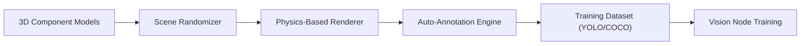

<!-- =============================================================================
HYDRA-UMC-SYNTHETIC-DATA-GEN - Procedural training datasets with exact labels
Copyright (C) JuanenRac (Electro Hobby 3D) <electrohobby3d@gmail.com>
GPL-3.0-or-later - see LICENSE
============================================================================= -->

<p align="center">
  
</p>

# 📸 HYDRA-UMC-SYNTHETIC-DATA-GEN

<p align="center"><a href="README.md">🇺🇸 English</a> | <a href="README_spa.md">🇪🇸 Español</a> | <a href="README_fra.md">🇫🇷 Français</a> | <a href="README_ita.md">🇮🇹 Italiano</a> | <a href="README_deu.md">🇩🇪 Deutsch</a> | <a href="README_zho.md">🇨🇳 简体中文</a> | 🇯🇵 <b>日本語</b> | <a href="README_por.md">🇵🇹 Português</a></p>

### 📸 ビジョン AI ノードの学習向けプロシージャルデータセットジェネレーター

<p align="center">
  
  
  
  
  
  
</p>

---

> **安全性とセキュリティの現状:** このエコシステムは認証された安全システムではありません。ハードウェアの E-STOP 経路、ファームウェアが強制する制限やインターロック、検証済みの動作コマンドはまだありません。ファームウェアイメージは CRC-32 と Ed25519 署名で検査し、リリースビルドは公開済みの開発用鍵を拒否します(リレーの先のツールヘッドと拡張ボードは引き続き URTC のブートローダーを使い、署名ではなく共有鍵の HMAC-SHA256 を使います)。TLS と相互 TLS は任意で、既定では無効です。独自基板はまだ実装も試験もされていません。ここに書かれた内容を人の安全のために頼る前に、[セキュリティベースライン](https://github.com/JuanenRac/HYDRA-UMC-DOCS/blob/main/docs/SECURITY_BASELINE.md)と[脅威モデル](https://github.com/JuanenRac/HYDRA-UMC-DOCS/blob/main/docs/THREAT_MODEL.md)をお読みください。

---

## 📋 ひと目で

| | |
|---|---|
| バージョン | `0.1.1` |
| 成熟度 | 確立 |
| テスト | 82 (`python -m pytest -q tests`) |
| 技術 | Python / procedural scene generation / YOLO/COCO annotation export |
| 対象 | 利用者の PC |
| 実機での確認 | 対象外：ここにあるものはハードウェア上では動きません |

**移動：** [概要](#-概要) · [アーキテクチャ](#-アーキテクチャ) · [クイックスタート](#-クイックスタート) · [テスト](#-テスト) · [リポジトリの構成](#-リポジトリの構成) · [関連プロジェクト](#-関連プロジェクト)

## 🚦 プロジェクトの状況

各行はこのリポジトリの一部分で、信号は今日どこまで進んでいるかを示します。計画ではなく、リポジトリが示せるもの（テスト、ビルド、実行）に基づいて書かれています。

🟢 完了・検証済み · 🟡 動作する（既知の制限あり） · 🟠 一部のみ、または未検証 · 🔴 未実装または動作しない

| 領域 | 状態 | ここでの意味 |
|---|---|---|
| ソフトウェア | 🟢 | 目的に対して完成していて安定しています。既知の制限は上の正直さの確認に書かれています |
| テスト | 🟢 | 自動テスト 82 件。変更のたびに実行されます |
| 実機 | 🟢 | 対象外：ここにあるものはハードウェア上では動きません |
| ドキュメント | 🟢 | 8 言語の README。変更のたびにマニフェストと照合されます |

## 🎯 概要

**HYDRA-UMC-SYNTHETIC-DATA-GEN** は、ビジョン AI ノードのためのデータ
工場です。デジタルツインの物理エンジンとレンダリングエンジンを活用し、
ニューラルネットワークの学習用にラベル付けされた画像を数千枚単位で
プロシージャルに生成します。

自動的にピクセル単位で正確なバウンディングボックス注釈により、新しい
工業部品や稀な欠陥タイプにおける「コールドスタート」問題を解決します。
フォトリアリスティックな3Dシナリオ、セグメンテーションマスク、キーポ
イントは、HYDRA-UMC-TWIN自身の本物の物理/レンダリングエンジンが存在
するようになった時点での目標です(今日実際に動くもの - 3Dではなく
本物の2Dプレースホルダー形状のレンダリング - については下記のKey
Featuresの注記と正直な現状確認を参照してください)。

### 主な機能：
* 🎲 **プロシージャルシナリオ（v0）：** シード指定による実際の決定論的な、2D コンポーネントの位置・サイズ・色のランダム化。*（実際の 2D プレースホルダー形状として実装済み——HYDRA-UMC-TWIN のエンジンを通じた 3D の姿勢/照明/テクスチャはまだです。下記の「ビルドとリリース」を参照）*
* 📸 **マルチカメラレンダリング：** 8 台以上の仮想カメラから同時にビューを生成します。*（計画中——HYDRA-UMC-TWIN の実際のレンダリングエンジンが必要です）*
* 🏷️ **自動ラベリング（v0）：** YOLO と COCO への実際のピクセル単位で正確なエクスポート。*（YOLO/COCO について実装済み。TFRecord エクスポートは計画中）*
* 🛠️ **欠陥注入（v0）：** コンポーネントごとの実際のランダムな矩形オーバーレイ、確率は設定可能。*（シンプルな実際のオーバーレイとして実装済み——実際の傷/部品欠落/はんだブリッジ形状は計画中）*
* 📋 **データセットマニフェストと検証（v0）：** `generate` を実行するたびに、実際の `manifest.json`（再現可能シードのフラグ、生成パラメータ、各画像の実際の sha256 チェックサム）が書き込まれ、実際の生成後検証——シーン境界、既知の実際のファイルレイアウトに対する BMP の整合性、ラベル分布の妥当性——が実行されます。実際の問題が見つかった場合はゼロ以外の終了コードで終了します。
* ✂️ **学習・検証・テストの分割:** `generate --split train=0.8,val=0.1,test=0.1` は、`train.txt`、`val.txt`、`test.txt`、YOLO 学習用の `data.yaml`、`splits.json` も書き出します。シーンがどの部分に入るかはシードとシーン番号だけで決まり、各シーンはちょうど一つの部分に入り、`verify` がそれを確認します。`--split` を付けなければ何も変わりません。

## 🧩 HYDRA-UMC での役割

**HYDRA-UMC-SYNTHETIC-DATA-GEN** はビジョンノード向けの小さな学習データセットを書き出します。部品のランダムな場面で、バウンディングボックスは描画に使った同じ座標から取られ、YOLO または COCO 形式で、作り方を記録したマニフェストとともに出力されます。現在の場面は平面の 2D 図形で、Digital Twin 経由のレンダリングは計画中です。

## 🏛️ アーキテクチャ

<p align="center">
  
</p>

<details>
<summary>図のテキスト版（Mermaid）</summary>



</details>

### アーキテクチャと設計上の決定

* **本ジェネレーターに `hardware/`/`firmware/`/`os/` フォルダがない理由。** 純粋なソフトウェアです——HYDRA-UMC-TWIN 自身のエンジンを通じてシーンをレンダリングするだけで、自らハードウェアを所有していません。
* **HYDRA-UMC-TWIN のサブモジュールではなく兄弟プロジェクトである理由。** データセット生成はバッチ処理のオフラインワークロード（レンダリングに数時間かかることもあります）であり、ツイン自身のリアルタイムループとは根本的に異なります——これを独立させておくことで、長時間のエクスポート処理が同一プロセスの CPU/GPU 時間をリアルタイムシミュレーションと奪い合うことは決してありません。
* **素の実行が今も身元/バージョン/役割のみを表示する理由。** これは足場（スキャフォールディング）段階の当初のスモークテストのままです：本パッケージが正しくインストールされ、問題なくインポートできることの確認です。実際のプロシージャルなランダム化/レンダリング/アノテーションエクスポートロジックは `generate` サブコマンドの背後にあります。
* **エコシステムの他の部分との関係。** HYDRA-UMC-TWIN 自身のエンジンを通じて、（自動 YOLO/COCO アノテーション付きの）学習データセットをレンダリングし、HYDRA-UMC-VISION-NODE と HYDRA-UMC-DETECTION-HEF がそれを用いて学習できるようにします——実際のカメラ映像を手作業でラベリングする代わりに、合成データを使用します。
* **v0 が HYDRA-UMC-TWIN を待たずに実際の 2D プレースホルダー形状をレンダリングする理由。** HYDRA-UMC-TWIN（本プロジェクト自身の統合親プロジェクト）自体がまだ足場段階にあります——データセット生成を実際の 3D エンジンに完全に依存させると、アノテーションパイプライン（配置、ラベリング、YOLO/COCO エクスポートという、実際に難しく再利用可能な部分）が未テストのまま残ってしまいます。標準ライブラリのみに依存する実際の BMP ラスタライザーは、今日すでに実際のピクセル単位で正確な正解データを提供します——後で TWIN の実際のエンジンに置き換えても、変わるのはピクセルの描画方法だけで、`Scene`/`Component`/エクスポートの契約は変わりません。
* **バウンディングボックスが構造的にピクセル単位で正確である理由。** `export.py` は `scene.py` が配置し `render.py` が描画したのとまったく同じ `Component` の座標を読み取ります——この v0 のループには検出モデルも手動ラベリングの手順も存在しないため、アノテーションがそこからずれる余地がありません。
* **検証が独立した第二のパーサーではなく `render.py` 自身の行サイズ計算式を再利用する理由。** `validate_bmp_integrity()` は BMP の行パディング計算を再度導出するのではなく、`render.py` から `_row_size()` を直接インポートします——正確なバイトレイアウトについて単一の真実の情報源を持つことで、将来ライター側に加えられる実際の変更がチェッカーと気づかぬうちに食い違ってしまうことを防ぎます。
* **「再現可能」が `--seed` の暗黙のプロパティではなく、マニフェストのフィールドである理由。** この変更以前から `--seed` は生成を決定論的にしていましたが、ディスク上の特定のデータセットが実際にシードを使用したかどうかを記録するものは何もありませんでした——利用者は後から再現可能な実行とランダムな実行を区別する手段を持っていませんでした。`manifest.json` の `reproducible` フラグと各画像の実際の sha256 により、この主張が検証可能になります。

## 🚀 クイックスタート

Python 3.10 以上が必要です。

```bash
./build.sh  # Linux, macOS (build.bat on Windows)
./run.sh generate --out ./out --count 10 --seed 42
./run.sh generate --out ./out --format yolo --defect-rate 0.3
```

## 🧪 テスト

`python -m pytest -q tests` で自動テスト 82 件を実行します。 ハードウェアも、このマシンの外にあるものも必要ありません。

CI は `HYDRA_UMC_CI=1 python tools/ci_validate.py` を実行し、マニフェスト、文書、8 つの README、図を検査します。

## 🏗️ ビルドとリリース

Python 3.10+ が必要です。

```bash
# Linux / macOS
./build.sh   # 、.venv を作成し、
             # パッケージを editable モード（dev エクストラ付き）で
             # インストールし、実際のテストスイートを実行し、
             # src/ 全体をコンパイルチェックします
./run.sh     # .venv からエントリポイントを実行し、名前 + バージョン + 役割を表示します
```

```bat
:: Windows
build.bat
run.bat
```

`build.sh`/`build.bat` はバージョンを変更せず（上げるのは `python tools/hydra_project_tool.py bump` だけです）、
`python -m compileall` でソースをコンパイルチェックし、その後
実際のテストスイートを実行します（`pytest tests/`）。

実際の `generate` サブコマンドは、実際のデータセットをディスクに
書き込みます：

```bash
./run.sh generate --out dataset/ --count 20 --components 6 --defect-rate 0.3 --seed 42 --format both

# Windows
run.bat generate --out dataset\ --count 20 --components 6 --defect-rate 0.3 --seed 42 --format both
```

`--jobs N` はシーンを N 個のプロセスでレンダリングします(既定は 1)。各シーンはシードとそのインデックスから初期化された独自の乱数生成器を持つため、N が何であってもデータセットは同じです。マニフェストにはクラス一覧(`classes`)とそのハッシュ(`classes_sha256`、`classes.txt` の sha256)が記録されるようになり、データセットで学習したモデルを登録する側がクラスの順序を確認できます。`verify --out dataset/` はデータセットのフォルダーを読み戻して確認します:画像はマニフェストのチェックサムと、YOLO ラベル(5 つのフィールド、既知のクラス ID、すべて [0, 1] の範囲内)、COCO ファイル(一意の ID、画像内のボックス)、ラベル数はマニフェストと照合します。`generate` は自身の出力に同じ確認を行います。BMP レンダラーはピクセル単位ではなくスライス単位で描画します(同じバイト列で、大きな画像ではるかに高速)。テスト済みです。ハッシュを比較する DETECTION-HEF 側の確認はまだありません。

`--format` に応じて、実際の BMP 画像を `dataset/images/` に、実際の
YOLO ラベルを `dataset/labels/` + `dataset/classes.txt` に、および/または
実際の `dataset/annotations.json`（COCO 形式）を書き込みます。特定の
`--seed` を指定すると、データセットはバイト単位で再現可能になります。

引数は範囲チェックされ（`--count` 1..10000、`--width`/`--height` 16..4096、`--components` 1..1000、`--defect-rate` 0..1）、データセット全体の画像は 4 GiB に制限されます。推定サイズがこれを超えるコマンドは、何かを書き込む前に終了コード 2 で拒否されるため、入力ミスで実行マシンのディスクがいっぱいになることはありません。

各実行は実際の `dataset/manifest.json` も書き込み、自身の出力を検証します：

```
Generated 20 scene(s) -> dataset/images
Total labeled components (incl. defects): 150
Annotations exported as: both
Reproducible seed: yes (seed=42)
Manifest written -> dataset/manifest.json
Validation: OK (scene bounds, BMP integrity, label distribution)
```

```json
{
  "seed": 42,
  "reproducible": true,
  "count": 20,
  "scenes": [
    { "image": "scene_0000.bmp", "num_components": 7,
      "label_counts": {"bracket": 1, "bolt": 2, "gear": 2, "defect": 1, "connector": 1},
      "sha256": "2301c6974673d9f6a408d7a4b746d236d0ec98b535064884b7a3929645a8f2eb" }
  ],
  "validation_issues": []
}
```

検証で実際の問題（境界を超えたコンポーネント、切り詰められた/破損した BMP
ファイル、`--defect-rate` から大きく外れた欠陥率）が見つかった場合、
`generate` は終了コード `1` で終了し、欠陥のあるデータセットを黙って
出荷する代わりに、すべての問題を一覧表示します。

## 📂 リポジトリの構成

<p align="center">
  
</p>

<details>
<summary>ツリーのテキスト版</summary>

```text
HYDRA-UMC-SYNTHETIC-DATA-GEN/
├── src/hydra_umc_synthetic_data_gen/   ソースコード
│   ├── __init__.py                     パッケージバージョン
│   ├── scene.py                        実際のプロシージャルな 2D シーン/コンポーネント生成
│   ├── render.py                       実際の、標準ライブラリのみによる BMP ラスタライズ
│   ├── export.py                       実際の YOLO/COCO アノテーションエクスポート
│   ├── manifest.py                     実際のデータセット manifest.json（シード、チェックサム）
│   ├── validate.py                     実際の境界/BMP 整合性/分布の検証
│   ├── main.py                         エントリポイント + 実際の `generate` サブコマンド
│   └── verify.py                       完成したデータセットフォルダーを自身のマニフェストおよび内部整合性で検査 (チェックサム、YOLO ラベル、COCO 注釈)
├── tests/                              実際のテスト：生成、レンダリング、エクスポート、エンドツーエンド CLI
├── docs/                               ドキュメントとプロシージャル生成ガイド
├── images/                             メディアと図表
├── tools/                              ci_validate.py —— CI が使用する manifest/CHANGELOG/docs の検証
├── .github/                            CI ワークフローと Issue テンプレート
├── pyproject.toml                      パッケージのメタデータ
├── bump_version.py                     明示的なバージョン更新
├── bump_manifest_version.py            hydra-umc.project.json のバージョンをネイティブ側と同期（--sync）
├── build.sh / build.bat                venv + editable インストール（dev エクストラ付き）+ 実際のテスト + コンパイルチェック
├── run.sh / run.bat                    ローカル venv からエントリポイントを実行（引数を転送、例：`generate`）
├── CHANGELOG.md                        各バージョンの変更点
├── build-test.sh                       変更を伴わないビルド確認
├── hydra-umc.project.json              マニフェスト：バージョン、成熟度、ファミリー
└── test.sh                             テストを実行
```

</details>

## 🗺️ ロードマップと既知の制限

**現時点の既知の制限**

* **フェーズ 1：** リアルタイムハードウェアテレメトリとのデジタルツイン同期、サブ 10ms の遅延。
* **フェーズ 2：** 産業グレードのシミュレーター（Isaac Sim）との Physics Replica 統合、変形体サポート。
* **フェーズ 3：** 分散型フェイルオーバーと早期センサー劣化検知のためのノード自己修復自動化パターン。
* **フェーズ 4：** 超リアルな産業用素材のための GAN ベースのテクスチャリファインメントとフォトリアリスティックなデータセット生成。

## 🌍 言語

この README とリポジトリの文書は、英語・スペイン語・ドイツ語・フランス語・イタリア語・日本語・中国語・ポルトガル語（ポルトガル）の 8 言語で提供されています。8 つのファイルは同時に書かれ、同じ節と同じリンクを持つことを CI が確認します。 このリポジトリには独自の画面もメッセージカタログもないため、翻訳すべきインターフェース文字列はありません。

## 🔗 関連プロジェクト

本プロジェクトは、同じ作者(JuanenRac / Electro Hobby 3D)による HYDRA-UMC ロボティクスエコシステムの一部です。リクエストが実はこの中のどれかについてのものである可能性があるため、知っておく価値があります。

**親プロジェクト**
- **[HYDRA-UMC-TWIN](https://github.com/JuanenRac/HYDRA-UMC-TWIN)** — デジタルツインエンジンの統合ハブ、実際のバージョン互換性同期契約付き。本リポジトリは、その自身のデジタルツインエンジン内における特定のシミュレーションサービスとして、この親の一部を成す。

**兄弟プロジェクト** —— HYDRA-UMC-TWIN 自身のデジタルツインエンジンにおける他のシミュレーションサービス
- **[HYDRA-UMC-PHYSICS-REPLICA](https://github.com/JuanenRac/HYDRA-UMC-PHYSICS-REPLICA)** — 実際の URDF サブセットに対する、実際の順運動学と関節限界検証。
- **[HYDRA-UMC-HIL-BRIDGE](https://github.com/JuanenRac/HYDRA-UMC-HIL-BRIDGE)** — シミュレーションと実機の間にソフトウェアの衝突インターロックを備えたハードウェア・イン・ザ・ループのルーター(実機なしでテスト済み)。

**直接関連**
- **[HYDRA-UMC-VISION-NODE](https://github.com/JuanenRac/HYDRA-UMC-VISION-NODE)** — Hailo-8 ビジョンパイプラインの統合ハブ、段階ごとの実際のハードウェア準備状況チェック付き ——本プロジェクトが生成するデータセットで学習される。
- **[HYDRA-UMC-DETECTION-HEF](https://github.com/JuanenRac/HYDRA-UMC-DETECTION-HEF)** — Hailo アーキテクチャ/チェックサムによる安全読み込み検証を備えた、実際のコンパイル済みモデルレジストリ ——本プロジェクトが生成するデータセットで学習される。

**エコシステムの他のプロジェクト**

*コアハードウェア&プラットフォーム*
- **[HYDRA-UMC](https://github.com/JuanenRac/HYDRA-UMC)** — ロボットアームのマザーボードの設計——CM5 ホスト + デュアルコア STM32H745、CAN-OTA/SPI-OTA 経由で最大 8 本のツールアームを統括することを目指す(ファームウェアは初期段階で、実装済みの基板はまだない)。
- **[HYDRA-UMC-OS](https://github.com/JuanenRac/HYDRA-UMC-OS)** — CM5 向けの再現可能な Raspberry Pi OS プロダクト層——読み取り専用エージェント、検証済み設定/プロファイル、WiFi 初回接続プロビジョニング。
- **[HYDRA-UMC-SDK](https://github.com/JuanenRac/HYDRA-UMC-SDK)** — すべてのブリッジが自身のコマンドを検証する共有 JSON-Schema 契約とソフトウェアのジョブゲート境界(認証済みの安全機能ではない)。
- **[HYDRA-UMC-CONNECTOR-HUB](https://github.com/JuanenRac/HYDRA-UMC-CONNECTOR-HUB)** — 外部マシン用コネクタのための宣言的アダプターマニフェストのレジストリとバリデーター。SDK 自身の契約という発想を外部マシンにまで拡張し、産業用ゲートウェイ系のプロジェクトを置き換えることはありません。

*コアバックエンド&クライアント*
- **[HYDRA-UMC-SERVER](https://github.com/JuanenRac/HYDRA-UMC-SERVER)** — すべての制御クライアントが実際に通信する、本物のヘッドレスバックエンド(REST/WebSocket)。
- **[HYDRA-UMC-STUDIO](https://github.com/JuanenRac/HYDRA-UMC-STUDIO)** — リアルタイムのマルチロボット 3D 可視化を備えたウェブ制御ダッシュボード。
- **[HYDRA-UMC-SUITE](https://github.com/JuanenRac/HYDRA-UMC-SUITE)** — 複数のサーバーを同時に扱えるデスクトップ(PySide6)スウォームコマンドセンター、スタンドアロン実行ファイルとしてパッケージ化。
- **[HYDRA-UMC-ANDROID-CONTROL](https://github.com/JuanenRac/HYDRA-UMC-ANDROID-CONTROL)** — 生体認証ログインとペアリングされた Wear OS コンパニオンを備えたネイティブ Android 制御アプリ。
- **[HYDRA-UMC-IOS-CONTROL](https://github.com/JuanenRac/HYDRA-UMC-IOS-CONTROL)** — リアルタイム WebSocket 同期を備えた iOS/iPadOS 制御アプリ(Flutter)。
- **[HYDRA-UMC-DSI](https://github.com/JuanenRac/HYDRA-UMC-DSI)** — 本体搭載の 7 インチ DSI タッチスクリーン向けネイティブタッチ UI、CM5 自体に組み込み。
- **[HYDRA-UMC-EDITOR-URDF](https://github.com/JuanenRac/HYDRA-UMC-EDITOR-URDF)** — 完成したモデルを STUDIO 自身のカタログへ送信するデスクトップ用グラフィカル URDF 作成/編集ツール。
- **[HYDRA-UMC-EDITOR-STL](https://github.com/JuanenRac/HYDRA-UMC-EDITOR-STL)** — HYDRA-UMC-EDITOR-URDF も編集する同じモデルカタログ内で、実在するパーツを変換/置換/削除/追加するデスクトップ STL モデルエディタ。
- **[HYDRA-UMC-BRIDGE-AMR](https://github.com/JuanenRac/HYDRA-UMC-BRIDGE-AMR)** — VDA 5050 MQTT パブリッシャーによる AGV/AMR フリートの調整境界(エミュレートしたフリートに対してのみテスト済み)。
- **[HYDRA-UMC-BRIDGE-CNC](https://github.com/JuanenRac/HYDRA-UMC-BRIDGE-CNC)** — GRBL ステータス/制御バイトへのアクセスを持つ、CNC セルの高レベルコーディネーター(エミュレーターに対してのみテスト済み)。
- **[HYDRA-UMC-BRIDGE-DROIDS](https://github.com/JuanenRac/HYDRA-UMC-BRIDGE-DROIDS)** — Boston Dynamics Spot コマンド送信機能を持つ、脚型/ヒューマノイドドロイドの調整境界(エミュレーターに対してのみテスト済み)。
- **[HYDRA-UMC-BRIDGE-LASER](https://github.com/JuanenRac/HYDRA-UMC-BRIDGE-LASER)** — キー/筐体/インターロックの GPIO 信号 3 系統を読み取るレーザーセルのコーディネーター(模擬チップに対してのみテスト済み。レーザーの武装や発射はできない)。
- **[HYDRA-UMC-BRIDGE-OPENPNP](https://github.com/JuanenRac/HYDRA-UMC-BRIDGE-OPENPNP)** — OpenPnP ピックアンドプレースの基板フローを安全に統括する高レベルコーディネーター。
- **[HYDRA-UMC-BRIDGE-PRINTER3D](https://github.com/JuanenRac/HYDRA-UMC-BRIDGE-PRINTER3D)** — 実際にゲート制御されたジョブコマンドを持つ、Moonraker/Klipper 3D プリンター向けの安全な調整境界。
- **[HYDRA-UMC-BRIDGE-ROS2](https://github.com/JuanenRac/HYDRA-UMC-BRIDGE-ROS2)** — 遅延インポートの rclpy ROS 2 トランスポートを持つコーディネーター(ROS 2 環境ではまだ実行していない)。
- **[HYDRA-UMC-BRIDGE-UAV](https://github.com/JuanenRac/HYDRA-UMC-BRIDGE-UAV)** — MAVLink コマンド送信機能を持つ、カメラ搭載 UAV の調整境界(エミュレーターに対してのみテスト済み)。

*URTC ツールプラットフォーム*
- **[URTC](https://github.com/JuanenRac/URTC)** — 物理的な Universal Robot Tool Controller 基板向けファームウェア、CAN バス経由の 25 以上のツールプロファイル。
- **[URTC-FLASHER](https://github.com/JuanenRac/URTC-FLASHER)** — URTC 基板用のデスクトップ GUI 書き込みツール、CAN-OTA およびフルチップ SWD/JTAG。
- **[URTC-TESTER](https://github.com/JuanenRac/URTC-TESTER)** — URTC 基板向けのデスクトップ CAN バスライブ診断ツール、ツールプロファイルごとに 1 パネル。
- **[URTC-WEB-STUDIO](https://github.com/JuanenRac/URTC-WEB-STUDIO)** — Web Serial API を使ったブラウザベースの URTC-TESTER の代替、ローカルインストール不要。
- **[URTC-GATEWAY](https://github.com/JuanenRac/URTC-GATEWAY)** — URTC の CAN バスの前に置くゲートウェイ：許可する識別子のリスト、レート制限、セッション鍵。コンピューター上でテスト済みで、実際のバスではまだ試していません。

*ビジョン AI ノード(Hailo-8)*
- **[HYDRA-UMC-VISION-STREAMER](https://github.com/JuanenRac/HYDRA-UMC-VISION-STREAMER)** — 実際の HailoRT 統合境界を持つ、実際の GStreamer パイプライン + MediaMTX 設定生成器。
- **[HYDRA-UMC-VISUAL-SERVOING-API](https://github.com/JuanenRac/HYDRA-UMC-VISUAL-SERVOING-API)** — ゾーン状態を条件に承認する Position-Based Visual Servoing 補正則。カメラによる姿勢推定はまだない。
- **[HYDRA-UMC-SAFETY-ZONES](https://github.com/JuanenRac/HYDRA-UMC-SAFETY-ZONES)** — ファイルから物体位置を受け取る、ゾーン侵入・キャリブレーション鮮度・E-STOP 要求の v0 ロジック。検出器は接続されておらず、物理 E-STOP もまだ配線されていない。

*コグニティブ AI ノード(Hailo-10)*
- **[HYDRA-UMC-COGNITIVE-NODE](https://github.com/JuanenRac/HYDRA-UMC-COGNITIVE-NODE)** — Hailo-10 コグニティブパイプライン(LLM/VLA/音声オーケストレーション)の統合ハブ。
- **[HYDRA-UMC-VLA-ENGINE](https://github.com/JuanenRac/HYDRA-UMC-VLA-ENGINE)** — Vision-Language-Action モデル向けの、実際のアクショントークンのエンコード/デコードと軌道生成。
- **[HYDRA-UMC-VOICE-UI](https://github.com/JuanenRac/HYDRA-UMC-VOICE-UI)** — 確認ゲート付きの限定的な Watch リレーを備えた、実際の音声フロントエンド(VAD + 意図解析)。
- **[HYDRA-UMC-SEMANTIC-PLANNER](https://github.com/JuanenRac/HYDRA-UMC-SEMANTIC-PLANNER)** — MCU エラーコードに対する、実際のルールベースのタスク分解と意味的エラー復旧。
- **[HYDRA-UMC-DOCS-QA](https://github.com/JuanenRac/HYDRA-UMC-DOCS-QA)** — このエコシステム自身の Markdown ドキュメントに対する、標準ライブラリのみの実際の TF-IDF 文書検索。
- **[HYDRA-UMC-LOCAL-TECHNICIAN](https://github.com/JuanenRac/HYDRA-UMC-LOCAL-TECHNICIAN)** — エコシステム自身のための、ローカルでポリシーゲート付きのAIメンテナンス技術者 — 観察、診断し、修正を提案する;最上位の2つのリスクレベルは意図的にまだ実装されていない。

*オーケストレーション&スウォーム*
- **[HYDRA-UMC-ORCHESTRATOR](https://github.com/JuanenRac/HYDRA-UMC-ORCHESTRATOR)** — 実際の gRPC/Protobuf ヘルスレポート契約とミッションステートマシンを持つ統合ハブ。
- **[HYDRA-UMC-JOB-DISPATCHER](https://github.com/JuanenRac/HYDRA-UMC-JOB-DISPATCHER)** — 実際の HTTP API 上に構築された、優先度ベースの実際のジョブキュー(重複排除付き)。
- **[HYDRA-UMC-NODE-HEALING](https://github.com/JuanenRac/HYDRA-UMC-NODE-HEALING)** — リトライ/バックオフとアイデンティティ不一致検出を備えた、実際の gRPC ベースのフリートヘルスウォッチドッグ。
- **[HYDRA-UMC-PATH-PLANNER-3D](https://github.com/JuanenRac/HYDRA-UMC-PATH-PLANNER-3D)** — 実際の障害物/ワークスペース衝突検証を備えた、実際の RRT ベースの 3D 経路プランナー。
- **[HYDRA-UMC-SWARM-SYNC](https://github.com/JuanenRac/HYDRA-UMC-SWARM-SYNC)** — 複数セルの収束についてプロパティテストされた、実際の CRDT LWW-Element-Map 状態同期。

*データ&分析*
- **[HYDRA-UMC-DATALAKE](https://github.com/JuanenRac/HYDRA-UMC-DATALAKE)** — 実際の取り込み/クエリ HTTP API を備えた、実際の sqlite3 ベースの時系列ストア。
- **[HYDRA-UMC-ANOMALY-DETECTOR](https://github.com/JuanenRac/HYDRA-UMC-ANOMALY-DETECTOR)** — ドリフト監視を備えた、実際の FFT + 統計ベースラインによる異常検知器。
- **[HYDRA-UMC-PRODUCTION-REPORTS](https://github.com/JuanenRac/HYDRA-UMC-PRODUCTION-REPORTS)** — DATALAKE の履歴に対する実際の OEE/稼働率計算、再現可能な CSV エクスポート付き。
- **[HYDRA-UMC-TELEMETRY-COLLECTOR](https://github.com/JuanenRac/HYDRA-UMC-TELEMETRY-COLLECTOR)** — シーケンス重複排除機能を備えた、DATALAKE への実際の CAN/WebSocket 取り込みパイプライン。

*産業用ゲートウェイ*
- **[HYDRA-UMC-GATEWAY-INDUSTRIAL](https://github.com/JuanenRac/HYDRA-UMC-GATEWAY-INDUSTRIAL)** — 実際のコマンド許可リスト/バックプレッシャー層を持つ、産業用プロトコルへ中継する統合ハブ。
- **[HYDRA-UMC-OPCUA-SERVER](https://github.com/JuanenRac/HYDRA-UMC-OPCUA-SERVER)** — 実際のバイナリプロトコルクライアントセッションで検証された、実際の OPC-UA アドレス空間。
- **[HYDRA-UMC-MQTT-BROKER](https://github.com/JuanenRac/HYDRA-UMC-MQTT-BROKER)** — クライアント単位のオプション認証とトピック ACL を備えた、実際の MQTT ブローカー。
- **[HYDRA-UMC-MTCONNECT-ADAPTER](https://github.com/JuanenRac/HYDRA-UMC-MTCONNECT-ADAPTER)** — 縮退モード出力を備えた、実際の MTConnect `/probe` および `/current` XML エンドポイント。

*補完ツール&エコシステム運用*
- **[HYDRA-UMC-DASHBOARD-AI](https://github.com/JuanenRac/HYDRA-UMC-DASHBOARD-AI)** — 誠実な統計フォールバックを備えた、DATALAKE/ANOMALY-DETECTOR 上のスマートサマリーと異常ハイライトパネル。
- **[HYDRA-UMC-TOOL-CLI](https://github.com/JuanenRac/HYDRA-UMC-TOOL-CLI)** — 実際の安定した終了コード契約を持つフリート CLI、HYDRA-UMC-SERVER 自身の API の本物のライブクライアント。
- **[HYDRA-UMC-WATCH](https://github.com/JuanenRac/HYDRA-UMC-WATCH)** — 触覚アラートのパターンとペアリング済みスマートフォンへの音声リレーを備えた WearOS コンパニオンアプリ(物理的なウォッチではまだ実行していない)。
- **[URTC-SMART-RACK](https://github.com/JuanenRac/URTC-SMART-RACK)** — 実際の工具 ID デコードと Smart Idle 予熱ロジックを備えた、基板搭載ラック用ファームウェア。
- **[URTC-VISION-TOOL](https://github.com/JuanenRac/URTC-VISION-TOOL)** — サーマル/RGB 検査ツールヘッド向けの、ファームウェアと実際の Python ビジョンコンパニオン。
- **[HYDRA-UMC-UPDATER](https://github.com/JuanenRac/HYDRA-UMC-UPDATER)** — このエコシステム内のすべてのリポジトリを検出・クローン・更新する、管理用デスクトップツール。
- **[HYDRA-UMC-OS-REBUILDER](https://github.com/JuanenRac/HYDRA-UMC-OS-REBUILDER)** — エコシステムの最新バージョンをプリロードした、書き込み可能なCM5イメージを構築するWindows/Linuxデスクトップツール。Raspberry Pi Imager方式の初回起動Wi-Fi/ユーザー/SSH設定を備える。
- **[HYDRA-UMC-OPS-AGENT](https://github.com/JuanenRac/HYDRA-UMC-OPS-AGENT)** — 保守インシデントコーディネーター: 低権限のエッジ役割がサニタイズされたインベントリ/ヘルスのスナップショットを収集し、コントロールプレーン役割がそれを読み取り専用でレンダリングして AI プロバイダーに診断の提案を依頼します - パッチを適用することも、何かをデプロイすることも決してありません。
- **[HYDRA-UMC-DEV-SERVER](https://github.com/JuanenRac/HYDRA-UMC-DEV-SERVER)** — 再現可能な開発ホスト（Raspberry Pi 5 / CM5）。エコシステムのソースコードを保管し、永続キューのもとで境界の明確なビルド/テストタスクを実行する。運用中の CM5 とは明確に異なる、開発専用の役割。

## 📚 ドキュメント

さらに読むには：

* [エコシステムのセキュリティ基準](https://github.com/JuanenRac/HYDRA-UMC-DOCS/blob/main/docs/SECURITY_BASELINE.md)
* [エコシステムの脅威モデル](https://github.com/JuanenRac/HYDRA-UMC-DOCS/blob/main/docs/THREAT_MODEL.md)
* [このリポジトリの変更履歴](CHANGELOG.md)
* [このリポジトリのライセンス](LICENSE.md)

## 🤝 コントリビュートとコミュニティ

* プルリクエストの前に `HYDRA_UMC_CI=1 py -3 tools/ci_validate.py`（または `HYDRA_UMC_CI=1 python3 tools/ci_validate.py`）を実行してください。`CI_VALIDATION=PASS` と表示される必要があります。この確認に `build.sh` や `build.bat` は使わないでください。ビルドは検査ではありません。
* 8 つの README は HYDRA-UMC-DOCS の 1 つのソースから書かれます。手で編集しないでください。ソースを変更し、`tools/make_readmes.py` で書き直します。
* 実行していないことを README に書かないでください。事実であれば「シミュレーションのみ」「実機では未確認」と書きます。
* [CONTRIBUTING.md](CONTRIBUTING.md)、[行動規範](CODE_OF_CONDUCT.md)、[SECURITY.md](SECURITY.md)、[SUPPORT.md](SUPPORT.md) を参照してください。

## 👤 作者

**JuanenRac (Electro Hobby 3D)** · electrohobby3d@gmail.com

## 📜 ライセンス

GPL-3.0-or-later - [LICENSE](LICENSE).
