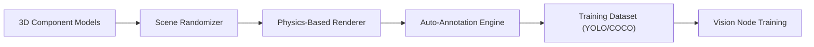

<!-- =============================================================================
HYDRA-UMC-SYNTHETIC-DATA-GEN - Procedural training datasets with exact labels
Copyright (C) JuanenRac (Electro Hobby 3D) <electrohobby3d@gmail.com>
GPL-3.0-or-later - see LICENSE
============================================================================= -->

<p align="center">
  
</p>

# 📸 HYDRA-UMC-SYNTHETIC-DATA-GEN

<p align="center"><a href="README.md">🇺🇸 English</a> | <a href="README_spa.md">🇪🇸 Español</a> | <a href="README_fra.md">🇫🇷 Français</a> | <a href="README_ita.md">🇮🇹 Italiano</a> | <a href="README_deu.md">🇩🇪 Deutsch</a> | <a href="README_zho.md">🇨🇳 简体中文</a> | <a href="README_jpn.md">🇯🇵 日本語</a> | 🇵🇹 <b>Português</b></p>

### 📸 Gerador procedural de conjuntos de dados para o treino do Nó de IA de Visão

<p align="center">
  
  
  
  
  
  
</p>

---

> **Estado de segurança (safety e security):** este ecossistema não é um sistema de segurança certificado. Ainda não existe um caminho de E-STOP por hardware, nem limites ou interlocks impostos pelo firmware, nem um comando de movimento verificado; as imagens de firmware são verificadas com CRC-32 e uma assinatura Ed25519, e uma compilação de versão recusa as chaves de desenvolvimento publicadas (as cabeças de ferramenta e as placas de expansão atrás do relé ainda usam os bootloaders do URTC, que aceitam um HMAC-SHA256 de chave partilhada em vez de uma assinatura); TLS e TLS mútuo são opcionais e estão desativados por defeito; nenhuma placa própria foi ainda montada ou testada. Leia a [base de segurança](https://github.com/JuanenRac/HYDRA-UMC-DOCS/blob/main/docs/SECURITY_BASELINE.md) e o [modelo de ameaças](https://github.com/JuanenRac/HYDRA-UMC-DOCS/blob/main/docs/THREAT_MODEL.md) antes de confiar em qualquer afirmação aqui para a segurança de uma pessoa.

---

## 📋 Num relance

| | |
|---|---|
| Versão | `0.1.1` |
| Maturidade | Estabelecido |
| Testes | 82 (`python -m pytest -q tests`) |
| Tecnologia | Python / procedural scene generation / YOLO/COCO annotation export |
| Destino | O PC de quem o usa |
| Em hardware real | Não aplicável: nada aqui corre em hardware |

**Ir para:** [Visão geral](#-visão-geral) · [Arquitetura](#-arquitetura) · [Início rápido](#-início-rápido) · [Testes](#-testes) · [Estrutura do repositório](#-estrutura-do-repositório) · [Projetos relacionados](#-projetos-relacionados)

## 🚦 Estado do projeto

Cada linha é uma parte deste repositório e a luz diz até onde chega hoje. É escrita com o que o repositório consegue demonstrar (testes, compilações, execuções), não com o que está previsto.

🟢 Feito e verificado · 🟡 Funciona, com limites conhecidos · 🟠 Feito a meio ou ainda por verificar · 🔴 Por fazer ou a não funcionar

| Área | Estado | O que significa aqui |
|---|---|---|
| Software | 🟢 | Completo para o seu propósito e estável; a verificação de honestidade acima lista os limites conhecidos |
| Testes | 🟢 | 82 testes automáticos, executados a cada alteração |
| Hardware real | 🟢 | Não aplicável: nada aqui corre em hardware |
| Documentação | 🟢 | README em oito idiomas, verificado contra o manifesto a cada alteração |

## 🎯 Visão geral

O **HYDRA-UMC-SYNTHETIC-DATA-GEN** é a fábrica de dados do Nó de IA de Visão. Tira partido dos motores de física e renderização do Gémeo Digital para gerar proceduralmente milhares de imagens etiquetadas para treinar redes neuronais.

Resolve o problema do "arranque a frio" para novos componentes industriais ou tipos raros de defeitos com anotação automática de caixas delimitadoras perfeita ao píxel. Os cenários 3D fotorrealistas, as máscaras de segmentação e os pontos-chave são o objetivo quando o próprio motor de física/renderização do HYDRA-UMC-TWIN existir (veja as ressalvas das Funcionalidades principais e a Verificação de honestidade abaixo para o que funciona hoje: renderização 2D real de formas provisórias, não 3D).

### Funcionalidades principais:
* 🎲 **Cenários procedurais (v0):** aleatorização real, determinística por semente, da colocação, tamanho e cor de componentes 2D. *(implementado como formas 2D provisórias reais, ainda não como poses/iluminação/texturas 3D através do motor do HYDRA-UMC-TWIN - veja COMPILAR E EXECUTAR abaixo)*
* 📸 **Renderização multicâmara:** gera vistas simultâneas de mais de 8 câmaras virtuais. *(planeado - precisa do motor de renderização real do HYDRA-UMC-TWIN)*
* 🏷️ **Etiquetagem automática (v0):** exportação real de anotações YOLO e COCO perfeita ao píxel. *(implementado para YOLO/COCO; a exportação TFRecord está planeada)*
* 🛠️ **Injeção de defeitos (v0):** sobreposição real e aleatória de defeitos por componente, a uma probabilidade configurável - ou um retângulo sólido, ou um arranhão real por linha de Bresenham com largura/opacidade aleatórias por ponto. *(implementado - as formas de peça em falta/ponte de soldadura continuam planeadas)*
* 📋 **Manifesto do conjunto de dados e validação (v0):** cada execução de `generate` escreve um `manifest.json` real (bandeira de semente reproduzível, parâmetros de geração e uma soma de verificação sha256 por imagem) e executa uma validação real posterior à geração - verificação dos limites da cena, verificação da integridade do BMP contra a disposição exata de um ficheiro correto e sanidade da distribuição de etiquetas - terminando com código diferente de zero se encontrar algum problema real.
* ✂️ **Divisão em treino, validação e teste:** `generate --split train=0.8,val=0.1,test=0.1` escreve também `train.txt`, `val.txt` e `test.txt`, um `data.yaml` para treinadores YOLO e `splits.json`. A parte de uma cena depende apenas da semente e do índice da cena, cada cena está numa só parte e o `verify` verifica-o. Sem `--split` nada muda.

## 🧩 Papel no HYDRA-UMC

O **HYDRA-UMC-SYNTHETIC-DATA-GEN** escreve pequenos conjuntos de treino para os nós de visão: cenas aleatórias de componentes, com as caixas delimitadoras tiradas das mesmas coordenadas que as desenharam, exportadas como YOLO ou COCO com um manifesto de como o conjunto foi feito. Hoje as cenas são formas 2D planas; a renderização através do Digital Twin está prevista.

## 🏛️ Arquitetura

<p align="center">
  
</p>

<details>
<summary>Versão em texto do diagrama (Mermaid)</summary>



</details>

### ARQUITETURA E DECISÕES DE DESENHO

* **Porque este gerador não tem pastas `hardware/`/`firmware/`/`os/`.** Software puro - renderiza cenas através do motor próprio do HYDRA-UMC-TWIN em vez de possuir qualquer hardware.
* **Porque é irmão, e não um submódulo, do HYDRA-UMC-TWIN.** A geração de conjuntos de dados é uma carga em lote e offline (potencialmente horas de renderização), fundamentalmente diferente do ciclo em tempo real do próprio gémeo - mantê-la separada significa que uma longa exportação nunca compete com a simulação em tempo real pelo tempo de CPU/GPU do mesmo processo.
* **Porque a invocação simples continua a imprimir apenas identidade/versão/papel.** Isso mantém-se como o teste rápido original da fase de andaimes - prova de que o pacote instala e importa limpo. A lógica real de aleatorização procedural / renderização / exportação de anotações vive atrás do subcomando `generate`.
* **Como isto se encaixa no resto do ecossistema.** Produz conjuntos de dados de treino (com anotação automática YOLO/COCO) através do motor próprio do HYDRA-UMC-TWIN, para o HYDRA-UMC-VISION-NODE e o HYDRA-UMC-DETECTION-HEF treinarem contra eles - dados sintéticos em vez de etiquetar à mão imagens de câmaras reais.
* **Porque a v0 renderiza formas 2D provisórias reais em vez de esperar pelo HYDRA-UMC-TWIN.** O HYDRA-UMC-TWIN (o pai de integração deste projeto) é ele próprio ainda uma estrutura base - bloquear a geração de conjuntos de dados por inteiro no seu motor 3D real deixaria por testar o pipeline de anotação (a parte realmente difícil e reutilizável: colocação, etiquetagem, exportação YOLO/COCO). Um rasterizador BMP real, só com a biblioteca padrão, dá hoje uma verdade de referência real e perfeita ao píxel; trocá-lo mais tarde pelo renderizador real do TWIN só muda a forma como os píxeis são pintados, não os contratos de `Scene`/`Component`/exportação.
* **Porque as caixas delimitadoras são perfeitas ao píxel por construção.** O `export.py` lê exatamente as mesmas coordenadas de `Component` que o `scene.py` colocou e o `render.py` pintou - não há nesta v0 nenhum modelo de deteção nem etapa de etiquetagem manual de que as anotações se possam desviar.
* **Porque a validação reutiliza a fórmula de tamanho de linha do `render.py` em vez de um segundo analisador independente.** O `validate_bmp_integrity()` importa diretamente o `_row_size()` do `render.py` em vez de voltar a derivar a matemática de preenchimento de linhas do BMP - uma única fonte de verdade para a disposição exata dos bytes significa que uma alteração real futura ao escritor não pode dessincronizar-se em silêncio do verificador.
* **Porque "reproduzível" é um campo do manifesto e não apenas uma propriedade implícita do `--seed`.** O `--seed` já tornava a geração determinística antes desta alteração, mas nada registava se um dado conjunto de dados em disco usara de facto uma - quem o consumia não tinha forma de distinguir uma execução reproduzível de uma aleatória depois do facto. A bandeira `reproducible` do `manifest.json` mais um sha256 real por imagem torna essa afirmação verificável.

## 🚀 Início rápido

Requer Python 3.10 ou superior.

```bash
./build.sh  # Linux, macOS (build.bat on Windows)
./run.sh generate --out ./out --count 10 --seed 42
./run.sh generate --out ./out --format yolo --defect-rate 0.3
```

## 🧪 Testes

82 testes automáticos correm com `python -m pytest -q tests`. Não precisam de hardware nem de nada fora desta máquina.

A CI executa `HYDRA_UMC_CI=1 python tools/ci_validate.py`, que verifica o manifesto, os documentos, os oito README e as imagens.

## 🏗️ Compilação e publicação

Requer o Python 3.10+.

```bash
# Linux / macOS
./build.sh   # cria o .venv, instala o pacote
             # em modo editável (com extras de desenvolvimento), executa a suite de testes
             # real, verifica a compilação de todo o src/
./run.sh     # executa o ponto de entrada a partir do .venv, imprime nome + versão + papel
```

```bat
:: Windows
build.bat
run.bat
```

O `build.sh`/`build.bat` nunca alteram a versão (só `python tools/hydra_project_tool.py bump` a sobe), verificam a compilação do código-fonte com `python -m compileall` e depois executam a suite de testes real (`pytest tests/`).

O subcomando real `generate` escreve um conjunto de dados real em disco:

```bash
./run.sh generate --out dataset/ --count 20 --components 6 --defect-rate 0.3 --seed 42 --format both

# Windows
run.bat generate --out dataset\ --count 20 --components 6 --defect-rate 0.3 --seed 42 --format both
```

`--jobs N` renderiza as cenas em N processos (por omissão 1): cada cena tem o seu próprio gerador aleatório semeado pela semente e pelo seu índice, por isso o conjunto de dados é o mesmo seja qual for N. O manifesto passa a registar a lista de classes (`classes`) e o seu hash (`classes_sha256`, o sha256 de `classes.txt`) para que quem registe um modelo treinado com o conjunto de dados possa verificar a ordem das classes. `verify --out dataset/` volta a ler uma pasta de conjunto de dados: as imagens contra as somas de verificação do manifesto, as etiquetas YOLO (cinco campos, um id de classe conhecido, tudo dentro de [0, 1]), o ficheiro COCO (ids únicos, caixas dentro da imagem) e o número de etiquetas contra o manifesto; o `generate` faz a mesma verificação à sua própria saída. O renderizador BMP pinta por fatias em vez de pixel a pixel (os mesmos bytes, muito mais rápido em imagens grandes). Testado; a verificação do lado do DETECTION-HEF que compararia o hash ainda não existe.

Escreve imagens BMP reais em `dataset/images/`, etiquetas YOLO reais em `dataset/labels/` + `dataset/classes.txt` e/ou um `dataset/annotations.json` real em formato COCO, consoante o `--format`. Um dado `--seed` torna o conjunto de dados reproduzível byte a byte.

Os argumentos são verificados por intervalo (`--count` 1..10000, `--width`/`--height` 16..4096, `--components` 1..1000, `--defect-rate` 0..1) e as imagens de todo o conjunto de dados estão limitadas a 4 GiB: um comando cujo tamanho estimado ultrapasse esse limite é recusado com o código de saída 2 antes de se escrever o que quer que seja, para que um erro de escrita não possa encher o disco da máquina onde corre.

Cada execução escreve também um `dataset/manifest.json` real e valida a sua própria saída:

```
Generated 20 scene(s) -> dataset/images
Total labeled components (incl. defects): 150
Annotations exported as: both
Reproducible seed: yes (seed=42)
Manifest written -> dataset/manifest.json
Validation: OK (scene bounds, BMP integrity, label distribution)
```

```json
{
  "seed": 42,
  "reproducible": true,
  "count": 20,
  "scenes": [
    { "image": "scene_0000.bmp", "num_components": 7,
      "label_counts": {"bracket": 1, "bolt": 2, "gear": 2, "defect": 1, "connector": 1},
      "sha256": "2301c6974673d9f6a408d7a4b746d236d0ec98b535064884b7a3929645a8f2eb" }
  ],
  "validation_issues": []
}
```

Se a validação encontrar um problema real (um componente fora de intervalo, um BMP truncado/corrompido ou uma taxa de defeitos que se afastou muito do `--defect-rate`), o `generate` termina com `1` e lista todos os problemas em vez de entregar em silêncio um conjunto de dados mau.

## 📂 Estrutura do repositório

<p align="center">
  
</p>

<details>
<summary>Versão em texto da árvore</summary>

```text
HYDRA-UMC-SYNTHETIC-DATA-GEN/
├── src/hydra_umc_synthetic_data_gen/   código-fonte
│   ├── __init__.py                     Versão do pacote
│   ├── scene.py                        Geração procedural real de cenas/componentes 2D
│   ├── render.py                       Rasterização BMP real só com a biblioteca padrão
│   ├── export.py                       Exportação real de anotações YOLO/COCO
│   ├── manifest.py                     manifest.json real do conjunto de dados (semente, somas de verificação)
│   ├── validate.py                     Verificações reais de limites/integridade do BMP/distribuição
│   ├── main.py                         Ponto de entrada + subcomando real `generate`
│   └── verify.py                       Verifica uma pasta de dataset terminada face ao seu próprio manifesto e a si mesma (somas de verificação, etiquetas YOLO, anotações COCO)
├── tests/                              Testes reais: geração, renderização, exportação, CLI de ponta a ponta
├── docs/                               Documentação e guias procedurais
├── images/                             Multimédia e diagramas
├── tools/                              ci_validate.py - validação de manifesto/CHANGELOG/documentação usada pelo CI
├── .github/                            fluxo de CI e modelos de problemas
├── pyproject.toml                      Metadados do pacote, dependências, versão ao estilo conta-quilómetros
├── bump_version.py                     Subida de versão ao estilo conta-quilómetros (executada só pelo comando `bump` explícito)
├── bump_manifest_version.py            Sincroniza a versão do hydra-umc.project.json com a nativa (--sync)
├── build.sh / build.bat                venv + instalação editável (com extras de desenvolvimento) + testes reais + verificação de compilação
├── run.sh / run.bat                    Executa o ponto de entrada a partir do venv local (reencaminha argumentos, por exemplo `generate`)
├── CHANGELOG.md                        o que mudou em cada versão
├── build-test.sh                       verificação de compilação sem alterações
├── hydra-umc.project.json              manifesto: versão, maturidade, família
└── test.sh                             executa os testes
```

</details>

## 🗺️ Roteiro e limites conhecidos

**Limites conhecidos hoje**

* **Fase 1:** Lista de classes fixa e divisões reprodutíveis de treino/validação/teste (a opção `--split` é o primeiro passo).
* **Fase 2:** Máscaras de segmentação a par das caixas delimitadoras.
* **Fase 3:** Anotações de pontos-chave para conjuntos de dados de estimação de pose.
* **Fase 4:** Saída em PNG e integração com o gémeo digital (TWIN) como origem das cenas.

## 🌍 Idiomas

Este README e os documentos do repositório existem em oito idiomas: inglês, espanhol, alemão, francês, italiano, japonês, chinês e português (Portugal). São escritos em conjunto e a CI verifica que os oito ficheiros têm as mesmas secções e as mesmas ligações. Este repositório não tem ecrã nem catálogo de mensagens próprios, por isso não há textos de interface para traduzir.

## 🔗 Projetos relacionados

Este projeto faz parte do ecossistema de robótica HYDRA-UMC do mesmo autor (JuanenRac / Electro Hobby 3D). Vale a pena conhecê-los, porque um pedido pode ser, na verdade, sobre um destes e não sobre este repositório.

**Projeto-mãe**
- **[HYDRA-UMC-TWIN](https://github.com/JuanenRac/HYDRA-UMC-TWIN)** — hub de integração do motor de gémeo digital, com um contrato real de sincronização por compatibilidade de versões; o pai de que este repositório é um serviço de simulação específico, dentro do seu próprio motor de gémeo digital.

**Projetos irmãos** — os outros serviços de simulação do próprio motor de gémeo digital do HYDRA-UMC-TWIN
- **[HYDRA-UMC-PHYSICS-REPLICA](https://github.com/JuanenRac/HYDRA-UMC-PHYSICS-REPLICA)** — cinemática direta real e validação de limites de juntas sobre um subconjunto real de URDF.
- **[HYDRA-UMC-HIL-BRIDGE](https://github.com/JuanenRac/HYDRA-UMC-HIL-BRIDGE)** — encaminhador hardware-in-the-loop com um interlock de software de colisão entre a simulação e o hardware real (testado sem hardware real).

**Diretamente relacionados**
- **[HYDRA-UMC-VISION-NODE](https://github.com/JuanenRac/HYDRA-UMC-VISION-NODE)** — centro de integração do pipeline de visão Hailo-8, com uma verificação real de prontidão de hardware por etapa — treinado com os conjuntos de dados que este projeto gera.
- **[HYDRA-UMC-DETECTION-HEF](https://github.com/JuanenRac/HYDRA-UMC-DETECTION-HEF)** — registo real de modelos compilados com verificação segura de carga por arquitetura Hailo e soma de verificação — treinado com os conjuntos de dados que este projeto gera.

**Também fazem parte do ecossistema**

*Hardware e plataforma centrais*
- **[HYDRA-UMC](https://github.com/JuanenRac/HYDRA-UMC)** — o desenho da placa-mãe do braço robótico: anfitrião CM5 + STM32H745 de dois núcleos, pensado para orquestrar até 8 braços de ferramenta por CAN-OTA/SPI-OTA (firmware numa fase inicial; ainda sem placa montada).
- **[HYDRA-UMC-OS](https://github.com/JuanenRac/HYDRA-UMC-OS)** — camada de produto reproduzível do Raspberry Pi OS para o CM5: agente só de leitura, configuração/perfis validados, aprovisionamento Wi-Fi de primeiro contacto.
- **[HYDRA-UMC-SDK](https://github.com/JuanenRac/HYDRA-UMC-SDK)** — o contrato JSON-Schema partilhado e a fronteira de software de controlo de trabalhos contra a qual cada bridge valida os seus comandos (não é uma função de segurança certificada).
- **[HYDRA-UMC-CONNECTOR-HUB](https://github.com/JuanenRac/HYDRA-UMC-CONNECTOR-HUB)** — registo declarativo de manifestos de adaptador e validador para conectores de máquinas externas; estende a ideia de contrato do SDK a máquinas externas sem substituir os projetos de gateway industrial.

*Backend central e clientes*
- **[HYDRA-UMC-SERVER](https://github.com/JuanenRac/HYDRA-UMC-SERVER)** — o back-end headless real (REST/WebSocket) com que todos os clientes de controlo realmente comunicam.
- **[HYDRA-UMC-STUDIO](https://github.com/JuanenRac/HYDRA-UMC-STUDIO)** — painel web de controlo com visualização 3D em tempo real de vários robôs.
- **[HYDRA-UMC-SUITE](https://github.com/JuanenRac/HYDRA-UMC-SUITE)** — centro de comando de enxame para desktop (PySide6) para vários servidores ao mesmo tempo, empacotado como executável independente.
- **[HYDRA-UMC-ANDROID-CONTROL](https://github.com/JuanenRac/HYDRA-UMC-ANDROID-CONTROL)** — aplicação Android nativa de controlo, com início de sessão biométrico e um companheiro Wear OS emparelhado.
- **[HYDRA-UMC-IOS-CONTROL](https://github.com/JuanenRac/HYDRA-UMC-IOS-CONTROL)** — aplicação de controlo para iOS/iPadOS (Flutter) com sincronização WebSocket em tempo real.
- **[HYDRA-UMC-DSI](https://github.com/JuanenRac/HYDRA-UMC-DSI)** — interface tátil nativa para o ecrã tátil DSI de 7" integrado, executada no próprio CM5.
- **[HYDRA-UMC-EDITOR-URDF](https://github.com/JuanenRac/HYDRA-UMC-EDITOR-URDF)** — criador/editor gráfico de URDF para desktop que envia os modelos concluídos para o catálogo do STUDIO.
- **[HYDRA-UMC-EDITOR-STL](https://github.com/JuanenRac/HYDRA-UMC-EDITOR-STL)** — editor de modelos STL para desktop que transforma/substitui/remove/adiciona peças reais no mesmo catálogo de modelos que o HYDRA-UMC-EDITOR-URDF também edita.
- **[HYDRA-UMC-BRIDGE-AMR](https://github.com/JuanenRac/HYDRA-UMC-BRIDGE-AMR)** — fronteira de coordenação para frotas AGV/AMR através de um publicador MQTT VDA 5050 (testado apenas contra uma frota emulada).
- **[HYDRA-UMC-BRIDGE-CNC](https://github.com/JuanenRac/HYDRA-UMC-BRIDGE-CNC)** — coordenador de células CNC de alto nível com acesso ao estado GRBL e aos bytes de controlo (testado apenas contra um emulador).
- **[HYDRA-UMC-BRIDGE-DROIDS](https://github.com/JuanenRac/HYDRA-UMC-BRIDGE-DROIDS)** — fronteira de coordenação para droides com patas/humanoides, com um emissor de comandos para o Boston Dynamics Spot (testado apenas contra um emulador).
- **[HYDRA-UMC-BRIDGE-LASER](https://github.com/JuanenRac/HYDRA-UMC-BRIDGE-LASER)** — coordenador de células laser que lê 3 sinais GPIO (chave, caixa e interlock) (testado apenas contra um chip simulado; não pode armar nem disparar um laser).
- **[HYDRA-UMC-BRIDGE-OPENPNP](https://github.com/JuanenRac/HYDRA-UMC-BRIDGE-OPENPNP)** — coordenador seguro de fluxo de placa de alto nível para pick-and-place com OpenPnP.
- **[HYDRA-UMC-BRIDGE-PRINTER3D](https://github.com/JuanenRac/HYDRA-UMC-BRIDGE-PRINTER3D)** — fronteira de coordenação segura para impressoras 3D Moonraker/Klipper, com comandos de trabalho reais protegidos por portas.
- **[HYDRA-UMC-BRIDGE-ROS2](https://github.com/JuanenRac/HYDRA-UMC-BRIDGE-ROS2)** — coordenador com um transporte ROS 2 baseado em rclpy importado sob demanda (ainda não executado contra uma instalação ROS 2).
- **[HYDRA-UMC-BRIDGE-UAV](https://github.com/JuanenRac/HYDRA-UMC-BRIDGE-UAV)** — fronteira de coordenação para UAV com câmara, com um emissor de comandos MAVLink (testado apenas contra um emulador).

*Plataforma de ferramentas URTC*
- **[URTC](https://github.com/JuanenRac/URTC)** — firmware da placa física Universal Robot Tool Controller, mais de 25 perfis de ferramenta por barramento CAN.
- **[URTC-FLASHER](https://github.com/JuanenRac/URTC-FLASHER)** — ferramenta gráfica de gravação para desktop das placas URTC, por CAN-OTA e também SWD/JTAG de chip completo.
- **[URTC-TESTER](https://github.com/JuanenRac/URTC-TESTER)** — ferramenta de diagnóstico CAN em tempo real para desktop das placas URTC, com um painel por perfil de ferramenta.
- **[URTC-WEB-STUDIO](https://github.com/JuanenRac/URTC-WEB-STUDIO)** — alternativa no navegador ao URTC-TESTER através da Web Serial API, sem instalação local.
- **[URTC-GATEWAY](https://github.com/JuanenRac/URTC-GATEWAY)** — gateway à frente do barramento CAN do URTC: lista de identificadores permitidos, limite de taxa e chave de sessão; software testado num computador, ainda não num barramento real.

*Nó de IA de visão (Hailo-8)*
- **[HYDRA-UMC-VISION-STREAMER](https://github.com/JuanenRac/HYDRA-UMC-VISION-STREAMER)** — pipeline GStreamer real e gerador de configuração MediaMTX com uma fronteira de integração HailoRT real.
- **[HYDRA-UMC-VISUAL-SERVOING-API](https://github.com/JuanenRac/HYDRA-UMC-VISUAL-SERVOING-API)** — lei de correção de servovisão baseada em posição com autorização condicionada ao estado da zona; ainda sem estimativa de pose por câmara.
- **[HYDRA-UMC-SAFETY-ZONES](https://github.com/JuanenRac/HYDRA-UMC-SAFETY-ZONES)** — lógica v0 de violação de zonas, atualidade da calibração e pedido de E-STOP que lê as posições dos objetos de um ficheiro; nenhum detetor a alimenta e ainda não há E-STOP físico ligado.

*Nó de IA cognitiva (Hailo-10)*
- **[HYDRA-UMC-COGNITIVE-NODE](https://github.com/JuanenRac/HYDRA-UMC-COGNITIVE-NODE)** — centro de integração do pipeline cognitivo do Hailo-10 (orquestração de LLM/VLA/voz).
- **[HYDRA-UMC-VLA-ENGINE](https://github.com/JuanenRac/HYDRA-UMC-VLA-ENGINE)** — codificação/descodificação real de tokens de ação e geração de trajetórias para um modelo Visão-Linguagem-Ação.
- **[HYDRA-UMC-VOICE-UI](https://github.com/JuanenRac/HYDRA-UMC-VOICE-UI)** — front-end de voz real (VAD + analisador de intenções) com um relé para o relógio limitado e protegido por confirmação.
- **[HYDRA-UMC-SEMANTIC-PLANNER](https://github.com/JuanenRac/HYDRA-UMC-SEMANTIC-PLANNER)** — decomposição real de tarefas baseada em regras e recuperação semântica de erros sobre os códigos de erro do MCU.
- **[HYDRA-UMC-DOCS-QA](https://github.com/JuanenRac/HYDRA-UMC-DOCS-QA)** — pesquisa real de documentos TF-IDF só com a biblioteca padrão sobre a documentação Markdown deste ecossistema.
- **[HYDRA-UMC-LOCAL-TECHNICIAN](https://github.com/JuanenRac/HYDRA-UMC-LOCAL-TECHNICIAN)** — técnico de manutenção de IA local, protegido por políticas, para o próprio ecossistema: observa, diagnostica e propõe correções; os dois níveis de maior risco não estão implementados de propósito.

*Orquestração e enxame*
- **[HYDRA-UMC-ORCHESTRATOR](https://github.com/JuanenRac/HYDRA-UMC-ORCHESTRATOR)** — centro de integração com um contrato real de relatório de saúde gRPC/Protobuf e uma máquina de estados de missões.
- **[HYDRA-UMC-JOB-DISPATCHER](https://github.com/JuanenRac/HYDRA-UMC-JOB-DISPATCHER)** — fila real de trabalhos por prioridade com deduplicação, sobre uma API HTTP real.
- **[HYDRA-UMC-NODE-HEALING](https://github.com/JuanenRac/HYDRA-UMC-NODE-HEALING)** — vigilante real de saúde da frota por gRPC com repetição/recuo e deteção de identidade incoerente.
- **[HYDRA-UMC-PATH-PLANNER-3D](https://github.com/JuanenRac/HYDRA-UMC-PATH-PLANNER-3D)** — planeador real de trajetórias 3D baseado em RRT com validação real de colisões com obstáculos e espaço de trabalho.
- **[HYDRA-UMC-SWARM-SYNC](https://github.com/JuanenRac/HYDRA-UMC-SWARM-SYNC)** — sincronização real de estado CRDT LWW-Element-Map, testada por propriedades para a convergência de várias células.

*Dados e análise*
- **[HYDRA-UMC-DATALAKE](https://github.com/JuanenRac/HYDRA-UMC-DATALAKE)** — armazém real de séries temporais sobre sqlite3 com uma API HTTP real de ingestão/consulta.
- **[HYDRA-UMC-ANOMALY-DETECTOR](https://github.com/JuanenRac/HYDRA-UMC-ANOMALY-DETECTOR)** — detetor real de anomalias por FFT e linha de base estatística, com monitorização de deriva.
- **[HYDRA-UMC-PRODUCTION-REPORTS](https://github.com/JuanenRac/HYDRA-UMC-PRODUCTION-REPORTS)** — cálculo real de OEE/disponibilidade sobre o histórico do DATALAKE, com exportação CSV reprodutível.
- **[HYDRA-UMC-TELEMETRY-COLLECTOR](https://github.com/JuanenRac/HYDRA-UMC-TELEMETRY-COLLECTOR)** — pipeline real de ingestão CAN/WebSocket para o DATALAKE, com deduplicação por sequência.

*Gateway industrial*
- **[HYDRA-UMC-GATEWAY-INDUSTRIAL](https://github.com/JuanenRac/HYDRA-UMC-GATEWAY-INDUSTRIAL)** — centro de integração que retransmite para protocolos industriais, com uma camada real de lista de comandos permitidos e contrapressão.
- **[HYDRA-UMC-OPCUA-SERVER](https://github.com/JuanenRac/HYDRA-UMC-OPCUA-SERVER)** — espaço de endereços OPC-UA real, verificado com uma sessão de cliente real do protocolo binário.
- **[HYDRA-UMC-MQTT-BROKER](https://github.com/JuanenRac/HYDRA-UMC-MQTT-BROKER)** — broker MQTT real com autenticação opcional por cliente e ACL de tópicos.
- **[HYDRA-UMC-MTCONNECT-ADAPTER](https://github.com/JuanenRac/HYDRA-UMC-MTCONNECT-ADAPTER)** — endpoints XML MTConnect `/probe` e `/current` reais com saída em modo degradado.

*Ferramentas complementares e operações do ecossistema*
- **[HYDRA-UMC-DASHBOARD-AI](https://github.com/JuanenRac/HYDRA-UMC-DASHBOARD-AI)** — painéis de Resumos Inteligentes e Realce de Anomalias sobre o DATALAKE/ANOMALY-DETECTOR, com um recurso estatístico honesto.
- **[HYDRA-UMC-TOOL-CLI](https://github.com/JuanenRac/HYDRA-UMC-TOOL-CLI)** — CLI da frota com um contrato de códigos de saída real e estável, um cliente vivo genuíno da API do HYDRA-UMC-SERVER.
- **[HYDRA-UMC-WATCH](https://github.com/JuanenRac/HYDRA-UMC-WATCH)** — aplicação companheira WearOS com padrões de alerta tátil e um relé de voz para o telemóvel emparelhado (ainda não executada num relógio físico).
- **[URTC-SMART-RACK](https://github.com/JuanenRac/URTC-SMART-RACK)** — firmware de um rack de montagem de placas com descodificação real do ID da ferramenta e lógica de pré-aquecimento Smart Idle.
- **[URTC-VISION-TOOL](https://github.com/JuanenRac/URTC-VISION-TOOL)** — firmware mais um companheiro de visão em Python real para uma cabeça de ferramenta de inspeção térmica/RGB.
- **[HYDRA-UMC-UPDATER](https://github.com/JuanenRac/HYDRA-UMC-UPDATER)** — ferramenta administrativa de desktop que descobre, clona e atualiza todos os repositórios deste ecossistema.
- **[HYDRA-UMC-OS-REBUILDER](https://github.com/JuanenRac/HYDRA-UMC-OS-REBUILDER)** — ferramenta de desktop para Windows/Linux que constrói uma imagem do CM5 pronta a gravar com as versões mais recentes do ecossistema, com configuração de primeiro arranque de Wi-Fi/utilizador/SSH ao estilo do Raspberry Pi Imager.
- **[HYDRA-UMC-OPS-AGENT](https://github.com/JuanenRac/HYDRA-UMC-OPS-AGENT)** — coordenador de incidentes de manutenção: um papel de borda de poucos privilégios recolhe um inventário/estado higienizado, um papel de plano de controlo mostra-o só de leitura e pede a um fornecedor de IA que sugira um diagnóstico; nunca aplica um patch nem implanta nada.
- **[HYDRA-UMC-DEV-SERVER](https://github.com/JuanenRac/HYDRA-UMC-DEV-SERVER)** — anfitrião de desenvolvimento reproduzível (Raspberry Pi 5 / CM5) que guarda o código-fonte do ecossistema e executa tarefas limitadas de compilação/teste numa fila durável; um papel de desenvolvimento dedicado, explicitamente não um CM5 operacional.

## 📚 Documentação

Onde ler mais:

* [Base de segurança do ecossistema](https://github.com/JuanenRac/HYDRA-UMC-DOCS/blob/main/docs/SECURITY_BASELINE.md)
* [Modelo de ameaças do ecossistema](https://github.com/JuanenRac/HYDRA-UMC-DOCS/blob/main/docs/THREAT_MODEL.md)
* [Registo de alterações deste repositório](CHANGELOG.md)
* [Licença deste repositório](LICENSE.md)

## 🤝 Contribuir e comunidade

* Antes de um pull request execute `HYDRA_UMC_CI=1 py -3 tools/ci_validate.py` (ou `HYDRA_UMC_CI=1 python3 tools/ci_validate.py`): tem de imprimir `CI_VALIDATION=PASS`. Não execute `build.sh` nem `build.bat` para esta verificação; compilar não é verificar.
* Os oito README são escritos a partir de uma única fonte em HYDRA-UMC-DOCS; não os edite à mão. Altere a fonte e escreva-os de novo com `tools/make_readmes.py`.
* Não afirme num README o que não foi executado: diga «simulado» ou «não testado em hardware» quando for a verdade.
* Consulte [CONTRIBUTING.md](CONTRIBUTING.md), o [código de conduta](CODE_OF_CONDUCT.md), [SECURITY.md](SECURITY.md) e [SUPPORT.md](SUPPORT.md).

## 👤 AUTOR

**JuanenRac (Electro Hobby 3D)** · electrohobby3d@gmail.com

## 📜 LICENÇA

GPL-3.0-or-later - [LICENSE](LICENSE).
