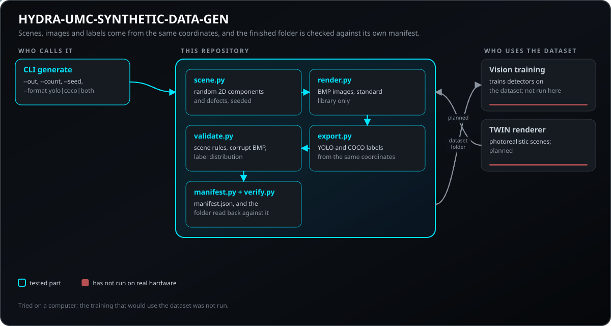
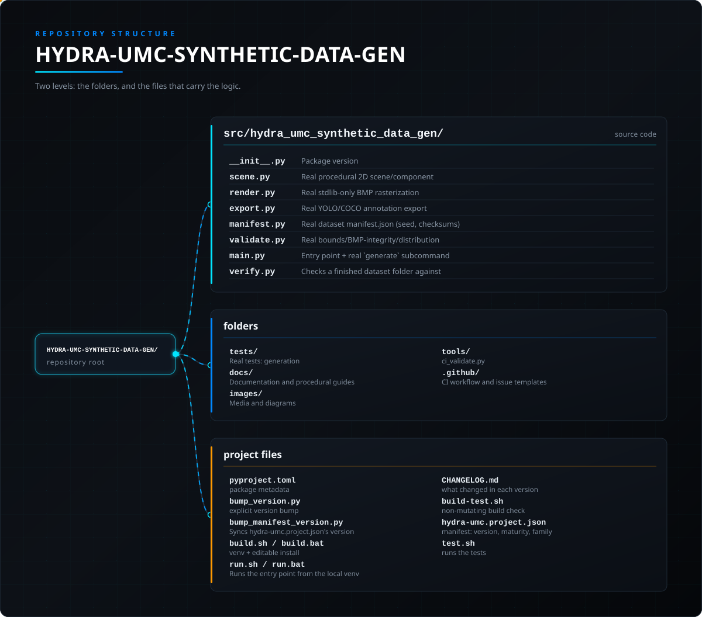

<!-- =============================================================================
HYDRA-UMC-SYNTHETIC-DATA-GEN - Procedural training datasets with exact labels
Copyright (C) JuanenRac (Electro Hobby 3D) <electrohobby3d@gmail.com>
GPL-3.0-or-later - see LICENSE
============================================================================= -->

<p align="center">
  
</p>

# 📸 HYDRA-UMC-SYNTHETIC-DATA-GEN

<p align="center"><a href="README.md">🇺🇸 English</a> | 🇪🇸 <b>Español</b> | <a href="README_fra.md">🇫🇷 Français</a> | <a href="README_ita.md">🇮🇹 Italiano</a> | <a href="README_deu.md">🇩🇪 Deutsch</a> | <a href="README_zho.md">🇨🇳 简体中文</a> | <a href="README_jpn.md">🇯🇵 日本語</a> | <a href="README_por.md">🇵🇹 Português</a></p>

### 📸 Generador de Datasets Procedurales para Entrenamiento del Nodo Vision AI

<p align="center">
  
  
  
  
  
  
</p>

---

> **Estado de seguridad física y de ciberseguridad:** este ecosistema no es un sistema de seguridad certificado. Todavía no existe una ruta de E-STOP por hardware, ni límites ni enclavamientos aplicados por el firmware, ni un comando de movimiento verificado; las imágenes de firmware se comprueban con CRC32 y un HMAC-SHA256 de clave compartida, no con una firma asimétrica; TLS y TLS mutuo son opcionales y están desactivados por defecto; aún no se ha poblado ni probado ninguna placa propia. Lee la [línea base de seguridad](https://github.com/JuanenRac/HYDRA-UMC-DOCS/blob/main/docs/SECURITY_BASELINE.md) y el [modelo de amenazas](https://github.com/JuanenRac/HYDRA-UMC-DOCS/blob/main/docs/THREAT_MODEL.md) antes de fiarte de cualquier afirmación de aquí para la seguridad de una persona.

---

## 📋 De un vistazo

| | |
|---|---|
| Versión | `0.1.1` |
| Madurez | Establecido |
| Tests | 82 (`python -m pytest -q tests`) |
| Tecnología | Python / procedural scene generation / YOLO/COCO annotation export |
| Destino | El PC de quien lo usa |
| En hardware real | No aplica: nada de esto se ejecuta en hardware |

**Ir a:** [Resumen](#-resumen) · [Arquitectura](#-arquitectura) · [Inicio rápido](#-inicio-rápido) · [Pruebas](#-pruebas) · [Estructura del repositorio](#-estructura-del-repositorio) · [Proyectos relacionados](#-proyectos-relacionados)

## 🚦 Estado del proyecto

Cada línea es una parte de este repositorio y la luz dice hasta dónde llega hoy. Se escribe con lo que el repositorio puede demostrar (pruebas, compilaciones, ejecuciones), no con lo previsto.

🟢 Hecho y verificado · 🟡 Funciona, con límites conocidos · 🟠 Hecho a medias o sin verificar · 🔴 Sin hacer o sin funcionar

| Área | Estado | Qué significa aquí |
|---|---|---|
| Software | 🟢 | Completo para su propósito y estable; la comprobación de honestidad de arriba lista los límites conocidos |
| Pruebas | 🟢 | 82 pruebas automáticas, ejecutadas en cada cambio |
| Hardware real | 🟢 | No aplica: nada de esto se ejecuta en hardware |
| Documentación | 🟢 | README en ocho idiomas, comprobado contra el manifiesto en cada cambio |

## 🎯 Resumen

**HYDRA-UMC-SYNTHETIC-DATA-GEN** es la fábrica de datos para el Nodo Vision AI. Aprovecha los motores de física y renderizado del Digital Twin para generar proceduralmente miles de imágenes etiquetadas para el entrenamiento de redes neuronales.

Resuelve el problema del "arranque en frío" para nuevos componentes industriales o tipos de defectos raros con anotación automática de bounding boxes perfecta a nivel de píxel. Los escenarios 3D fotorrealistas, las máscaras de segmentación y los puntos clave son el objetivo una vez exista el motor real de física/renderizado de HYDRA-UMC-TWIN (ver las salvedades de Key Features y la Comprobación de honestidad más abajo para lo que funciona hoy: renderizado real de formas 2D de marcador, no 3D).

### Características Clave:
* 🎲 **Escenarios Procedurales (v0):** Aleatorización real y determinista (con semilla) de la posición, tamaño y color de componentes 2D. *(implementado como formas 2D reales de marcador de posición, todavía no poses/iluminación/texturas 3D a través del motor de HYDRA-UMC-TWIN - ver BUILD Y RUN abajo)*
* 📸 **Renderizado Multi-Cámara:** Genera vistas simultáneas desde más de 8 cámaras virtuales. *(planeado - necesita el motor de renderizado real de HYDRA-UMC-TWIN)*
* 🏷️ **Etiquetado Automático (v0):** Exportación real y perfecta a nivel de píxel en YOLO y COCO. *(implementado para YOLO/COCO; la exportación TFRecord está planeada)*
* 🛠️ **Inyección de Defectos (v0):** Superposición rectangular real y aleatoria por componente, con probabilidad configurable. *(implementado como una superposición real simple - formas reales de arañazo/pieza faltante/puente de soldadura están planeadas)*
* 📋 **Manifiesto de Dataset y Validación (v0):** Cada ejecución de `generate` escribe un `manifest.json` real (semilla reproducible, parámetros de generación y un checksum sha256 real por imagen) y ejecuta una validación real posterior a la generación - límites de escena, integridad BMP contra el layout de archivo real conocido, y sanidad de distribución de etiquetas - saliendo con código distinto de cero si encuentra algún problema real.

## 🧩 Papel en HYDRA-UMC

**HYDRA-UMC-SYNTHETIC-DATA-GEN** escribe pequeños conjuntos de entrenamiento para los nodos de visión: escenas aleatorias de componentes, con las cajas delimitadoras tomadas de las mismas coordenadas que las dibujaron, exportadas como YOLO o COCO junto con un manifiesto de cómo se hizo el conjunto. Hoy las escenas son formas 2D planas; el renderizado con el Digital Twin está previsto.

## 🏛️ Arquitectura

<p align="center">
  
</p>

<details>
<summary>Versión en texto del diagrama (Mermaid)</summary>


</details>

### ARQUITECTURA Y DECISIONES DE DISEÑO

* **Por qué este generador no tiene carpetas `hardware/`/`firmware/`/`os/`.** Software puro - renderiza escenas a través del propio motor de HYDRA-UMC-TWIN en vez de poseer hardware propio.
* **Por qué es hermano, no un submódulo, de HYDRA-UMC-TWIN.** La generación de datasets es una carga de trabajo por lotes, sin conexión (potencialmente horas de renderizado) fundamentalmente distinta del propio bucle en tiempo real del gemelo - mantenerla separada significa que una exportación larga nunca compite con la simulación en tiempo real por la CPU/GPU del mismo proceso.
* **Por qué la invocación simple sigue imprimiendo solo identidad/versión/rol.** Se mantiene como la prueba de humo original de la etapa de andamiaje: comprobar que el paquete se instala e importa limpiamente. La lógica real de aleatorización procedural/renderizado/exportación de anotaciones vive tras el subcomando `generate`.
* **Cómo encaja en el resto del ecosistema.** Renderiza datasets de entrenamiento (con anotación automática YOLO/COCO) a través del propio motor de HYDRA-UMC-TWIN, para que HYDRA-UMC-VISION-NODE y HYDRA-UMC-DETECTION-HEF entrenen con ellos - datos sintéticos en vez de etiquetar a mano vídeo real de cámara.
* **Por qué v0 renderiza formas 2D reales de marcador de posición en vez de esperar a HYDRA-UMC-TWIN.** HYDRA-UMC-TWIN (el propio padre de integración de este proyecto) está todavía en andamiaje - bloquear por completo la generación de datasets a su motor 3D real dejaría sin probar el pipeline de anotación (la parte realmente difícil y reutilizable: colocación, etiquetado, exportación YOLO/COCO). Un rasterizador BMP real, solo con stdlib, da datos reales y perfectos a nivel de píxel hoy; sustituirlo mas adelante por el renderizador real de TWIN solo cambia cómo se pintan los píxeles, no los contratos `Scene`/`Component`/exportación.
* **Por qué las cajas delimitadoras son perfectas a nivel de píxel por construcción.** `export.py` lee las mismas coordenadas exactas de `Component` que `scene.py` colocó y `render.py` pintó - no hay ningún modelo de detección ni paso de etiquetado manual en este bucle de v0 del que las anotaciones puedan desviarse.
* **Por qué la validación reutiliza la propia fórmula de tamaño de fila de `render.py` en vez de un segundo parser independiente.** `validate_bmp_integrity()` importa `_row_size()` de `render.py` directamente en vez de re-derivar el cálculo de relleno de fila BMP - una única fuente de verdad para el layout exacto de bytes evita que un futuro cambio real en el escritor se desincronice silenciosamente del validador.
* **Por qué "reproducible" es un campo del manifiesto y no solo una propiedad implícita de `--seed`.** `--seed` ya hacía la generación determinista antes de este cambio, pero nada registraba si un dataset concreto en disco realmente usó una semilla - un consumidor no tenía forma de distinguir una ejecución reproducible de una aleatoria después del hecho. El campo `reproducible` de `manifest.json` más un sha256 real por imagen hace esa afirmación verificable.

## 🚀 Inicio rápido

Requiere Python 3.10 o superior.

```bash
./build.sh  # Linux, macOS (build.bat on Windows)
./run.sh generate --out ./out --count 10 --seed 42
./run.sh generate --out ./out --format yolo --defect-rate 0.3
```

## 🧪 Pruebas

82 pruebas automáticas se ejecutan con `python -m pytest -q tests`. No necesitan hardware ni nada fuera de esta máquina.

El CI ejecuta `HYDRA_UMC_CI=1 python tools/ci_validate.py`, que comprueba el manifiesto, los documentos, los ocho README y las imágenes.

## 🏗️ Compilación y publicación

Requiere Python 3.10+.

```bash
# Linux / macOS
./build.sh   # crea .venv, instala el
             # paquete en modo editable (con extras de dev), corre la
             # suite de tests real, compile-check de todo src/
./run.sh     # ejecuta el entry point desde .venv, imprime nombre + version + rol
```

```bat
:: Windows
build.bat
run.bat
```

`build.sh`/`build.bat` nunca cambian la versión (solo `python tools/hydra_project_tool.py bump` la sube), hacen compile-check del código fuente con `python -m compileall` y luego corren la suite de tests real (`pytest tests/`).

El subcomando real `generate` escribe un dataset real en disco:

```bash
./run.sh generate --out dataset/ --count 20 --components 6 --defect-rate 0.3 --seed 42 --format both

# Windows
run.bat generate --out dataset\ --count 20 --components 6 --defect-rate 0.3 --seed 42 --format both
```

`--jobs N` renderiza las escenas en N procesos (por defecto 1): cada escena tiene su propio generador aleatorio sembrado con la semilla y su índice, así que el dataset es el mismo sea cual sea N. El manifiesto ahora registra la lista de clases (`classes`) y su hash (`classes_sha256`, el sha256 de `classes.txt`) para que quien registre un modelo entrenado con el dataset pueda comprobar el orden de las clases. `verify --out dataset/` vuelve a leer una carpeta de dataset: las imágenes contra los checksums del manifiesto, las etiquetas YOLO (cinco campos, un id de clase conocido, todo dentro de [0, 1]), el fichero COCO (ids únicos, cajas dentro de la imagen) y el número de etiquetas contra el manifiesto; `generate` ejecuta la misma comprobación sobre su propia salida. El renderizador BMP pinta por rebanadas en vez de por píxel (los mismos bytes, mucho más rápido en imágenes grandes). Probado; la comprobación del lado de DETECTION-HEF que compararía el hash todavía no existe.

Escribe imágenes BMP reales en `dataset/images/`, etiquetas YOLO reales en `dataset/labels/` + `dataset/classes.txt`, y/o un `dataset/annotations.json` real en formato COCO, según `--format`. Una `--seed` dada hace el dataset reproducible byte a byte.

Los argumentos se comprueban por rango (`--count` 1..10000, `--width`/`--height` 16..4096, `--components` 1..1000, `--defect-rate` 0..1) y las imágenes de todo el dataset están limitadas a 4 GiB: un comando cuyo tamaño estimado supere ese límite se rechaza con código de salida 2 antes de escribir nada, de modo que una errata no pueda llenar el disco de la máquina donde se ejecuta.

Cada ejecución también escribe un `dataset/manifest.json` real y valida su propia salida:

```
Generated 20 scene(s) -> dataset/images
Total labeled components (incl. defects): 150
Annotations exported as: both
Reproducible seed: yes (seed=42)
Manifest written -> dataset/manifest.json
Validation: OK (scene bounds, BMP integrity, label distribution)
```

```json
{
  "seed": 42,
  "reproducible": true,
  "count": 20,
  "scenes": [
    { "image": "scene_0000.bmp", "num_components": 7,
      "label_counts": {"bracket": 1, "bolt": 2, "gear": 2, "defect": 1, "connector": 1},
      "sha256": "2301c6974673d9f6a408d7a4b746d236d0ec98b535064884b7a3929645a8f2eb" }
  ],
  "validation_issues": []
}
```

Si la validación encuentra un problema real (un componente fuera de rango, un BMP truncado/corrupto, o una tasa de defectos que se desvía mucho de `--defect-rate`), `generate` sale con código `1` y lista cada problema en vez de entregar silenciosamente un dataset defectuoso.

## 📂 Estructura del repositorio

<p align="center">
  
</p>

<details>
<summary>Versión en texto del árbol</summary>

```text
HYDRA-UMC-SYNTHETIC-DATA-GEN/
├── src/hydra_umc_synthetic_data_gen/   código fuente
│   ├── __init__.py                     Versión del paquete
│   ├── scene.py                        Generación real de escenas/componentes 2D procedurales
│   ├── render.py                       Rasterización real de BMP, solo stdlib
│   ├── export.py                       Exportación real de anotaciones YOLO/COCO
│   ├── manifest.py                     manifest.json real del dataset (semilla, checksums)
│   ├── validate.py                     Validación real de límites/integridad BMP/distribución
│   ├── main.py                         Punto de entrada + subcomando real `generate`
│   └── verify.py                       Comprueba una carpeta de dataset terminada contra su propio manifiesto y contra sí misma (sumas de control, etiquetas YOLO, anotaciones COCO)
├── tests/                              Tests reales: generación, renderizado, exportación, CLI end-to-end
├── docs/                               Documentación y guías procedurales
├── images/                             Medios y diagramas
├── tools/                              ci_validate.py - validación de manifest/CHANGELOG/docs usada por la CI
├── .github/                            flujo de CI y plantillas de incidencias
├── pyproject.toml                      Metadatos del paquete, dependencias, version cuentakilometros
├── bump_version.py                     Incremento de versión tipo cuentakilómetros (solo lo ejecuta el comando `bump` explícito)
├── bump_manifest_version.py            Sincroniza la versión de hydra-umc.project.json con la nativa (--sync)
├── build.sh / build.bat                venv + instalación editable (con extras de dev) + tests reales + compile-check
├── run.sh / run.bat                    Ejecuta el entry point desde el venv local (reenvia argumentos, ej. `generate`)
├── CHANGELOG.md                        qué cambió en cada versión
├── build-test.sh                       comprobación de compilación sin cambios
├── hydra-umc.project.json              manifiesto: versión, madurez, familia
└── test.sh                             ejecuta las pruebas
```

</details>

## 🗺️ Hoja de ruta y límites conocidos

**Límites conocidos hoy**

* **Fase 1:** Sincronización de Digital Twin con telemetría de hardware en tiempo real y latencia sub-10ms.
* **Fase 2:** Integración de Physics Replica con simuladores de grado industrial (Isaac Sim) y soporte para cuerpos deformables.
* **Fase 3:** Patrones de recuperación automatizados de Node Healing para failover descentralizado y detección temprana de degradación de sensores.
* **Fase 4:** Refinamiento de texturas basado en GAN para materiales industriales hiperrealistas y generación de datasets fotorrealistas.

## 🌍 Idiomas

Este README y los documentos del repositorio existen en ocho idiomas: inglés, español, alemán, francés, italiano, japonés, chino y portugués (Portugal). Se escriben a la vez y el CI comprueba que los ocho ficheros tengan las mismas secciones y los mismos enlaces. Este repositorio no tiene pantalla ni catálogo de mensajes propios, así que no hay cadenas de interfaz que traducir.

## 🔗 Proyectos relacionados

Este proyecto es parte del ecosistema de robótica HYDRA-UMC del mismo autor (JuanenRac / Electro Hobby 3D). Vale la pena conocerlo, ya que una petición podría en realidad ser sobre alguno de estos en vez de sobre este repositorio.

**Proyecto Padre**
- **[HYDRA-UMC-TWIN](https://github.com/JuanenRac/HYDRA-UMC-TWIN)** — nodo de integración para el motor de gemelo digital, con un contrato real de sincronización por compatibilidad de versión; el padre del que este repositorio es un servicio de simulación específico, dentro de su propio motor de gemelo digital.

**Proyectos Hermanos** — los demás servicios de simulación del propio motor de gemelo digital de HYDRA-UMC-TWIN
- **[HYDRA-UMC-PHYSICS-REPLICA](https://github.com/JuanenRac/HYDRA-UMC-PHYSICS-REPLICA)** — cinemática directa real y validación de límites articulares sobre un subconjunto real de URDF.
- **[HYDRA-UMC-HIL-BRIDGE](https://github.com/JuanenRac/HYDRA-UMC-HIL-BRIDGE)** — enrutador hardware-in-the-loop con un enclavamiento de software por colisión entre simulación y hardware real (probado sin hardware real).

**Directamente Relacionados**
- **[HYDRA-UMC-VISION-NODE](https://github.com/JuanenRac/HYDRA-UMC-VISION-NODE)** — nodo de integración para el pipeline de visión Hailo-8, con una comprobación real de disponibilidad de hardware por etapa — entrenado con los conjuntos de datos que este proyecto genera.
- **[HYDRA-UMC-DETECTION-HEF](https://github.com/JuanenRac/HYDRA-UMC-DETECTION-HEF)** — registro real de modelos compilados con verificación de carga segura por arquitectura Hailo/checksum — entrenado con los conjuntos de datos que este proyecto genera.

**También Forma Parte del Ecosistema**

*Hardware y Plataforma Base*
- **[HYDRA-UMC](https://github.com/JuanenRac/HYDRA-UMC)** — el diseño de la placa madre del brazo robótico: host CM5 + coprocesador STM32H745 de doble núcleo, pensado para coordinar hasta 8 brazos herramienta por CAN-OTA/SPI-OTA (firmware en fase temprana; todavía no hay ninguna placa poblada).
- **[HYDRA-UMC-OS](https://github.com/JuanenRac/HYDRA-UMC-OS)** — capa de producto reproducible sobre Raspberry Pi OS para el CM5: agente de solo lectura, config/perfiles validados, aprovisionamiento WiFi de primer contacto.
- **[HYDRA-UMC-SDK](https://github.com/JuanenRac/HYDRA-UMC-SDK)** — el contrato JSON-Schema compartido y la barrera de software de puerta de trabajos contra la que cada bridge valida sus comandos (no es una función de seguridad certificada).
- **[HYDRA-UMC-CONNECTOR-HUB](https://github.com/JuanenRac/HYDRA-UMC-CONNECTOR-HUB)** — registro declarativo y validador de manifiestos de adaptador para conectores de máquinas externas; extiende la propia idea de contrato del SDK a máquinas externas sin sustituir a los proyectos de pasarela industrial.

*Backend Central y Clientes*
- **[HYDRA-UMC-SERVER](https://github.com/JuanenRac/HYDRA-UMC-SERVER)** — el backend headless real (REST/WebSocket) con el que habla de verdad cada cliente de control.
- **[HYDRA-UMC-STUDIO](https://github.com/JuanenRac/HYDRA-UMC-STUDIO)** — panel de control web con visualización 3D multi-robot en tiempo real.
- **[HYDRA-UMC-SUITE](https://github.com/JuanenRac/HYDRA-UMC-SUITE)** — centro de mando de enjambre de escritorio (PySide6) para varios servidores a la vez, empaquetado como ejecutable independiente.
- **[HYDRA-UMC-ANDROID-CONTROL](https://github.com/JuanenRac/HYDRA-UMC-ANDROID-CONTROL)** — app nativa de control para Android con inicio de sesión biométrico y un compañero Wear OS emparejado.
- **[HYDRA-UMC-IOS-CONTROL](https://github.com/JuanenRac/HYDRA-UMC-IOS-CONTROL)** — app de control para iOS/iPadOS (Flutter) con sincronización en tiempo real por WebSocket.
- **[HYDRA-UMC-DSI](https://github.com/JuanenRac/HYDRA-UMC-DSI)** — interfaz táctil nativa para la pantalla táctil DSI de 7" a bordo, embebida en el propio CM5.
- **[HYDRA-UMC-EDITOR-URDF](https://github.com/JuanenRac/HYDRA-UMC-EDITOR-URDF)** — creador/editor gráfico de URDF de escritorio que envía los modelos terminados al propio catálogo de STUDIO.
- **[HYDRA-UMC-EDITOR-STL](https://github.com/JuanenRac/HYDRA-UMC-EDITOR-STL)** — editor de escritorio de modelos STL, que transforma/reemplaza/quita/añade piezas reales en el mismo catálogo de modelos que también edita HYDRA-UMC-EDITOR-URDF.
- **[HYDRA-UMC-BRIDGE-AMR](https://github.com/JuanenRac/HYDRA-UMC-BRIDGE-AMR)** — barrera de coordinación para flotas AGV/AMR mediante un publicador MQTT VDA 5050 (probado solo contra una flota emulada).
- **[HYDRA-UMC-BRIDGE-CNC](https://github.com/JuanenRac/HYDRA-UMC-BRIDGE-CNC)** — coordinador de alto nivel para celdas CNC con acceso a estado/bytes de control GRBL (probado solo contra un emulador).
- **[HYDRA-UMC-BRIDGE-DROIDS](https://github.com/JuanenRac/HYDRA-UMC-BRIDGE-DROIDS)** — barrera de coordinación para droides con patas/humanoides, con un emisor de comandos para Boston Dynamics Spot (probado solo contra un emulador).
- **[HYDRA-UMC-BRIDGE-LASER](https://github.com/JuanenRac/HYDRA-UMC-BRIDGE-LASER)** — coordinador de celdas láser que lee 3 señales GPIO de llave/carcasa/enclavamiento (probado solo contra un chip simulado; no puede armar ni disparar un láser).
- **[HYDRA-UMC-BRIDGE-OPENPNP](https://github.com/JuanenRac/HYDRA-UMC-BRIDGE-OPENPNP)** — coordinador de alto nivel seguro para el flujo de placas de pick-and-place OpenPnP.
- **[HYDRA-UMC-BRIDGE-PRINTER3D](https://github.com/JuanenRac/HYDRA-UMC-BRIDGE-PRINTER3D)** — barrera de coordinación segura para impresoras 3D Moonraker/Klipper, con comandos de trabajo reales y controlados.
- **[HYDRA-UMC-BRIDGE-ROS2](https://github.com/JuanenRac/HYDRA-UMC-BRIDGE-ROS2)** — coordinador con un transporte ROS 2 rclpy importado de forma perezosa (todavía no ejecutado contra una instalación de ROS 2).
- **[HYDRA-UMC-BRIDGE-UAV](https://github.com/JuanenRac/HYDRA-UMC-BRIDGE-UAV)** — barrera de coordinación para UAV equipados con cámara, con un emisor de comandos MAVLink (probado solo contra un emulador).

*Plataforma de Herramientas URTC*
- **[URTC](https://github.com/JuanenRac/URTC)** — firmware para la placa física del Universal Robot Tool Controller, más de 25 perfiles de herramienta por bus CAN.
- **[URTC-FLASHER](https://github.com/JuanenRac/URTC-FLASHER)** — herramienta de escritorio con GUI para flashear placas URTC, CAN-OTA más SWD/JTAG de chip completo.
- **[URTC-TESTER](https://github.com/JuanenRac/URTC-TESTER)** — herramienta de escritorio de diagnóstico CAN-bus en vivo para placas URTC, un panel por perfil de herramienta.
- **[URTC-WEB-STUDIO](https://github.com/JuanenRac/URTC-WEB-STUDIO)** — alternativa basada en navegador a URTC-TESTER mediante la Web Serial API, sin instalación local.
- **[URTC-GATEWAY](https://github.com/JuanenRac/URTC-GATEWAY)** — pasarela delante del bus CAN de URTC: lista de identificadores permitidos, límite de tasa y clave de sesión; software probado en ordenador, aún no en un bus real.

*Nodo IA de Visión (Hailo-8)*
- **[HYDRA-UMC-VISION-STREAMER](https://github.com/JuanenRac/HYDRA-UMC-VISION-STREAMER)** — generador real de pipeline GStreamer + config MediaMTX, con una frontera de integración HailoRT real.
- **[HYDRA-UMC-VISUAL-SERVOING-API](https://github.com/JuanenRac/HYDRA-UMC-VISUAL-SERVOING-API)** — ley de corrección Position-Based Visual Servoing con autorización condicionada al estado de zona; todavía sin estimación de pose por cámara.
- **[HYDRA-UMC-SAFETY-ZONES](https://github.com/JuanenRac/HYDRA-UMC-SAFETY-ZONES)** — lógica v0 de invasión de zona, vigencia de calibración y solicitud de E-STOP que toma las posiciones de los objetos de un fichero; ningún detector la alimenta y todavía no hay un E-STOP físico conectado.

*Nodo IA Cognitivo (Hailo-10)*
- **[HYDRA-UMC-COGNITIVE-NODE](https://github.com/JuanenRac/HYDRA-UMC-COGNITIVE-NODE)** — nodo de integración para el pipeline cognitivo Hailo-10 (orquestación de LLM/VLA/voz).
- **[HYDRA-UMC-VLA-ENGINE](https://github.com/JuanenRac/HYDRA-UMC-VLA-ENGINE)** — codificación/decodificación real de tokens de acción y generación de trayectoria para un modelo Vision-Language-Action.
- **[HYDRA-UMC-VOICE-UI](https://github.com/JuanenRac/HYDRA-UMC-VOICE-UI)** — front-end de voz real (VAD + analizador de intención) con un relé a Watch acotado y con confirmación.
- **[HYDRA-UMC-SEMANTIC-PLANNER](https://github.com/JuanenRac/HYDRA-UMC-SEMANTIC-PLANNER)** — descomposición real de tareas basada en reglas y recuperación semántica de errores sobre códigos de error del MCU.
- **[HYDRA-UMC-DOCS-QA](https://github.com/JuanenRac/HYDRA-UMC-DOCS-QA)** — búsqueda real de documentos TF-IDF (solo librería estándar) sobre los propios documentos Markdown de este ecosistema.
- **[HYDRA-UMC-LOCAL-TECHNICIAN](https://github.com/JuanenRac/HYDRA-UMC-LOCAL-TECHNICIAN)** — técnico de mantenimiento con IA local y con puertas de política para el propio ecosistema - observa, diagnostica y propone arreglos; los dos niveles de riesgo más altos están deliberadamente sin implementar todavía.

*Orquestación y Enjambre*
- **[HYDRA-UMC-ORCHESTRATOR](https://github.com/JuanenRac/HYDRA-UMC-ORCHESTRATOR)** — nodo de integración con un contrato real de informe de salud gRPC/Protobuf y una máquina de estados de misión.
- **[HYDRA-UMC-JOB-DISPATCHER](https://github.com/JuanenRac/HYDRA-UMC-JOB-DISPATCHER)** — cola de trabajos real basada en prioridad con deduplicación, sobre una API HTTP real.
- **[HYDRA-UMC-NODE-HEALING](https://github.com/JuanenRac/HYDRA-UMC-NODE-HEALING)** — watchdog de salud de flota real basado en gRPC, con reintento/backoff y detección de discrepancia de identidad.
- **[HYDRA-UMC-PATH-PLANNER-3D](https://github.com/JuanenRac/HYDRA-UMC-PATH-PLANNER-3D)** — planificador de rutas 3D real basado en RRT, con validación real de colisión de obstáculos/espacio de trabajo.
- **[HYDRA-UMC-SWARM-SYNC](https://github.com/JuanenRac/HYDRA-UMC-SWARM-SYNC)** — sincronización de estado real mediante CRDT LWW-Element-Map, con pruebas de propiedades para convergencia multi-celda.

*Datos y Analítica*
- **[HYDRA-UMC-DATALAKE](https://github.com/JuanenRac/HYDRA-UMC-DATALAKE)** — almacén de series temporales real respaldado por sqlite3, con una API HTTP real de ingesta/consulta.
- **[HYDRA-UMC-ANOMALY-DETECTOR](https://github.com/JuanenRac/HYDRA-UMC-ANOMALY-DETECTOR)** — detector de anomalías real basado en FFT + línea base estadística, con monitorización de deriva.
- **[HYDRA-UMC-PRODUCTION-REPORTS](https://github.com/JuanenRac/HYDRA-UMC-PRODUCTION-REPORTS)** — cálculo real de OEE/disponibilidad sobre el histórico de DATALAKE, con exportación CSV reproducible.
- **[HYDRA-UMC-TELEMETRY-COLLECTOR](https://github.com/JuanenRac/HYDRA-UMC-TELEMETRY-COLLECTOR)** — pipeline real de ingesta CAN/WebSocket hacia DATALAKE, con deduplicación por secuencia.

*Pasarela Industrial*
- **[HYDRA-UMC-GATEWAY-INDUSTRIAL](https://github.com/JuanenRac/HYDRA-UMC-GATEWAY-INDUSTRIAL)** — nodo de integración que retransmite a protocolos industriales, con una capa real de lista blanca de comandos/contrapresión.
- **[HYDRA-UMC-OPCUA-SERVER](https://github.com/JuanenRac/HYDRA-UMC-OPCUA-SERVER)** — espacio de direcciones OPC-UA real, verificado con una sesión de cliente real del protocolo binario.
- **[HYDRA-UMC-MQTT-BROKER](https://github.com/JuanenRac/HYDRA-UMC-MQTT-BROKER)** — broker MQTT real con autenticación por cliente opcional y ACL de tópicos.
- **[HYDRA-UMC-MTCONNECT-ADAPTER](https://github.com/JuanenRac/HYDRA-UMC-MTCONNECT-ADAPTER)** — endpoints XML reales `/probe` y `/current` de MTConnect, con salida en modo degradado.

*Herramientas Complementarias y Operaciones del Ecosistema*
- **[HYDRA-UMC-DASHBOARD-AI](https://github.com/JuanenRac/HYDRA-UMC-DASHBOARD-AI)** — paneles de Resúmenes Inteligentes y Resaltado de Anomalías sobre DATALAKE/ANOMALY-DETECTOR, con un respaldo estadístico honesto.
- **[HYDRA-UMC-TOOL-CLI](https://github.com/JuanenRac/HYDRA-UMC-TOOL-CLI)** — CLI de flota con un contrato real y estable de códigos de salida, cliente real y en vivo de la propia API de HYDRA-UMC-SERVER.
- **[HYDRA-UMC-WATCH](https://github.com/JuanenRac/HYDRA-UMC-WATCH)** — app compañera de WearOS con patrones de alerta háptica y un relé de voz al teléfono emparejado (todavía no ejecutada en un reloj físico).
- **[URTC-SMART-RACK](https://github.com/JuanenRac/URTC-SMART-RACK)** — firmware para un rack de montaje de placas con decodificación real de ID de herramienta y lógica de precalentamiento Smart Idle.
- **[URTC-VISION-TOOL](https://github.com/JuanenRac/URTC-VISION-TOOL)** — firmware más un compañero de visión real en Python para un cabezal de inspección térmica/RGB.
- **[HYDRA-UMC-UPDATER](https://github.com/JuanenRac/HYDRA-UMC-UPDATER)** — herramienta administrativa de escritorio que descubre, clona y actualiza cada repositorio de este ecosistema.
- **[HYDRA-UMC-OS-REBUILDER](https://github.com/JuanenRac/HYDRA-UMC-OS-REBUILDER)** — herramienta de escritorio Windows/Linux que construye una imagen de la CM5 lista para grabar, precargada con las versiones más actuales del ecosistema, con configuración de primer arranque de Wi-Fi/usuario/SSH al estilo de Raspberry Pi Imager.
- **[HYDRA-UMC-OPS-AGENT](https://github.com/JuanenRac/HYDRA-UMC-OPS-AGENT)** — coordinador de incidencias de mantenimiento: un rol edge de bajo privilegio recopila un snapshot de inventario/salud saneado, un rol control-plane lo renderiza de solo lectura y pide a un proveedor de IA que sugiera un diagnóstico - nunca aplica un parche ni despliega nada.
- **[HYDRA-UMC-DEV-SERVER](https://github.com/JuanenRac/HYDRA-UMC-DEV-SERVER)** — host de desarrollo reproducible (Raspberry Pi 5 / CM5) que almacena el código del ecosistema y ejecuta tareas acotadas de compilación/pruebas bajo una cola duradera; un rol de desarrollo dedicado, explícitamente distinto de un CM5 operativo.

## 📚 Documentación

Dónde leer más:

* [Base de seguridad del ecosistema](https://github.com/JuanenRac/HYDRA-UMC-DOCS/blob/main/docs/SECURITY_BASELINE.md)
* [Modelo de amenazas del ecosistema](https://github.com/JuanenRac/HYDRA-UMC-DOCS/blob/main/docs/THREAT_MODEL.md)
* [Historial de cambios de este repositorio](CHANGELOG.md)
* [Licencia de este repositorio](LICENSE.md)

## 🤝 Contribuir y comunidad

* Antes de un pull request ejecuta `HYDRA_UMC_CI=1 py -3 tools/ci_validate.py` (o `HYDRA_UMC_CI=1 python3 tools/ci_validate.py`): debe imprimir `CI_VALIDATION=PASS`. No ejecutes `build.sh` ni `build.bat` para esta comprobación; compilar no es comprobar.
* Los ocho README se escriben desde una sola fuente en HYDRA-UMC-DOCS; no los edites a mano. Cambia la fuente y vuelve a escribirlos con `tools/make_readmes.py`.
* No afirmes en un README lo que no se ha ejecutado: di «simulado» o «sin probar en hardware» cuando esa sea la verdad.
* Mira [CONTRIBUTING.md](CONTRIBUTING.md), el [código de conducta](CODE_OF_CONDUCT.md), [SECURITY.md](SECURITY.md) y [SUPPORT.md](SUPPORT.md).

## 👤 AUTOR

**JuanenRac (Electro Hobby 3D)** · electrohobby3d@gmail.com

## 📜 LICENCIA

GPL-3.0-or-later - [LICENSE](LICENSE).
