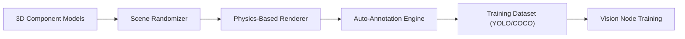

<!-- =============================================================================
HYDRA-UMC-SYNTHETIC-DATA-GEN - Procedural training datasets with exact labels
Copyright (C) JuanenRac (Electro Hobby 3D) <electrohobby3d@gmail.com>
GPL-3.0-or-later - see LICENSE
============================================================================= -->

<p align="center">
  
</p>

# 📸 HYDRA-UMC-SYNTHETIC-DATA-GEN

<p align="center"><a href="README.md">🇺🇸 English</a> | <a href="README_spa.md">🇪🇸 Español</a> | <a href="README_fra.md">🇫🇷 Français</a> | <a href="README_ita.md">🇮🇹 Italiano</a> | <a href="README_deu.md">🇩🇪 Deutsch</a> | 🇨🇳 <b>简体中文</b> | <a href="README_jpn.md">🇯🇵 日本語</a> | <a href="README_por.md">🇵🇹 Português</a></p>

### 📸 面向视觉 AI 节点训练的程序化数据集生成器

<p align="center">
  
  
  
  
  
  
</p>

---

> **安全与安防现状:**本生态系统不是经认证的安全系统。目前尚无硬件 E-STOP 通路,没有由固件强制执行的限位或联锁,也没有经过验证的运动指令;固件映像使用 CRC-32 和 Ed25519 签名校验,发布构建会拒绝已公开的开发密钥(中继之后的工具头和扩展板仍运行 URTC 的引导程序,它们使用共享密钥的 HMAC-SHA256 而不是签名);TLS 与双向 TLS 均为可选项,默认关闭;自制电路板尚未组装或测试。在依赖此处任何说法来保障人身安全之前,请先阅读[安全基线](https://github.com/JuanenRac/HYDRA-UMC-DOCS/blob/main/docs/SECURITY_BASELINE.md)和[威胁模型](https://github.com/JuanenRac/HYDRA-UMC-DOCS/blob/main/docs/THREAT_MODEL.md)。

---

## 📋 速览

| | |
|---|---|
| 版本 | `0.1.2` |
| 成熟度 | 成熟 |
| 测试 | 82 (`python -m pytest -q tests`) |
| 技术栈 | Python / procedural scene generation / YOLO/COCO annotation export |
| 目标 | 使用者的电脑 |
| 真实硬件 | 不适用：这里的内容不在硬件上运行 |

**跳转：** [概述](#-概述) · [架构](#-架构) · [快速开始](#-快速开始) · [测试](#-测试) · [仓库结构](#-仓库结构) · [相关项目](#-相关项目)

## 🚦 项目状态

每一行是本仓库的一个部分，灯号表示它今天做到了哪一步。内容依据仓库能够展示的证据（测试、构建、运行），而不是计划。

🟢 已完成并验证 · 🟡 可用，有已知限制 · 🟠 部分完成或尚未验证 · 🔴 未完成或不可用

| 领域 | 状态 | 在这里的含义 |
|---|---|---|
| 软件 | 🟢 | 就其用途而言已完整且稳定；上面的诚实性检查列出了已知限制 |
| 测试 | 🟢 | 82 项自动测试，每次变更都会运行 |
| 真实硬件 | 🟢 | 不适用：这里的内容不在硬件上运行 |
| 文档 | 🟢 | 八种语言的 README，每次变更都会与清单核对 |

## 🎯 概述

**HYDRA-UMC-SYNTHETIC-DATA-GEN** 是视觉 AI 节点的数据工厂。它利用数字
孪生系统的物理和渲染引擎，程序化地生成数千张带标注的图像，用于训练神经
网络。

它通过自动像素级精确的边界框标注，解决了新工业组件或罕见缺陷类型的
"冷启动"问题。照片级真实的 3D 场景、分割掩码和关键点是未来目标——一旦
HYDRA-UMC-TWIN 自身真正的物理/渲染引擎存在即可实现(今天真正能运行的
部分请见下方"关键特性"的说明和"诚实核查"：真实的 2D 占位形状渲染，
而非 3D)。

### 关键特性：
* 🎲 **程序化场景（v0）：** 真实的、确定性的（给定种子）2D 组件位置、大小和颜色的随机化。*（已实现为真实的 2D 占位形状，尚非通过 HYDRA-UMC-TWIN 引擎实现的 3D 姿态/光照/纹理——见下方"构建与发布"）*
* 📸 **多摄像头渲染：** 同时从 8 个以上虚拟摄像头生成视图。*（计划中——需要 HYDRA-UMC-TWIN 的真实渲染引擎）*
* 🏷️ **自动标注（v0）：** 真实的、像素级精确的 YOLO 和 COCO 导出。*（已为 YOLO/COCO 实现；TFRecord 导出计划中）*
* 🛠️ **缺陷注入（v0）：** 每个组件真实的、随机的矩形叠加，概率可配置。*（已实现为简单的真实叠加——真实的划痕/缺失部件/焊桥形状计划中）*
* 📋 **数据集清单与验证（v0）：** 每次 `generate` 运行都会写入一个真实的 `manifest.json`（可复现种子标志、生成参数，以及每张图像真实的 sha256 校验和），并运行真实的生成后验证——场景边界、针对已知真实文件布局的 BMP 完整性、以及标签分布的合理性——若发现任何真实问题，则以非零退出码退出。
* ✂️ **训练、验证和测试划分:** `generate --split train=0.8,val=0.1,test=0.1` 还会写出 `train.txt`、`val.txt`、`test.txt`、供 YOLO 训练器使用的 `data.yaml` 以及 `splits.json`。场景属于哪一部分只取决于种子和场景序号，每个场景恰好属于一部分，`verify` 会检查这一点。不加 `--split` 则一切照旧。

## 🧩 在 HYDRA-UMC 中的角色

**HYDRA-UMC-SYNTHETIC-DATA-GEN** 为视觉节点写出小型训练数据集：随机的元件场景，边界框取自绘制它们的同一组坐标，以 YOLO 或 COCO 导出，并附带说明数据集如何生成的清单。目前场景是平面的 2D 形状；通过 Digital Twin 渲染还在计划中。

## 🏛️ 架构

<p align="center">
  
</p>

<details>
<summary>图表的文本版本（Mermaid）</summary>



</details>

### 架构与设计决策

* **为何本生成器没有 `hardware/`/`firmware/`/`os/` 文件夹。** 纯软件——它通过 HYDRA-UMC-TWIN 自身的引擎渲染场景，而非自己拥有任何硬件。
* **为何它是 HYDRA-UMC-TWIN 的兄弟项目，而非子模块。** 数据集生成是一项批量的、离线的工作负载（可能需要数小时的渲染时间），与孪生系统自身的实时循环有本质区别——将其保持独立，意味着一次长时间的导出运行永远不会与实时仿真争夺同一进程的 CPU/GPU 时间。
* **为何裸调用如今仍只打印身份/版本/角色。** 这保留了脚手架阶段最初的冒烟测试：证明该包能够正确安装并被导入。真正的程序化随机化/渲染/标注导出逻辑位于 `generate` 子命令之后。
* **这如何融入生态系统的其余部分。** 通过 HYDRA-UMC-TWIN 自身的引擎渲染训练数据集（带自动 YOLO/COCO 标注），供 HYDRA-UMC-VISION-NODE 和 HYDRA-UMC-DETECTION-HEF 用于训练——以合成数据取代手动标注真实摄像头画面。
* **为何 v0 渲染真实的 2D 占位形状，而不是等待 HYDRA-UMC-TWIN。** HYDRA-UMC-TWIN（本项目自身的集成父项目）本身仍处于脚手架阶段——如果将数据集生成完全阻塞在它的真实 3D 引擎上，标注流水线（真正困难、可复用的部分：放置、标注、YOLO/COCO 导出）就得不到测试。一个真实的、仅依赖标准库的 BMP 光栅化器如今就能提供真实的、像素级精确的真值数据；日后替换为 TWIN 的真实引擎，改变的只是像素如何被绘制，而不是 `Scene`/`Component`/导出的契约。
* **为何边界框在构造上就是像素级精确的。** `export.py` 读取的正是 `scene.py` 放置、`render.py` 绘制的同一组 `Component` 坐标——这个 v0 循环中没有任何检测模型，也没有任何人工标注步骤，标注不会有偏差的来源。
* **为何验证复用 `render.py` 自身的行大小公式，而非使用第二个独立的解析器。** `validate_bmp_integrity()` 直接从 `render.py` 导入 `_row_size()`，而不是重新推导 BMP 行填充计算——对确切字节布局采用单一事实来源，可避免未来对写入器的真实改动在无声中与校验器失步。
* **为何“可复现”是清单中的一个字段，而不仅是 `--seed` 隐含的一种属性。** 在此改动之前，`--seed` 已经使生成过程具有确定性，但没有任何记录能说明磁盘上某个数据集是否真的使用了种子——消费者事后无法区分一次可复现的运行和一次随机的运行。`manifest.json` 的 `reproducible` 标志加上每张图像真实的 sha256，使这一断言变得可核实。

## 🚀 快速开始

需要 Python 3.10 或更高版本。

```bash
./build.sh  # Linux, macOS (build.bat on Windows)
./run.sh generate --out ./out --count 10 --seed 42
./run.sh generate --out ./out --format yolo --defect-rate 0.3
```

## 🧪 测试

运行 `python -m pytest -q tests` 会执行 82 个自动测试。 不需要硬件，也不需要这台机器以外的任何东西。

CI 运行 `HYDRA_UMC_CI=1 python tools/ci_validate.py`，检查清单、文档、八个 README 和图片。

## 🏗️ 构建与发布

需要 Python 3.10+。

```bash
# Linux / macOS
./build.sh   # ，创建 .venv，以可编辑模式（含 dev 附加
             # 依赖）安装该包，运行真实测试套件，对整个 src/ 进行编译检查
./run.sh     # 从 .venv 运行入口点，打印名称 + 版本 + 角色
```

```bat
:: Windows
build.bat
run.bat
```

`build.sh`/`build.bat` 不会更改版本号（只有 `python tools/hydra_project_tool.py bump` 才会提升），使用 `python -m compileall` 对源代码进行编译检查，然后
运行真实测试套件（`pytest tests/`）。

真实的 `generate` 子命令会将真实数据集写入磁盘：

```bash
./run.sh generate --out dataset/ --count 20 --components 6 --defect-rate 0.3 --seed 42 --format both

# Windows
run.bat generate --out dataset\ --count 20 --components 6 --defect-rate 0.3 --seed 42 --format both
```

`--jobs N` 用 N 个进程渲染场景(默认 1)：每个场景都有由种子和其序号初始化的独立随机数生成器，所以无论 N 是多少数据集都相同。清单现在记录类别列表(`classes`)及其哈希(`classes_sha256`，即 `classes.txt` 的 sha256)，注册用该数据集训练的模型的人可以核对类别顺序。`verify --out dataset/` 会回读数据集文件夹：图像对照清单的校验和，YOLO 标签(五个字段、已知的类别 ID、全部在 [0, 1] 内)，COCO 文件(ID 唯一、框在图像内)，以及标签数量对照清单；`generate` 对自己的输出做同样的检查。BMP 渲染器按切片而不是逐像素绘制(字节完全相同，大图上快得多)。已测试；DETECTION-HEF 一侧用于比较该哈希的检查尚不存在。

根据 `--format`，将真实的 BMP 图像写入 `dataset/images/`，真实的 YOLO
标注写入 `dataset/labels/` + `dataset/classes.txt`，和/或将真实的
`dataset/annotations.json`（COCO 格式）写入磁盘。给定 `--seed` 可使数据
集实现逐字节可复现。

参数会做范围检查（`--count` 1..10000、`--width`/`--height` 16..4096、`--components` 1..1000、`--defect-rate` 0..1），整个数据集的图像上限为 4 GiB：预计大小超过该上限的命令会在写入任何内容之前以退出码 2 被拒绝，因此一个笔误不会把运行它的机器的磁盘写满。

每次运行还会写入一个真实的 `dataset/manifest.json`，并验证自身的输出：

```
Generated 20 scene(s) -> dataset/images
Total labeled components (incl. defects): 150
Annotations exported as: both
Reproducible seed: yes (seed=42)
Manifest written -> dataset/manifest.json
Validation: OK (scene bounds, BMP integrity, label distribution)
```

```json
{
  "seed": 42,
  "reproducible": true,
  "count": 20,
  "scenes": [
    { "image": "scene_0000.bmp", "num_components": 7,
      "label_counts": {"bracket": 1, "bolt": 2, "gear": 2, "defect": 1, "connector": 1},
      "sha256": "2301c6974673d9f6a408d7a4b746d236d0ec98b535064884b7a3929645a8f2eb" }
  ],
  "validation_issues": []
}
```

如果验证发现真实问题（超出边界的组件、被截断/损坏的 BMP 文件，或缺陷率
与 `--defect-rate` 出现严重偏离），`generate` 会以退出码 `1` 结束，并
列出每一个问题，而不是悄悄交付一个有缺陷的数据集。

## 📂 仓库结构

<p align="center">
  
</p>

<details>
<summary>目录树的文本版本</summary>

```text
HYDRA-UMC-SYNTHETIC-DATA-GEN/
├── src/hydra_umc_synthetic_data_gen/   源代码
│   ├── __init__.py                     包版本
│   ├── scene.py                        真实的程序化 2D 场景/组件生成
│   ├── render.py                       真实的、仅依赖标准库的 BMP 光栅化
│   ├── export.py                       真实的 YOLO/COCO 标注导出
│   ├── manifest.py                     真实的数据集 manifest.json（种子、校验和）
│   ├── validate.py                     真实的边界/BMP 完整性/分布验证
│   ├── main.py                         入口点 + 真实的 `generate` 子命令
│   └── verify.py                       对照自身的清单及内部一致性检查完成的数据集文件夹 (校验和、YOLO 标签、COCO 标注)
├── tests/                              真实测试：生成、渲染、导出、端到端 CLI
├── docs/                               文档与程序化生成指南
├── images/                             媒体与图表
├── tools/                              ci_validate.py——CI 使用的 manifest/CHANGELOG/docs 校验
├── .github/                            CI 工作流和 Issue 模板
├── pyproject.toml                      包的元数据
├── bump_version.py                     显式提升版本
├── bump_manifest_version.py            将 hydra-umc.project.json 的版本与原生版本同步（--sync）
├── build.sh / build.bat                venv + 可编辑安装（含 dev 附加依赖）+ 真实测试 + 编译检查
├── run.sh / run.bat                    从本地 venv 运行入口点（转发参数，例如 `generate`）
├── CHANGELOG.md                        每个版本的变更
├── build-test.sh                       不修改内容的构建检查
├── hydra-umc.project.json              清单：版本、成熟度、系列
└── test.sh                             运行测试
```

</details>

## 🗺️ 路线图与已知限制

**当前已知限制**

* **第一阶段：** 固定的类别列表以及可复现的训练/验证/测试划分（`--split` 选项是第一步）。
* **第二阶段：** 在边界框之外增加分割掩码。
* **第三阶段：** 面向姿态估计数据集的关键点标注。
* **第四阶段：** PNG 输出，以及与数字孪生（TWIN）作为场景来源的集成。

## 🌍 语言

本 README 和仓库文档提供八种语言：英语、西班牙语、德语、法语、意大利语、日语、中文和葡萄牙语（葡萄牙）。它们同时编写，并由 CI 检查八个文件拥有相同的章节和相同的链接。 本仓库没有自己的界面或消息目录，因此没有需要翻译的界面文字。

## 🔗 相关项目

本项目是同一作者(JuanenRac / Electro Hobby 3D)打造的 HYDRA-UMC 机器人生态系统的一部分。值得了解,因为某个请求实际上可能是关于这些项目之一,而非本仓库本身。

**父项目**
- **[HYDRA-UMC-TWIN](https://github.com/JuanenRac/HYDRA-UMC-TWIN)** — 面向数字孪生引擎的集成中枢,具备真实的版本兼容性同步契约;本仓库是其自身数字孪生引擎中一个具体仿真服务所属的父项目。

**兄弟项目** —— HYDRA-UMC-TWIN 自身数字孪生引擎中的其他仿真服务
- **[HYDRA-UMC-PHYSICS-REPLICA](https://github.com/JuanenRac/HYDRA-UMC-PHYSICS-REPLICA)** — 面向真实 URDF 子集的真实正向运动学与关节限位校验。
- **[HYDRA-UMC-HIL-BRIDGE](https://github.com/JuanenRac/HYDRA-UMC-HIL-BRIDGE)** — 在仿真与真实硬件之间带有软件碰撞联锁的硬件在环路由器(未在真实硬件上测试)。

**直接相关**
- **[HYDRA-UMC-VISION-NODE](https://github.com/JuanenRac/HYDRA-UMC-VISION-NODE)** — 面向 Hailo-8 视觉流水线的集成中枢，具备逐阶段的真实硬件就绪检测 —— 基于本项目生成的数据集进行训练。
- **[HYDRA-UMC-DETECTION-HEF](https://github.com/JuanenRac/HYDRA-UMC-DETECTION-HEF)** — 具备 Hailo 架构/校验和安全加载验证的真实编译模型注册表 —— 基于本项目生成的数据集进行训练。

**生态系统中的其他项目**

*核心硬件与平台*
- **[HYDRA-UMC](https://github.com/JuanenRac/HYDRA-UMC)** — 机器人手臂主板设计——CM5 主机 + 双核 STM32H745,目标是通过 CAN-OTA/SPI-OTA 协调最多 8 条工具臂(固件处于早期阶段,尚无已组装的电路板)。
- **[HYDRA-UMC-OS](https://github.com/JuanenRac/HYDRA-UMC-OS)** — 面向 CM5 的可复现 Raspberry Pi OS 产品层——只读代理、经过验证的配置/配置文件、WiFi 首次配网。
- **[HYDRA-UMC-SDK](https://github.com/JuanenRac/HYDRA-UMC-SDK)** — 每个桥接都据此校验自身指令的共享 JSON-Schema 契约与软件作业门限边界(并非经认证的安全功能)。
- **[HYDRA-UMC-CONNECTOR-HUB](https://github.com/JuanenRac/HYDRA-UMC-CONNECTOR-HUB)** — 面向外部机器连接器的声明式适配器清单注册与校验工具；把 SDK 自身的契约理念扩展到外部机器，而不取代工业网关类项目。

*核心后端与客户端*
- **[HYDRA-UMC-SERVER](https://github.com/JuanenRac/HYDRA-UMC-SERVER)** — 每个控制客户端真正通信的真实无头后端(REST/WebSocket)。
- **[HYDRA-UMC-STUDIO](https://github.com/JuanenRac/HYDRA-UMC-STUDIO)** — 具有实时多机器人 3D 可视化的网页控制面板。
- **[HYDRA-UMC-SUITE](https://github.com/JuanenRac/HYDRA-UMC-SUITE)** — 面向多台服务器的桌面(PySide6)集群指挥中心，打包为独立可执行文件。
- **[HYDRA-UMC-ANDROID-CONTROL](https://github.com/JuanenRac/HYDRA-UMC-ANDROID-CONTROL)** — 具有生物识别登录和配对 Wear OS 伴侣应用的原生 Android 控制应用。
- **[HYDRA-UMC-IOS-CONTROL](https://github.com/JuanenRac/HYDRA-UMC-IOS-CONTROL)** — 具有实时 WebSocket 同步的 iOS/iPadOS 控制应用(Flutter)。
- **[HYDRA-UMC-DSI](https://github.com/JuanenRac/HYDRA-UMC-DSI)** — 面向机载 7 英寸 DSI 触摸屏的原生触控界面，直接嵌入 CM5 本体。
- **[HYDRA-UMC-EDITOR-URDF](https://github.com/JuanenRac/HYDRA-UMC-EDITOR-URDF)** — 将完成的模型推送到 STUDIO 自身目录的桌面版图形化 URDF 创建/编辑工具。
- **[HYDRA-UMC-EDITOR-STL](https://github.com/JuanenRac/HYDRA-UMC-EDITOR-STL)** — 桌面 STL 模型编辑器，在 HYDRA-UMC-EDITOR-URDF 编辑的同一模型目录中变换/替换/移除/添加真实部件。
- **[HYDRA-UMC-BRIDGE-AMR](https://github.com/JuanenRac/HYDRA-UMC-BRIDGE-AMR)** — 通过 VDA 5050 MQTT 发布者为 AGV/AMR 车队提供的协调边界(仅针对仿真车队测试)。
- **[HYDRA-UMC-BRIDGE-CNC](https://github.com/JuanenRac/HYDRA-UMC-BRIDGE-CNC)** — 具备 GRBL 状态/控制字节访问能力的高层 CNC 单元协调器(仅针对模拟器测试)。
- **[HYDRA-UMC-BRIDGE-DROIDS](https://github.com/JuanenRac/HYDRA-UMC-BRIDGE-DROIDS)** — 面向足式/人形机器人的协调边界,带有 Boston Dynamics Spot 指令发送器(仅针对模拟器测试)。
- **[HYDRA-UMC-BRIDGE-LASER](https://github.com/JuanenRac/HYDRA-UMC-BRIDGE-LASER)** — 读取 3 路钥匙/外壳/联锁 GPIO 信号的激光单元协调器(仅针对模拟芯片测试;无法使激光器上膛或发射)。
- **[HYDRA-UMC-BRIDGE-OPENPNP](https://github.com/JuanenRac/HYDRA-UMC-BRIDGE-OPENPNP)** — 面向 OpenPnP 贴片机板级流程的安全高层协调器。
- **[HYDRA-UMC-BRIDGE-PRINTER3D](https://github.com/JuanenRac/HYDRA-UMC-BRIDGE-PRINTER3D)** — 面向 Moonraker/Klipper 3D 打印机的安全协调边界，具备真实的受控作业指令。
- **[HYDRA-UMC-BRIDGE-ROS2](https://github.com/JuanenRac/HYDRA-UMC-BRIDGE-ROS2)** — 带有惰性导入 rclpy ROS 2 传输层的协调器(尚未在 ROS 2 环境中运行)。
- **[HYDRA-UMC-BRIDGE-UAV](https://github.com/JuanenRac/HYDRA-UMC-BRIDGE-UAV)** — 面向搭载摄像头的无人机的协调边界,带有 MAVLink 指令发送器(仅针对模拟器测试)。

*URTC 工具平台*
- **[URTC](https://github.com/JuanenRac/URTC)** — 面向实体 Universal Robot Tool Controller 板卡的固件，通过 CAN 总线支持 25 种以上工具配置。
- **[URTC-FLASHER](https://github.com/JuanenRac/URTC-FLASHER)** — 面向 URTC 板卡的桌面图形烧录工具，支持 CAN-OTA 以及全芯片 SWD/JTAG。
- **[URTC-TESTER](https://github.com/JuanenRac/URTC-TESTER)** — 面向 URTC 板卡的桌面实时 CAN 总线诊断工具，每种工具配置对应一个面板。
- **[URTC-WEB-STUDIO](https://github.com/JuanenRac/URTC-WEB-STUDIO)** — 通过 Web Serial API 实现的浏览器版 URTC-TESTER 替代方案，无需本地安装。
- **[URTC-GATEWAY](https://github.com/JuanenRac/URTC-GATEWAY)** — URTC CAN 总线前的网关：允许的标识符列表、速率限制和会话密钥；软件已在计算机上测试，尚未在真实总线上测试。

*视觉 AI 节点(Hailo-8)*
- **[HYDRA-UMC-VISION-STREAMER](https://github.com/JuanenRac/HYDRA-UMC-VISION-STREAMER)** — 具备真实 HailoRT 集成边界的真实 GStreamer 流水线 + MediaMTX 配置生成器。
- **[HYDRA-UMC-VISUAL-SERVOING-API](https://github.com/JuanenRac/HYDRA-UMC-VISUAL-SERVOING-API)** — 以区域状态为授权条件的 Position-Based Visual Servoing 修正律;尚无摄像头位姿估计。
- **[HYDRA-UMC-SAFETY-ZONES](https://github.com/JuanenRac/HYDRA-UMC-SAFETY-ZONES)** — 从文件读取物体位置的 v0 区域入侵、校准新鲜度与 E-STOP 请求逻辑;没有检测器为其供数,也尚未连接任何物理 E-STOP。

*认知 AI 节点(Hailo-10)*
- **[HYDRA-UMC-COGNITIVE-NODE](https://github.com/JuanenRac/HYDRA-UMC-COGNITIVE-NODE)** — 面向 Hailo-10 认知流水线(LLM/VLA/语音编排)的集成中枢。
- **[HYDRA-UMC-VLA-ENGINE](https://github.com/JuanenRac/HYDRA-UMC-VLA-ENGINE)** — 面向 Vision-Language-Action 模型的真实动作 token 编解码与轨迹生成。
- **[HYDRA-UMC-VOICE-UI](https://github.com/JuanenRac/HYDRA-UMC-VOICE-UI)** — 具备受限、需确认的 Watch 中继的真实语音前端(VAD + 意图解析)。
- **[HYDRA-UMC-SEMANTIC-PLANNER](https://github.com/JuanenRac/HYDRA-UMC-SEMANTIC-PLANNER)** — 基于真实规则的任务分解，以及针对 MCU 错误码的语义化错误恢复。
- **[HYDRA-UMC-DOCS-QA](https://github.com/JuanenRac/HYDRA-UMC-DOCS-QA)** — 面向本生态系统自身 Markdown 文档的真实纯标准库 TF-IDF 文档检索。
- **[HYDRA-UMC-LOCAL-TECHNICIAN](https://github.com/JuanenRac/HYDRA-UMC-LOCAL-TECHNICIAN)** — 面向生态系统自身的本地、按策略门控的 AI 维护技师——观察、诊断并提出修复建议;两个最高风险等级目前特意尚未实现。

*编排与集群*
- **[HYDRA-UMC-ORCHESTRATOR](https://github.com/JuanenRac/HYDRA-UMC-ORCHESTRATOR)** — 具备真实 gRPC/Protobuf 健康报告契约与任务状态机的集成中枢。
- **[HYDRA-UMC-JOB-DISPATCHER](https://github.com/JuanenRac/HYDRA-UMC-JOB-DISPATCHER)** — 基于真实 HTTP API 的真实优先级任务队列，支持去重。
- **[HYDRA-UMC-NODE-HEALING](https://github.com/JuanenRac/HYDRA-UMC-NODE-HEALING)** — 具备重试/退避与身份不匹配检测的真实基于 gRPC 的车队健康看门狗。
- **[HYDRA-UMC-PATH-PLANNER-3D](https://github.com/JuanenRac/HYDRA-UMC-PATH-PLANNER-3D)** — 具备真实障碍物/工作空间碰撞校验的真实基于 RRT 的三维路径规划器。
- **[HYDRA-UMC-SWARM-SYNC](https://github.com/JuanenRac/HYDRA-UMC-SWARM-SYNC)** — 经过多单元收敛属性测试的真实 CRDT LWW-Element-Map 状态同步。

*数据与分析*
- **[HYDRA-UMC-DATALAKE](https://github.com/JuanenRac/HYDRA-UMC-DATALAKE)** — 具备真实数据摄入/查询 HTTP API 的真实 sqlite3 时序数据存储。
- **[HYDRA-UMC-ANOMALY-DETECTOR](https://github.com/JuanenRac/HYDRA-UMC-ANOMALY-DETECTOR)** — 具备漂移监测能力的真实 FFT + 统计基线异常检测器。
- **[HYDRA-UMC-PRODUCTION-REPORTS](https://github.com/JuanenRac/HYDRA-UMC-PRODUCTION-REPORTS)** — 基于 DATALAKE 历史数据的真实 OEE/可用率计算，支持可复现的 CSV 导出。
- **[HYDRA-UMC-TELEMETRY-COLLECTOR](https://github.com/JuanenRac/HYDRA-UMC-TELEMETRY-COLLECTOR)** — 面向 DATALAKE 的真实 CAN/WebSocket 数据摄入管道，支持序列去重。

*工业网关*
- **[HYDRA-UMC-GATEWAY-INDUSTRIAL](https://github.com/JuanenRac/HYDRA-UMC-GATEWAY-INDUSTRIAL)** — 中继至工业协议的集成中枢，具备真实的指令白名单/背压控制层。
- **[HYDRA-UMC-OPCUA-SERVER](https://github.com/JuanenRac/HYDRA-UMC-OPCUA-SERVER)** — 经真实二进制协议客户端会话验证的真实 OPC-UA 地址空间。
- **[HYDRA-UMC-MQTT-BROKER](https://github.com/JuanenRac/HYDRA-UMC-MQTT-BROKER)** — 具备可选按客户端认证与主题 ACL 的真实 MQTT 代理。
- **[HYDRA-UMC-MTCONNECT-ADAPTER](https://github.com/JuanenRac/HYDRA-UMC-MTCONNECT-ADAPTER)** — 具备降级模式输出的真实 MTConnect `/probe` 与 `/current` XML 端点。

*辅助工具与生态系统运维*
- **[HYDRA-UMC-DASHBOARD-AI](https://github.com/JuanenRac/HYDRA-UMC-DASHBOARD-AI)** — 基于 DATALAKE/ANOMALY-DETECTOR 的智能摘要与异常高亮面板，具备诚实的统计回退机制。
- **[HYDRA-UMC-TOOL-CLI](https://github.com/JuanenRac/HYDRA-UMC-TOOL-CLI)** — 具备真实、稳定退出码契约的车队 CLI，是 HYDRA-UMC-SERVER 自身 API 的真实在线客户端。
- **[HYDRA-UMC-WATCH](https://github.com/JuanenRac/HYDRA-UMC-WATCH)** — 带有触觉提醒模式与配对手机语音中继的 WearOS 伴侣应用(尚未在实体手表上运行)。
- **[URTC-SMART-RACK](https://github.com/JuanenRac/URTC-SMART-RACK)** — 面向板卡安装机架的固件，具备真实的工具 ID 解码与 Smart Idle 预热逻辑。
- **[URTC-VISION-TOOL](https://github.com/JuanenRac/URTC-VISION-TOOL)** — 面向热成像/RGB 检测工具头的固件及真实 Python 视觉伴侣程序。
- **[HYDRA-UMC-UPDATER](https://github.com/JuanenRac/HYDRA-UMC-UPDATER)** — 发现、克隆并更新本生态系统中每个仓库的管理类桌面工具。
- **[HYDRA-UMC-OS-REBUILDER](https://github.com/JuanenRac/HYDRA-UMC-OS-REBUILDER)** —— 构建即刻可烧录、预装生态系统最新版本的 CM5 镜像的 Windows/Linux 桌面工具,具备类似 Raspberry Pi Imager 风格的首次启动 Wi-Fi/用户/SSH 配置。
- **[HYDRA-UMC-OPS-AGENT](https://github.com/JuanenRac/HYDRA-UMC-OPS-AGENT)** — 维护事件协调器：一个低权限的边缘角色采集经过脱敏的库存/健康快照，一个控制面角色以只读方式渲染它，并请求某个 AI 提供方给出诊断建议——从不应用补丁，也从不部署任何内容。
- **[HYDRA-UMC-DEV-SERVER](https://github.com/JuanenRac/HYDRA-UMC-DEV-SERVER)** — 可复现的开发主机（Raspberry Pi 5 / CM5），保存整个生态系统的源代码，并在持久队列下运行有界的构建/测试任务；这是专用的开发角色，明确区别于运行中的 CM5。

## 📚 文档

更多阅读：

* [生态系统的安全基线](https://github.com/JuanenRac/HYDRA-UMC-DOCS/blob/main/docs/SECURITY_BASELINE.md)
* [生态系统的威胁模型](https://github.com/JuanenRac/HYDRA-UMC-DOCS/blob/main/docs/THREAT_MODEL.md)
* [本仓库的更新日志](CHANGELOG.md)
* [本仓库的许可证](LICENSE.md)

## 🤝 参与贡献与社区

* 提交 pull request 之前，请运行 `HYDRA_UMC_CI=1 py -3 tools/ci_validate.py`（或 `HYDRA_UMC_CI=1 python3 tools/ci_validate.py`）：它必须输出 `CI_VALIDATION=PASS`。此检查不要运行 `build.sh` 或 `build.bat`；构建不是检查。
* 八个 README 由 HYDRA-UMC-DOCS 中的同一个源生成；请勿手工编辑。修改源文件，再用 `tools/make_readmes.py` 重新生成。
* 不要在 README 中声称尚未运行过的内容：属实时请写“仅模拟”或“尚未在硬件上试过”。
* 请参阅 [CONTRIBUTING.md](CONTRIBUTING.md)、[行为准则](CODE_OF_CONDUCT.md)、[SECURITY.md](SECURITY.md) 和 [SUPPORT.md](SUPPORT.md)。

## 👤 作者

**JuanenRac (Electro Hobby 3D)** · electrohobby3d@gmail.com

## 📜 许可证

GPL-3.0-or-later - [LICENSE](LICENSE).
